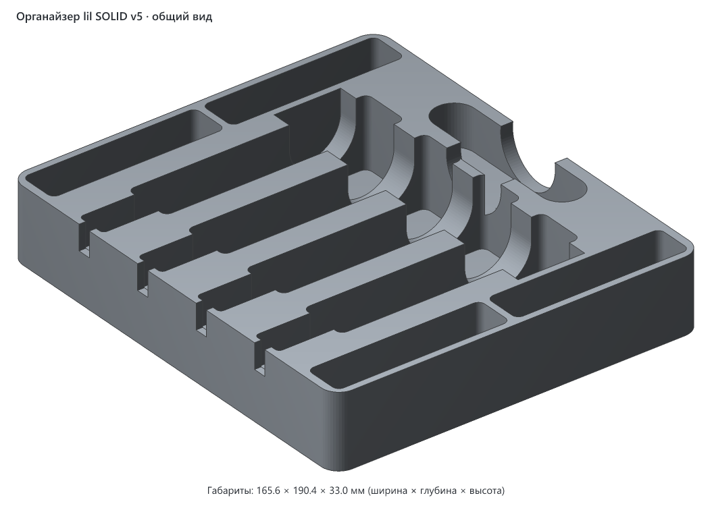
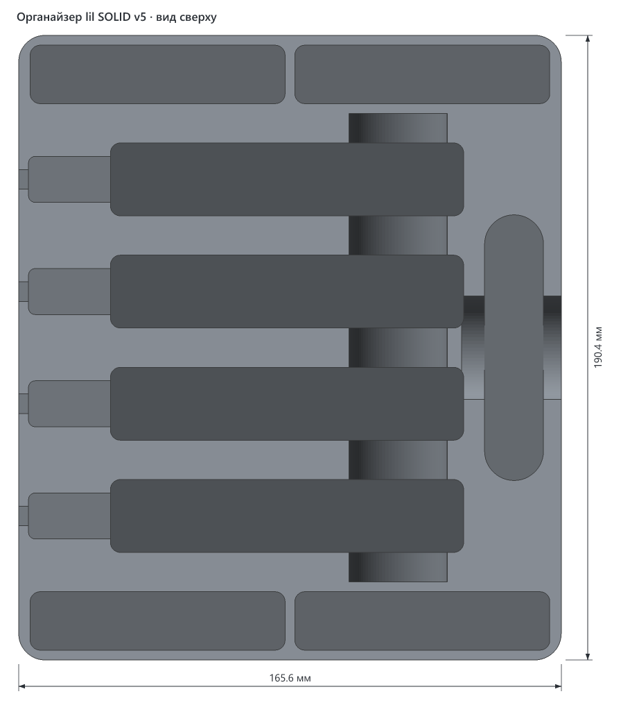
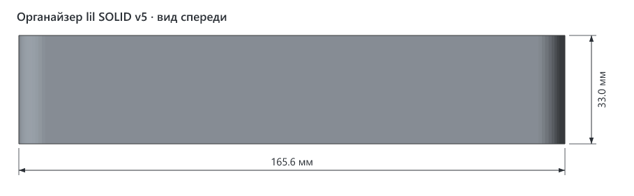
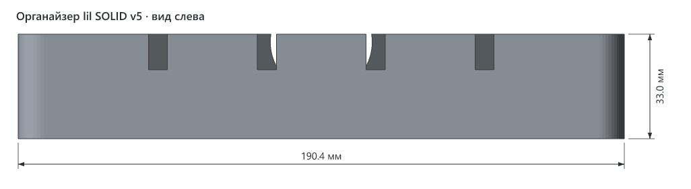
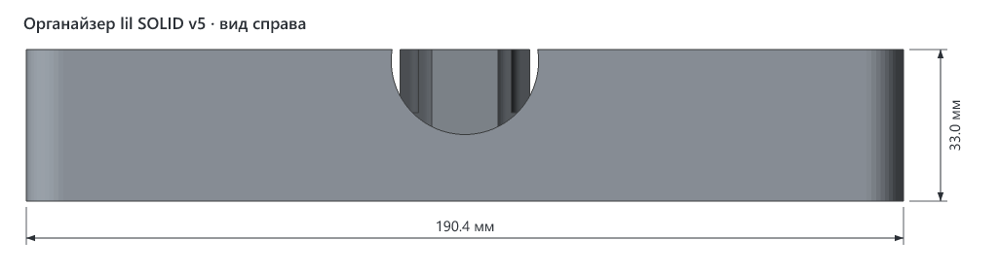

# Органайзер для IQOS lil SOLID

> **ID:** 001 · **Актуальная версия:** v5 · **Статус:** не указан · **Обновлено:** 2026-10-30



## Что это

Настольный бокс для системы нагревания табака lil SOLID 3.0 и всего, что к ней нужно. В нём помещаются 4 устройства, 4 пачки стиков HEETS и чистилка.

Устройства стоят в ряд на ребре, индикатором вверх. У левого торца каждого ложа есть карман под штекер USB-C, а в левой стенке — прорезь для кабеля, поэтому устройства можно заряжать прямо в органайзере. Поперёк всех четырёх лож, ближе к правым концам, идёт полукруглый жёлоб: в него проходят пальцы, чтобы взять устройство.

Пачки стоят вертикально в четырёх карманах, два спереди и два сзади. Чистилка лежит в продолговатом гнезде справа. Посередине гнезда есть поперечная выемка, которая выходит через правую стенку: за неё чистилку удобно подцепить.

## Как пользоваться

- Устройство ставится в ложе на ребро, индикатором вверх, разъёмом USB-C влево — к карману под штекер.
- Кабель зарядки заводится сверху в прорезь в левой стенке.
- Пачки ставятся стоя в карманы спереди и сзади, чистилка кладётся в гнездо справа.

## Габариты (v5)

| Ширина (X) | Глубина (Y) | Высота (Z) |
|---|---|---|
| 165.6 мм | 190.4 мм | 33.0 мм |

Помещается на стол K1C (220 × 220 мм) целиком.

## Посадочные места (v5)

Размеры взяты из параметров `src/organizer.py`.

| Гнездо | Шт. | Размер гнезда, мм | Под что | Зазор на сторону |
|---|---|---|---|---|
| Ложе устройства | 4 | 107.8 × 22.2, глубина 31.0 | lil SOLID 3.0: 105.8 × 30.8 × 21.4, стоит на ребре | 1.0 по длине, 0.4 по толщине |
| Карман под пачку | 4 | 77.8 × 17.8, глубина 22.0 | пачка HEETS гранью 75 × 15 | 1.4 |
| Гнездо чистилки | 1 | 81.0 × 18.0 со скруглёнными концами, глубина 18.5 | чистилка 80 × 17 | 0.5 |
| Карман под штекер USB-C | 4 | 27 × 14, начинается на высоте 19.3 | штекер кабеля в торце устройства | — |
| Прорезь под кабель | 4 | ширина 6, начинается на высоте 21.8, сквозь левую стенку | кабель зарядки | — |

Остальное: наружная стенка 3 мм, перегородки между ложами 12 мм, дно под устройствами 2 мм, углы скруглены радиусом 8 мм. Жёлоб под пальцы шириной 30 мм с дном на высоте 8 мм. Выемка у чистилки шириной около 32 мм с дном на высоте 14.5 мм.

## Виды (v5)









## Печать

В 3mf только геометрия, без настроек слайсера: файл сгенерирован скриптом.

| Параметр | Значение |
|---|---|
| Материал / цвет | не указан |
| Сопло / высота слоя | 0.4 мм / не указана |
| Стенки / заполнение | не указаны |
| Поддержки | не нужны: все выемки открыты сверху, нависаний нет (вывод по геометрии) |
| Ориентация на столе | дном на стол, как в файле |
| Деталей на столе | 1 |
| Объём тела | 535 см³ — это сплошной объём; реальный расход нити зависит от заполнения |

## Исходники

`v5/src/organizer.py` — генератор на Python (библиотеки `numpy` и `manifold3d`). Все размеры и зазоры собраны в параметрах в начале файла.

Как перегенерировать:

```bash
pip install numpy manifold3d
cd models/001-lil-solid-organizer/v5/src
python organizer.py         # вся деталь
python organizer.py test    # пробник на 2 ложа и одну пачку — проверить посадку
```

Особенности скрипта:

- Скрипт сохраняет результат как `lil_solid_organizer_v4.3mf` (и `mesh.npz`), а в заголовке модели внутри 3mf тоже стоит «v4». Это названия, оставшиеся от прошлой версии. Геометрия при этом — v5: габариты и высоты всех выемок совпадают с `lil-solid-organizer-v5.3mf`.
- В описании в начале файла сказано «2 пачки HEETS», а код делает 4 кармана: два спереди и два сзади.

## Файлы (v5)

| Файл | Что это |
|---|---|
| `v5/lil-solid-organizer-v5.3mf` | модель для печати, только геометрия |
| `v5/src/organizer.py` | генератор модели |
| `v5/img/*.png` | общий вид и проекции с размерами |

## Заметки

- Зазоры подбирались печатью: под устройство по длине было 0.4 мм — туго, стало 1.0; под пачки было 0.4 — туго, стало 1.4.

## История версий

Версии до v5 сделаны до появления проекта. Их файлы в проект не добавлены, данные ниже восстановлены по файлам и комментариям в коде.

| Версия | Дата | Что изменилось и почему | Печать |
|---|---|---|---|
| первая | 2026-10-26 | Первый вариант, 163.0 × 146.6 × 24.0 мм. Файл `lil_solid_organizer.3mf`, в проекте нет | не указано |
| пробник v4 | 2026-10-26 | Кусок на 2 ложа и одну пачку для проверки посадки, 137.6 × 90.2 × 33.0 мм. Зазор по длине устройства 0.4 мм | печатался: зазор по длине оказался тугим |
| v4 | 2026-10-27 | Полная деталь: 4 устройства на ребре, 4 пачки, чистилка. Зазор по длине устройства увеличен до 1.0 мм. 164.2 × 186.4 × 33.0 мм | не указано; по коду — карманы под пачки тугие |
| v5 | 2026-10-28 | Зазор под пачки увеличен с 0.4 до 1.4 мм на сторону: туго входили. Деталь выросла до 165.6 × 190.4 × 33.0 мм | не указано |
