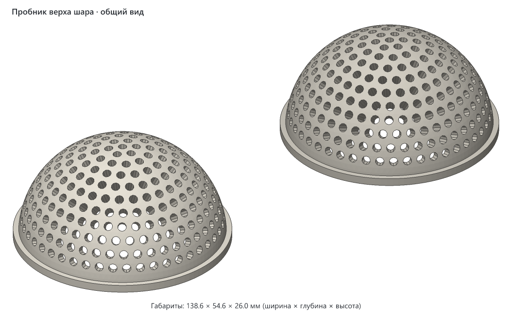
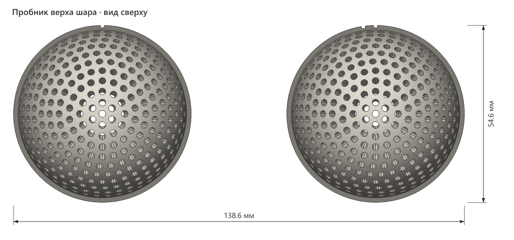
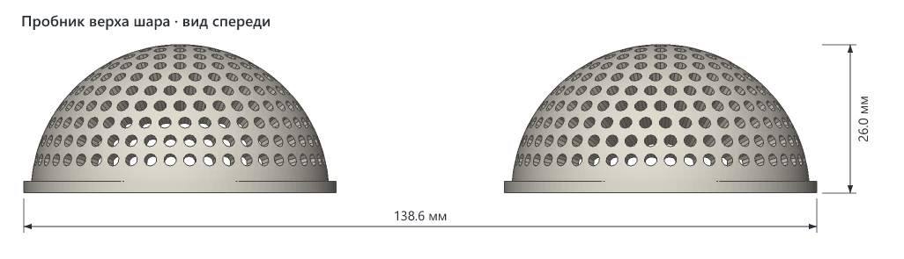
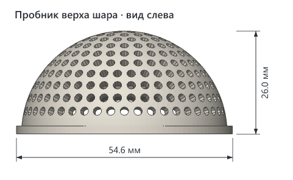
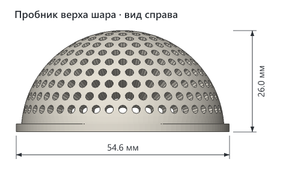

# Пробник верха шара кейса-микрофона

> **Версия:** нет, пробник ещё не напечатан · **Статус:** черновик · **Обновлено:** 2026-11-01
> **Для какой модели:** [Кейс-микрофон для петлички Aksdom M31](../aksdom-m31-reporter-mic-case/README.md)



## Что это

Верхняя половина шара с отверстиями и половиной пояска, в двух вариантах. Проверяет, печатается ли шар без поддержек, не печатая голову целиком. Детали вырезаны из самой модели, отверстия те же.

Наверху шар почти плоский, а стенка тонкая, поэтому такой купол висел бы в воздухе. Поддержки внутри шара пришлось бы вынимать через горло Ø27 мм. Поэтому снаружи шар оставлен прежним, а верх полости внутри сделан прямым конусом: нигде нет нависания круче, чем у конуса.

| Деталь в файле | Метка на пояске | Нависание конуса | Объём |
|---|---|---|---|
| `ball-1` | одна насечка | 60° | 8,5 см³ |
| `ball-2` | две насечки | 52° | 11,1 см³ |


## Как пользоваться

1. Напечатайте пробник той же нитью, какой будете печатать голову. Поддержки выключите.
2. Посмотрите снаружи: верх должен быть ровным, без дыр и наплывов, отверстия круглыми и открытыми.
3. Посмотрите изнутри: что конус шершавый, не страшно, этого никто не увидит. Проверьте на просвет, что нити не затянули отверстия.
4. Если оба варианта вышли хорошо, берите первый: он легче, отверстия в нём короче. Если первый провис, берите второй. Выбранное нависание задаётся параметром `BALL_ROOF` в `v1/src/mic_case.py` в папке модели.

## Совместимость

- **Нужный стол:** от 149 × 65 мм с запасом 5 мм на сторону (пробник можно повернуть на столе на 90°), высота печати от 26 мм. Шары можно напечатать и по одному.
- **Помещается на:** Creality K1C, Creality K1, Creality K1 Max, Creality Ender-3 V3 SE, Bambu Lab A1 mini, Bambu Lab A1, Bambu Lab P1P, Bambu Lab P1S, Bambu Lab X1 Carbon, Prusa MINI+, Prusa MK4S, Prusa Core One, Elegoo Neptune 4, Elegoo Centauri Carbon, Anycubic Kobra 3 — и на любой другой принтер с подходящим столом ([справочник принтеров](../../PRINTERS.md)).
- **Не помещается на:** —.
- **Проверено печатью:** ещё не печатался.

| Нить | Подходит? | Почему |
|---|---|---|
| PETG | да | Голова задумана из него, а нависание и нити зависят от материала. |
| PLA | только если голова будет из него | Нависания держит лучше PETG, результат на PETG не перенесётся. |
| ABS / ASA | только если голова будет из них, в закрытом принтере | Результат зависит от материала. |
| TPU | нет | Деталь должна быть жёсткой. |

## Габариты

| Ширина (X) | Глубина (Y) | Высота (Z) |
|---|---|---|
| 54,6 мм | 54,6 мм | 26 мм |

Это размер одного шара, вместе на столе они занимают 138,6 × 54,6 мм.

## Виды









## Печать

Рекомендации, печатью ещё не проверены.

| Параметр | Значение |
|---|---|
| Материал / цвет | PETG, та же нить, что у головы |
| Сопло / высота слоя | 0.4 мм / 0.2 мм |
| Стенки / заполнение | 3 стенки, 15 % |
| Поддержки | не нужны, в этом и смысл пробника |
| Ориентация на столе | в файле детали уже стоят как надо: срезом по экватору на столе. Полоса у стола узкая, поэтому можно добавить кайму |
| Деталей на столе | 2 объекта |
| Время / расход (по слайсеру) | будет после нарезки, сплошной объём 19,6 см³, то есть не больше 25 г |

## Исходники

Пробник сделан кодом: `v1/src/ball_test.py`. Геометрия берётся из `mic_case.py` в папке модели.

```bash
uv run ball_test.py
```

```bash
uv run ball_test.py --check
```

Первая команда пишет файл для печати, вторая считает нависания каждого варианта. Края самих отверстий Ø2,2 мм всегда круче, такие мелкие отверстия печатаются без поддержек.

## Файлы

| Файл | Что это |
|---|---|
| `v1/aksdom-m31-reporter-mic-case-ball-test-v1.3mf` | файл для печати |
| `v1/src/ball_test.py` | код пробника |
| `v1/img/` | картинки |

Папка `v1/` — это будущая первая версия, а не готовая: версия появится после удачной печати.

## Заметки

- Отверстия в толстой части стенки выходят длиной до 5 мм в первом варианте и до 7 мм во втором. Как это влияет на звук, не проверялось: нужен настоящий передатчик и готовая голова.
- Срез по экватору проверяет только верх. Низ шара при печати не круче 54°, поясок снизу со скосом 45°, отдельной проверки им не требуется по расчёту.

## История версий

Версий пока нет: пробник ещё не печатался.

## Лицензия

[CC BY 4.0](https://creativecommons.org/licenses/by/4.0/deed.ru): можно бесплатно печатать, изменять и распространять, в том числе в коммерческих целях. Нужно указать автора — iruch, <https://github.com/iruch/3d-print-models>.
