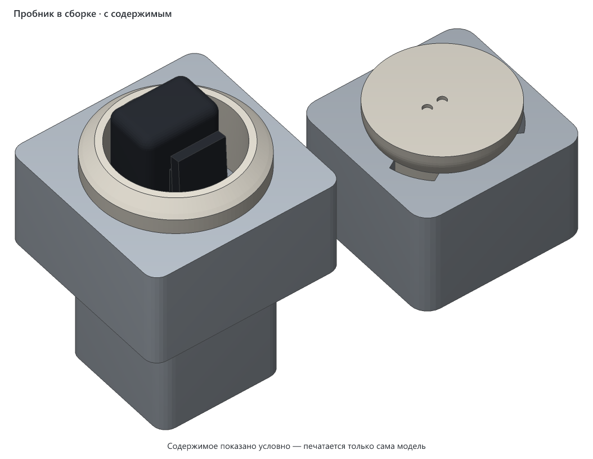
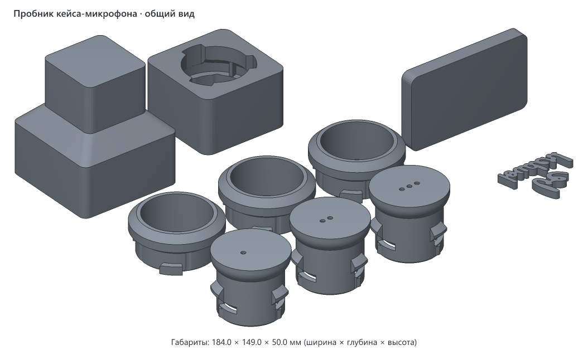
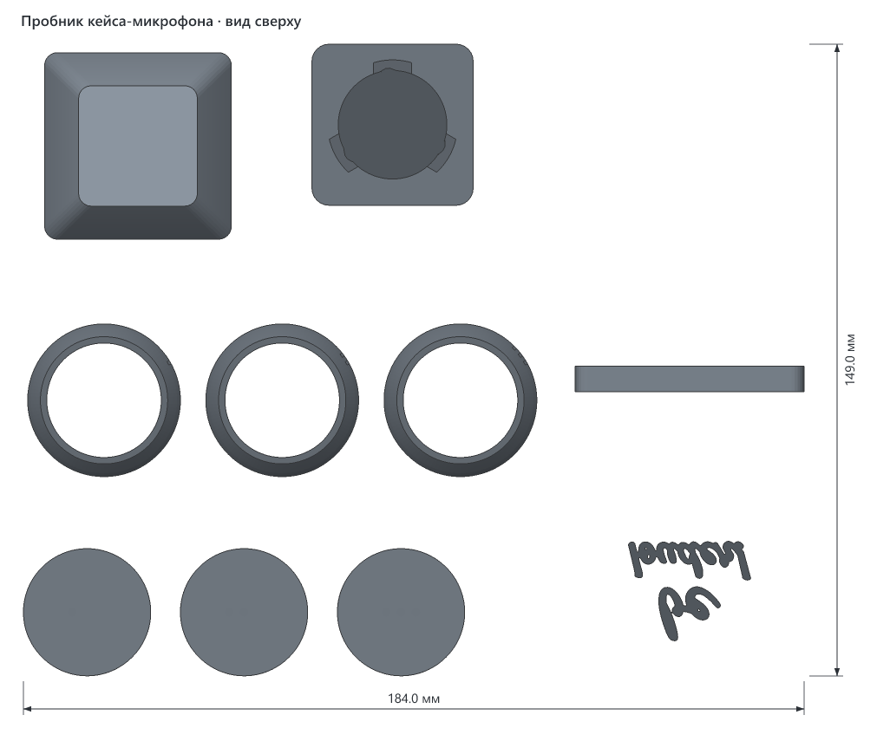
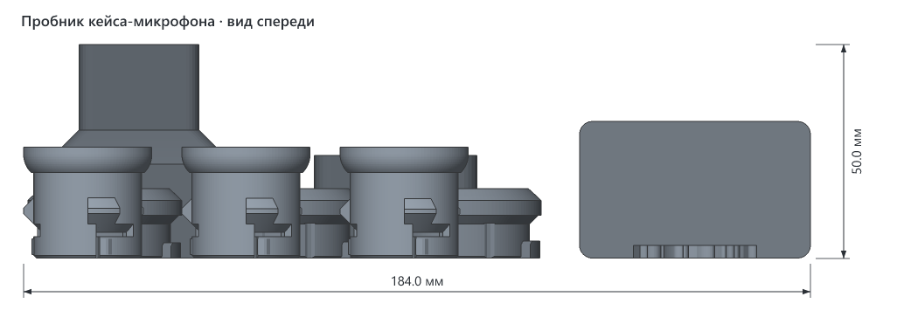
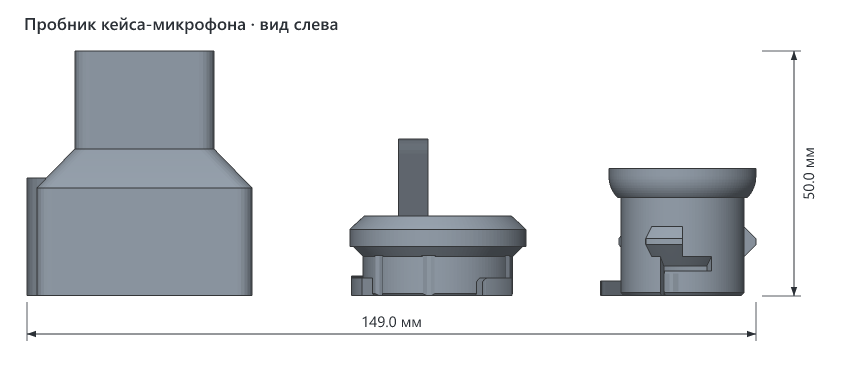
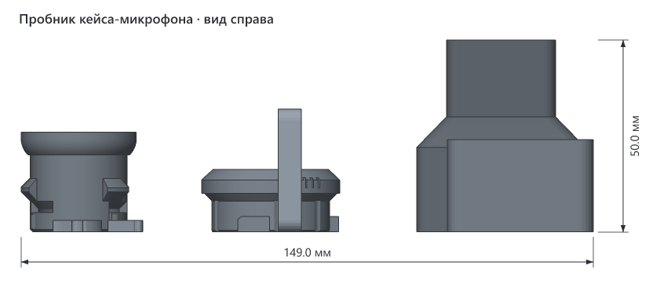

# Пробник кейса-микрофона

> **Версия:** нет, пробник ещё не напечатан · **Статус:** черновик · **Обновлено:** 2026-11-01
> **Для какой модели:** [Кейс-микрофон для петлички Aksdom M31](../aksdom-m31-reporter-mic-case/README.md)



## Что это

Куски настоящего кейса. Они нужны, чтобы проверить все посадки, не печатая целые детали: оба байонета, колодец под передатчик и выемку под надпись. Куски вырезаны из самой модели, поэтому посадки те же и печатаются так же, в той же ориентации.

| Деталь в файле | Что проверяет | Метка | Чем отличаются |
|---|---|---|---|
| `well` | колодец, пластина, гнездо головы, язычки щелчка | | |
| `head-ring-1` … `3` | байонет головы | насечки на шейке: одна, две, три | зазор лапки до плиты 0,4 / 0,2 / 0 мм |
| `handle-socket` | гнездо ручки | | |
| `handle-stub-1` … `3` | байонет ручки | ямки на торце: одна, две, три | зазор лапки до плиты 0,1 / 0,2 / 0,3 мм |
| `letters-tile` | выемка под надпись | | на боковой стенке бокса она стоит так же, поэтому плитка печатается стоя |
| `letters` | слова надписи | | |

## Как пользоваться

1. Напечатайте пробник той же нитью, какой будете печатать кейс. Поддержки выключите. Если не нужно проверять всё сразу, лишние детали можно убрать со стола: каждая из них отдельный объект.
2. Посмотрите прорези у язычков в `well`, с той стороны, где лежал стол. Если первый слой их затянул, пройдите ножом.
3. Голова. Вставьте кольцо лапками в вырезы и поверните на 45° по часовой, если смотреть сверху. Должен быть щелчок и упор. Выберите кольцо с самым большим номером, которое поворачивается рукой без силы и не качается.
4. Ручка. То же самое: поворот по часовой, если смотреть со стороны ручки. Выберите обрубок с самым маленьким номером, который поворачивается рукой.
5. Передатчик. Вставьте его в `well` сверху, микрофоном вверх: прищепка садится на пластину зубцами вниз. Он должен входить без усилия. Сожмите прищепку и посадите её на пластину, потом выньте за верх.
6. Надпись. Вставьте слова в выемку без клея. Они должны входить от руки. Если держатся, капните космофен в выемку на плитке и посмотрите, остаётся ли белёсый след и хорошо ли держит.

Результат нужно вписать в параметры `v1/src/mic_case.py` в папке модели: зазор головы `LUG_H`, зазор ручки `BOT_LUG_GAP`. Высота зуба щелчка задаётся параметром `BUMP_H`. Если щелчка не слышно, зуб надо сделать выше, а если поворачивается туго, ниже.

Без передатчика проверяется всё, кроме пятого пункта.

## Совместимость

- **Нужный стол:** от 194 × 159 мм с запасом 5 мм на сторону (пробник можно повернуть на столе на 90°), высота печати от 50 мм. Детали можно расставить плотнее или напечатать по частям.
- **Помещается на:** Creality K1C, Creality K1, Creality K1 Max, Creality Ender-3 V3 SE, Bambu Lab A1, Bambu Lab P1P, Bambu Lab P1S, Bambu Lab X1 Carbon, Prusa MK4S, Prusa Core One, Elegoo Neptune 4, Elegoo Centauri Carbon, Anycubic Kobra 3 — и на любой другой принтер с подходящим столом ([справочник принтеров](../../PRINTERS.md)).
- **Не помещается на:** Bambu Lab A1 mini, Prusa MINI+.
- **Проверено печатью:** ещё не печатался.

| Нить | Подходит? | Почему |
|---|---|---|
| PETG | да | Кейс задуман из него, посадки надо проверять этой же нитью. |
| PLA | только для примерки формы | Язычки и лапки ведут себя иначе, посадку так не проверить. |
| ABS / ASA | только если кейс будет из них, в закрытом принтере | Усадка другая, зазоры сядут иначе. |
| TPU | нет | Детали должны быть жёсткими. |

## Габариты

| Деталь | Ширина (X) | Глубина (Y) | Высота (Z) |
|---|---|---|---|
| `well` | 44 мм | 44 мм | 50 мм |
| `handle-socket` | 38 мм | 38 мм | 24 мм |
| `head-ring` | 36 мм | 36 мм | 16 мм |
| `handle-stub` | 30 мм | 30 мм | 26 мм |
| `letters-tile` | 54 мм | 6 мм | 32 мм |

## Виды











## Печать

Рекомендации, печатью ещё не проверены.

| Параметр | Значение |
|---|---|
| Материал / цвет | PETG, та же нить, что у кейса |
| Сопло / высота слоя | 0.4 мм / 0.2 мм |
| Стенки / заполнение | 3 стенки, 15 %: для пробника хватит |
| Поддержки | не нужны |
| Ориентация на столе | в файле детали уже стоят как надо: куски бокса вверх дном, кольца юбкой вниз, обрубки хвостовиком вниз, плитка стоя, слова плашмя |
| Деталей на столе | 10 объектов |
| Время / расход (по слайсеру) | будет после нарезки, по оценке около 95 г при таких настройках |

## Исходники

Пробник сделан кодом: `v1/src/fit_test.py`. Геометрия берётся из `mic_case.py` в папке модели, шрифт тот же, см. её README.

```bash
uv run fit_test.py
```

```bash
uv run fit_test.py --check
```

```bash
uv run fit_test.py --filled
```

Первая команда пишет файл для печати, вторая проверяет вход лапок и поворот у всех вариантов, третья пишет сцену для картинки. Другая надпись на плитке задаётся так: `--top слово --bottom слово --out файл.3mf`.

## Файлы

| Файл | Что это |
|---|---|
| `v1/aksdom-m31-reporter-mic-case-fit-test-v1.3mf` | файл для печати |
| `v1/src/fit_test.py` | код пробника |
| `v1/img/` | картинки |

Папка `v1/` — это будущая первая версия, а не готовая: версия появится после удачной печати.

## Заметки

- Зазоры колец идут с шагом 0,2 мм, потому что высоту задают слои. При другой высоте слоя кольца получатся иначе.
- Посадка считана по модели, передатчик в ней по верхней оценке с фото, настоящий чуть меньше.

## История версий

Версий пока нет: пробник ещё не печатался.

## Лицензия

[CC BY 4.0](https://creativecommons.org/licenses/by/4.0/deed.ru): можно бесплатно печатать, изменять и распространять, в том числе в коммерческих целях. Нужно указать автора — iruch, <https://github.com/iruch/3d-print-models>.
