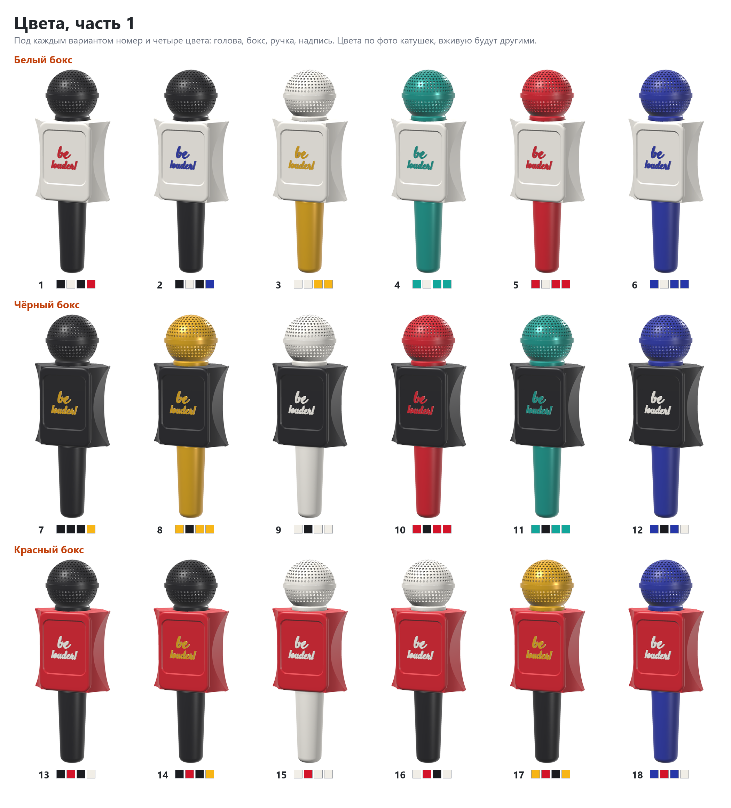
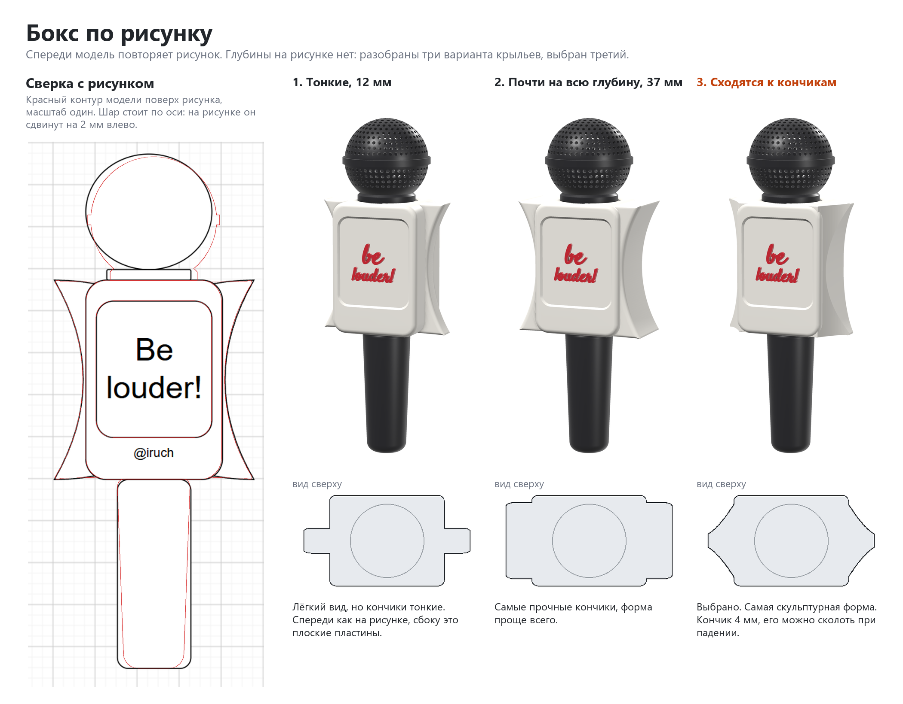
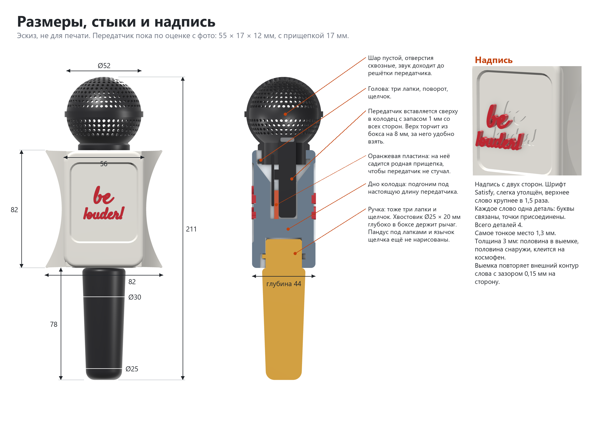

# Кейс-микрофон для петлички Aksdom M31

> **Версия:** нет, модель в разработке · **Статус:** черновик · **Обновлено:** 2026-10-31

**Печатать пока нельзя.** Здесь сохранён эскиз: файла для печати ещё нет, размер передатчика взят по фото, модель не печаталась. Папка `v1/` — это будущая первая версия, а не готовая.

## Что это

Корпус в виде репортёрского микрофона под беспроводную петличку Aksdom M31 с артикулом Wildberries 444481160. В шаре, боксе и ручке спрятан передатчик петлички, сам он остаётся рабочим: снимаешь видео и держишь в руке настоящий с виду микрофон с надписью на боксе.

Идея взята у блогера из Instagram, но форма, стыки и надпись свои. Бокс сделан по рисунку автора: [v1/ref/sketch.png](v1/ref/sketch.png).

## Как пользоваться

Задумано так, пока не проверено печатью:

1. Голова снимается поворотом на четверть оборота.
2. Передатчик вставляется сверху в колодец с запасом 1 мм со всех сторон. Его прищепка садится на пластину внутри, чтобы передатчик не болтался и не стучал в запись.
3. Голова ставится на место до щелчка. Шар пустой, отверстия в нём сквозные, звук доходит до решётки передатчика.
4. Верх передатчика выступает из бокса на 8 мм, за него удобно взять, чтобы вынуть.

Ручка соединяется с боксом так же, байонетом.

## Совместимость

- **Нужный стол:** от 91 × 54 мм с запасом 5 мм на сторону (деталь можно повернуть на столе на 90°), высота печати от 98 мм. Самая большая деталь в плане — бокс, самая высокая — ручка.
- **Принтеры:** таблица появится вместе с файлом для печати.
- **Проверено печатью:** ещё не печаталась.

| Нить | Подходит? | Почему |
|---|---|---|
| PETG | да, выбрана | Прочнее PLA, защёлки менее хрупкие, терпит тепло до ~70 °C. Может тянуть нити в отверстиях шара. |
| PLA | для примерки формы | Легко печатается, но защёлки хрупче. |
| ABS / ASA | только в закрытом принтере | Иначе большие плоские грани отрывает от стола. |
| TPU | нет | Детали должны быть жёсткими. |

В модели есть посадки с зазором. На другом принтере и другой нити они сядут иначе, поэтому перед печатью деталей будет пробник байонетов.

## Габариты

Эскиз, размеры могут поменяться после замера передатчика.

| Деталь | Ширина (X) | Глубина (Y) | Высота (Z) |
|---|---|---|---|
| Голова | 55 мм | 55 мм | 61 мм |
| Бокс | 81 мм | 44 мм | 82 мм |
| Ручка | 30 мм | 30 мм | 98 мм |

В сборке длина 211 мм. Ручка сужается от Ø30 мм у бокса до Ø25 мм внизу.

## Виды

Ещё варианты цветов: [часть 2](v1/img/colors-2.png), [часть 3](v1/img/colors-3.png). Цвета подобраны по фото катушек, вживую будут другими.

## Печать

Рекомендации, печатью ещё не проверены.

| Параметр | Значение |
|---|---|
| Материал / цвет | PETG, каждая деталь своим цветом, поэтому хватит принтера с одной нитью |
| Сопло / высота слоя | 0.4 мм / 0.2 мм |
| Стенки / заполнение | будут подобраны на пробной печати |
| Поддержки | задумано без поддержек, проверить на голове и посадках байонетов |
| Ориентация на столе | голова и бокс стоя, ручка стоя, надпись плашмя |
| Деталей | 7: голова, бокс, ручка и 4 слова надписи, по два с каждой стороны бокса |
| Время / расход (по слайсеру) | будет с файлом для печати |

## Исходники

Модель сделана кодом, папка `v1/src/`:

- `mic_case.py` — геометрия, параметры в начале файла. Проверка пересечений и зазоров: `uv run mic_case.py`.
- `lettering.py` — связная надпись. Текст задаётся параметром, в файле стоит пример.
- `sheets.py` — эти картинки: `uv run sheets.py form sizes colors`. Другая надпись: `--top слово --bottom слово --out папка`.

Шрифт Satisfy (Apache 2.0) в репозиторий не положен. Скачайте `Satisfy-Regular.ttf` с Google Fonts в папку `v1/src/fonts/` или укажите путь в переменной окружения `MIC_FONT`.

## Файлы

| Файл | Что это |
|---|---|
| `v1/src/` | код эскиза |
| `v1/img/` | картинки эскиза |
| `v1/ref/sketch.png` | рисунок бокса от автора |

Файла 3mf пока нет.

## Заметки

**Откуда размеры.** Размера передатчика M31 нигде нет.

- В карточке Wildberries указано 80 × 60 × 30 мм, вес 70 г. Не написано, чего именно, похоже на зарядный кейс.
- На AliExpress тот же товар, размеров там нет.
- Продавец называл 32 × 17 × 10 мм, но это ответ про другую модель, M-A1.
- В эскизе взята оценка по фото покупателя, масштаб по штекеру USB-C: 55 × 17 × 12 мм, с прищепкой толщина 17 мм.

**Что осталось до первой версии.**

- Снять размеры передатчика и пересчитать колодец, дно колодца и проход под голову. Сейчас проход Ø27 мм.
- Смоделировать пандусы и язычки щелчка в байонетах: в эскизе они пока не нарисованы.
- Напечатать пробник байонетов и проверить посадки на PETG.
- Проверить зазор выемки 0,15 мм и держится ли надпись на космофене. Клей может оставить белёсый налёт, поэтому капать лучше в выемку.
- Убедиться, что шар с отверстиями печатается без поддержек, и подобрать ретракт от нитей.

**Почему так устроено.**

- Голова и ручка на байонете, а не на резьбе: так решил автор. Хвостовик ручки длинный, Ø25 × 20 мм: он глубоко заходит в бокс и держит рычаг, а пандус под лапками поджимает ручку к боксу.
- Запас вокруг передатчика 1 мм, чтобы он свободно входил и вынимался. Держит его родная прищепка на пластине, иначе он бы стучал.
- Надпись связная: отдельные буквы длинного слова выходят со штрихом около 1 мм, их не напечатать и не наклеить. Поэтому каждое слово одна деталь, точка присоединена к букве. Деталь толщиной 3 мм, половина в выемке, половина снаружи, клеится на космофен.
- Верхнее слово крупнее в 1,5 раза, иначе надпись теряется в панели.

## История версий

Версий пока нет: первая появится после успешной печати.

## Лицензия

[CC BY 4.0](https://creativecommons.org/licenses/by/4.0/deed.ru): можно бесплатно печатать, изменять и распространять, в том числе в коммерческих целях. Нужно указать автора — iruch, <https://github.com/iruch/3d-print-models>.
