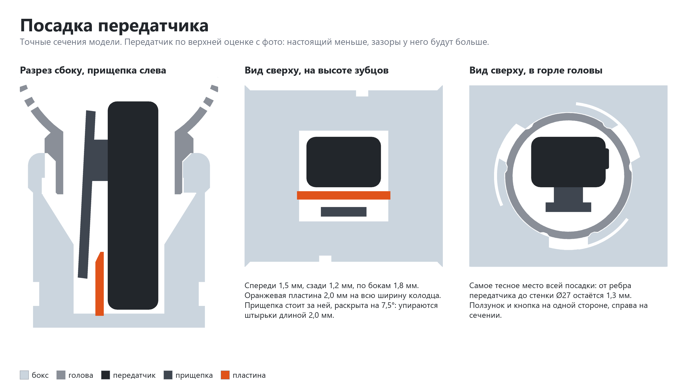
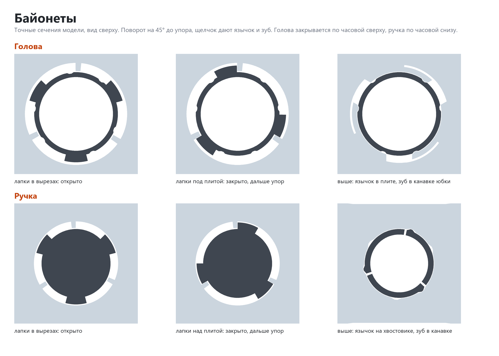
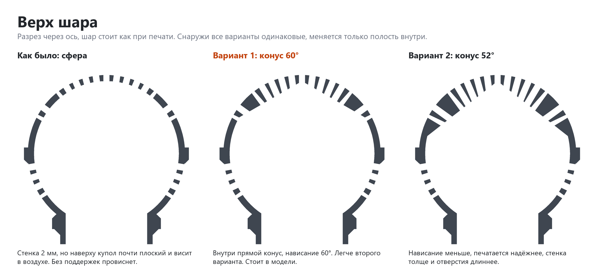

# Кейс-микрофон для петлички Aksdom M31

> **Версия:** нет, модель в разработке · **Статус:** черновик · **Обновлено:** 2026-11-01

**Печатать пока нельзя.** Здесь сохранён эскиз: файла для печати ещё нет, модель не печаталась. Сначала печатаются [пробник посадок](../aksdom-m31-reporter-mic-case-fit-test/README.md) и [пробник верха шара](../aksdom-m31-reporter-mic-case-ball-test/README.md). Папка `v1/` — это будущая первая версия, а не готовая.

## Что это

Корпус в виде репортёрского микрофона под беспроводную петличку Aksdom M31 с артикулом Wildberries 444481160. В шаре, боксе и ручке спрятан передатчик петлички, сам он остаётся рабочим: снимаешь видео и держишь в руке настоящий с виду микрофон с надписью на боксе.

Идея взята у блогера из Instagram, но форма, стыки и надпись свои. Бокс сделан по рисунку автора: [v1/ref/sketch.png](v1/ref/sketch.png).

## Как пользоваться

Задумано так, пока не проверено печатью:

1. Голова снимается поворотом на 45° против часовой, если смотреть сверху.
2. Передатчик вставляется сверху торцом с микрофоном вверх, в колодец с запасом не меньше 1 мм со всех сторон. Прищепку сжимают и сажают на пластину внутри, чтобы передатчик не болтался и не стучал в запись.
3. Голова ставится на место до щелчка. Шар пустой, отверстия в нём сквозные, звук доходит до микрофона.
4. Чтобы вынуть, снимают голову. Верх передатчика выступает из бокса на 9–12 мм, за него берутся и сжимают прищепку.

Ручка соединяется с боксом так же, байонетом: поворот на 45° по часовой, если смотреть со стороны ручки.

## Совместимость

- **Нужный стол:** от 91 × 54 мм с запасом 5 мм на сторону (деталь можно повернуть на столе на 90°), высота печати от 98 мм. Самая большая деталь в плане — бокс, самая высокая — ручка.
- **Принтеры:** таблица появится вместе с файлом для печати.
- **Проверено печатью:** ещё не печаталась.

| Нить | Подходит? | Почему |
|---|---|---|
| PETG | да, выбрана | Прочнее PLA, защёлки менее хрупкие, терпит тепло до ~70 °C. Может тянуть нити в отверстиях шара. |
| PLA | для примерки формы | Легко печатается, но защёлки хрупче. |
| ABS / ASA | только в закрытом принтере | Иначе большие плоские грани отрывает от стола. |
| TPU | нет | Детали должны быть жёсткими. |

В модели есть посадки с зазором. На другом принтере и другой нити они сядут иначе, поэтому сначала печатается [пробник](../aksdom-m31-reporter-mic-case-fit-test/README.md).

## Габариты

Эскиз, размеры могут поменяться после пробной печати.

| Деталь | Ширина (X) | Глубина (Y) | Высота (Z) |
|---|---|---|---|
| Голова | 55 мм | 55 мм | 61 мм |
| Бокс | 81 мм | 44 мм | 82 мм |
| Ручка | 30 мм | 30 мм | 98 мм |

В сборке длина 211 мм. Ручка сужается от Ø30 мм у бокса до Ø25 мм внизу.

## Виды

Ещё варианты цветов: [часть 2](v1/img/colors-2.png), [часть 3](v1/img/colors-3.png). Цвета подобраны по фото катушек, вживую будут другими.

## Печать

Рекомендации, печатью ещё не проверены.

| Параметр | Значение |
|---|---|
| Материал / цвет | PETG, каждая деталь своим цветом, поэтому хватит принтера с одной нитью. Первый экземпляр, вариант 37: голова и ручка белые, бокс многоцветный пастельный, надпись чёрная |
| Сопло / высота слоя | 0.4 мм / 0.2 мм |
| Стенки / заполнение | будут подобраны на пробной печати |
| Поддержки | все детали задуманы без поддержек, верх шара проверяется [отдельным пробником](../aksdom-m31-reporter-mic-case-ball-test/README.md) |
| Ориентация на столе | бокс вверх дном, голова юбкой вниз, ручка хвостовиком вниз, надпись плашмя |
| Деталей | 7: голова, бокс, ручка и 4 слова надписи, по два с каждой стороны бокса |
| Время / расход (по слайсеру) | будет с файлом для печати |

## Исходники

Модель сделана кодом, папка `v1/src/`:

- `mic_case.py` — геометрия, параметры в начале файла. Проверка пересечений, зазоров, прогон передатчика сверху до посадки, вход лапок и поворот байонетов: `uv run mic_case.py`.
- `lettering.py` — связная надпись. Текст задаётся параметром, в файле стоит пример.
- `sheets.py` — эти картинки: `uv run sheets.py form sizes fit bayonet ball colors`. Другая надпись: `--top слово --bottom слово --out папка`.

Шрифт Satisfy (Apache 2.0) в репозиторий не положен. Скачайте `Satisfy-Regular.ttf` с Google Fonts в папку `v1/src/fonts/` или укажите путь в переменной окружения `MIC_FONT`.

## Файлы

| Файл | Что это |
|---|---|
| `v1/src/` | код эскиза |
| `v1/img/` | картинки эскиза |
| `v1/ref/sketch.png` | рисунок бокса от автора |

Файла 3mf пока нет.

## Заметки

**Откуда размеры.** В продаже размера передатчика M31 нет: в карточке Wildberries только 80 × 60 × 30 мм, похоже на зарядный кейс, а 32 × 17 × 10 мм продавец называл для другой модели, M-A1. Поэтому передатчик снят с четырёх фото рядом с линейкой.

Линейка лежит на листе, а передатчик выше неё, поэтому на фото он выходит крупнее настоящего. Точно перспективу по таким снимкам не восстановить, так что в расчёт взята верхняя оценка без поправки. Настоящий передатчик примерно 47 × 17 × 11 мм, зазоры у него будут больше расчётных.

| Размер | В расчёте |
|---|---|
| Длина | 50,5 мм |
| Ширина | 18 мм, кнопка и ползунок выступают ещё на 0,8 мм с одной стороны |
| Толщина без прищепки | 12,2 мм |
| Толщина с прищепкой | 19 мм у зажима, 15,7 мм у зубцов: прищепка стоит с наклоном |
| Прищепка | 40,5 × 11 мм, зажим на 2,7 мм ниже верхнего торца, ось на 14,3 мм |

Контур модели передатчика сверен наложением на выпрямленные фото. Отверстие микрофона в верхнем торце: это видно на картинке продавца, где ветрозащита надета на торец рядом с кнопкой и ползунком. Лицевая сторона и сам торец на фото замера не сняты.

**Что осталось до первой версии.**

- Напечатать [пробник](../aksdom-m31-reporter-mic-case-fit-test/README.md), проверить посадки на PETG и на настоящем передатчике, в том числе посадку прищепки на пластину. Лучшие зазоры вписать в параметры.
- Напечатать [пробник верха шара](../aksdom-m31-reporter-mic-case-ball-test/README.md), выбрать нависание конуса внутри шара и подобрать ретракт от нитей.
- Проверить нижнюю кромку крыльев: их верхний край на столе чуть проваливается к боксу, до 0,7 мм, это почти мост над столом.
- Проверить зазор выемки 0,15 мм и держится ли надпись на космофене. Клей может оставить белёсый налёт, поэтому капать лучше в выемку.
- Посмотреть, как ложится многоцветная нить: цвет меняется по длине катушки, поэтому полосы на боксе могут выйти не такими, как на картинке. Там переход условный.

**Почему так устроено.**

- Голова и ручка на байонете, а не на резьбе: так решил автор. Хвостовик ручки длинный, Ø25 × 20 мм: он глубоко заходит в бокс и держит рычаг.
- Бокс печатается вверх дном. Тогда низ верхней плиты, на который давят лапки головы, получается плоским без поддержек, а язычок щелчка растёт от стола. В обычном положении под ним была бы пустота.
- Плита снизу бокса изнутри косая, под 45°, а лапки ручки сделаны как зуб резьбы: вверх дном такой скос держит сам себя и заодно центрует ручку.
- Щелчок дают язычки длиной около 10 мм и зубья высотой 0,4–0,5 мм: сами лапки слишком жёсткие, чтобы пружинить. Зуб заходит в канавку в двух положениях, открыто и закрыто. Язычки у головы спрятаны под шейкой.
- Вырезы под лапки заканчиваются под шейкой и плечом ручки, чтобы на собранном микрофоне их было почти не видно.
- Под шейкой головы скос 45° с зазором к конусу бокса: без него шейка висела бы в воздухе при печати. Садится голова на плоское кольцо снаружи.
- Плечо ручки начинается со скоса 45° и поэтому немного мягче, чем на рисунке: ручка печатается хвостовиком вниз.
- Верх полости шара сделан конусом, снаружи шар тот же. Купол с тонкой стенкой наверху почти плоский и висел бы в воздухе, а поддержки внутри пришлось бы вынимать через горло. Поясок снизу со скосом 45° по той же причине.
- Запас вокруг передатчика не меньше 1 мм, чтобы он свободно входил и вынимался. Держит его родная прищепка на пластине, иначе он бы стучал.
- Колодец на 0,5 мм глубже на сторону: на зубцах прищепки стоят штырьки длиной около 2 мм, на пластине они упираются и отжимают планку.
- Пластина толщиной 2 мм идёт на всю ширину колодца, поэтому держится за стенки, а не только за дно. Верх скошен, чтобы зубцы находили её на ощупь.
- Дно колодца поднято: передатчик короче, чем казалось по фото покупателя, а его верх должен торчать из бокса. Иначе не за что взяться и нечем сжать прищепку.
- Надпись связная: отдельные буквы длинного слова выходят со штрихом около 1 мм, их не напечатать и не наклеить. Поэтому каждое слово одна деталь, точка присоединена к букве. Деталь толщиной 3 мм, половина в выемке, половина снаружи, клеится на космофен.
- Верхнее слово крупнее в 1,5 раза, иначе надпись теряется в панели.

## История версий

Версий пока нет: первая появится после успешной печати.

## Лицензия

[CC BY 4.0](https://creativecommons.org/licenses/by/4.0/deed.ru): можно бесплатно печатать, изменять и распространять, в том числе в коммерческих целях. Нужно указать автора — iruch, <https://github.com/iruch/3d-print-models>.
