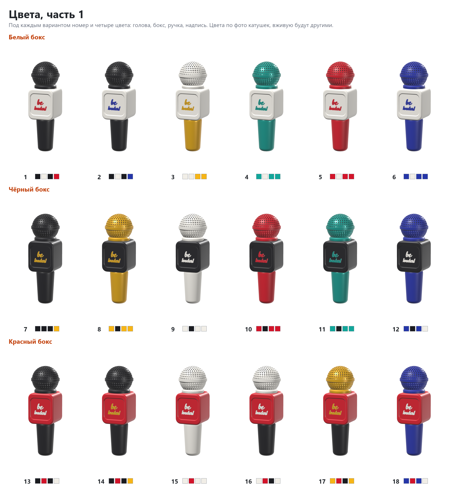
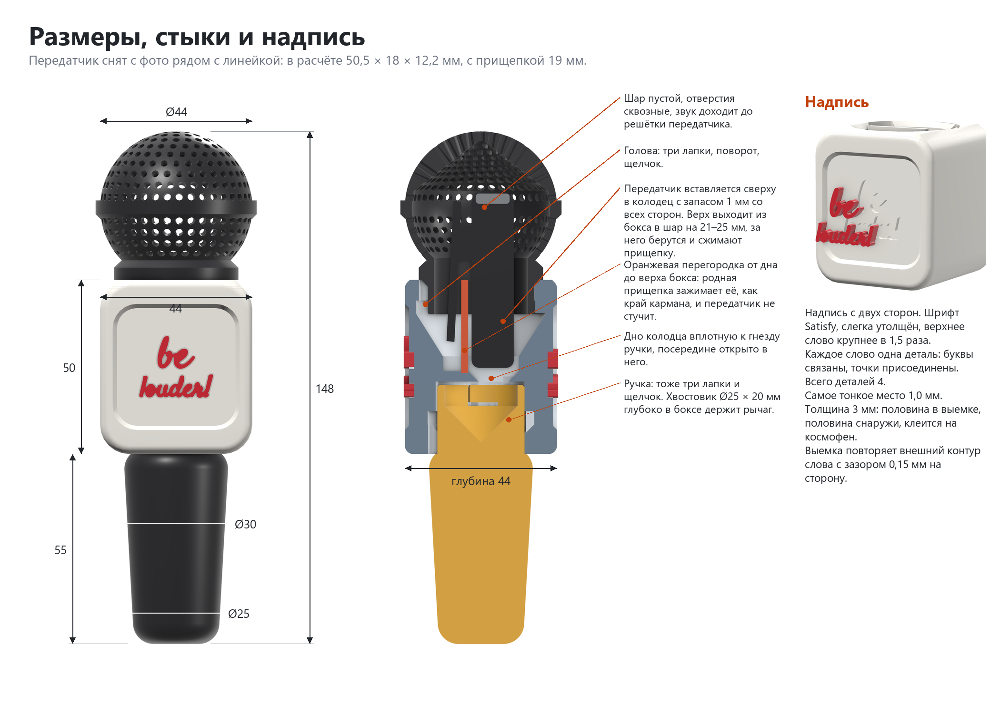
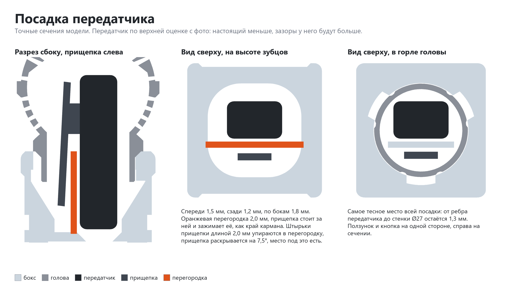
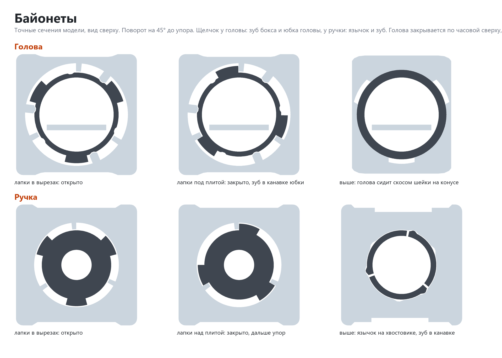
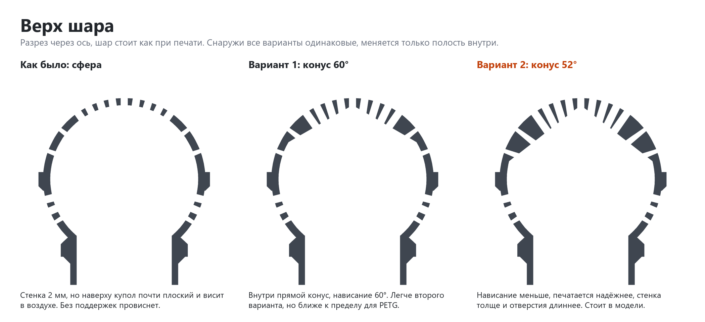
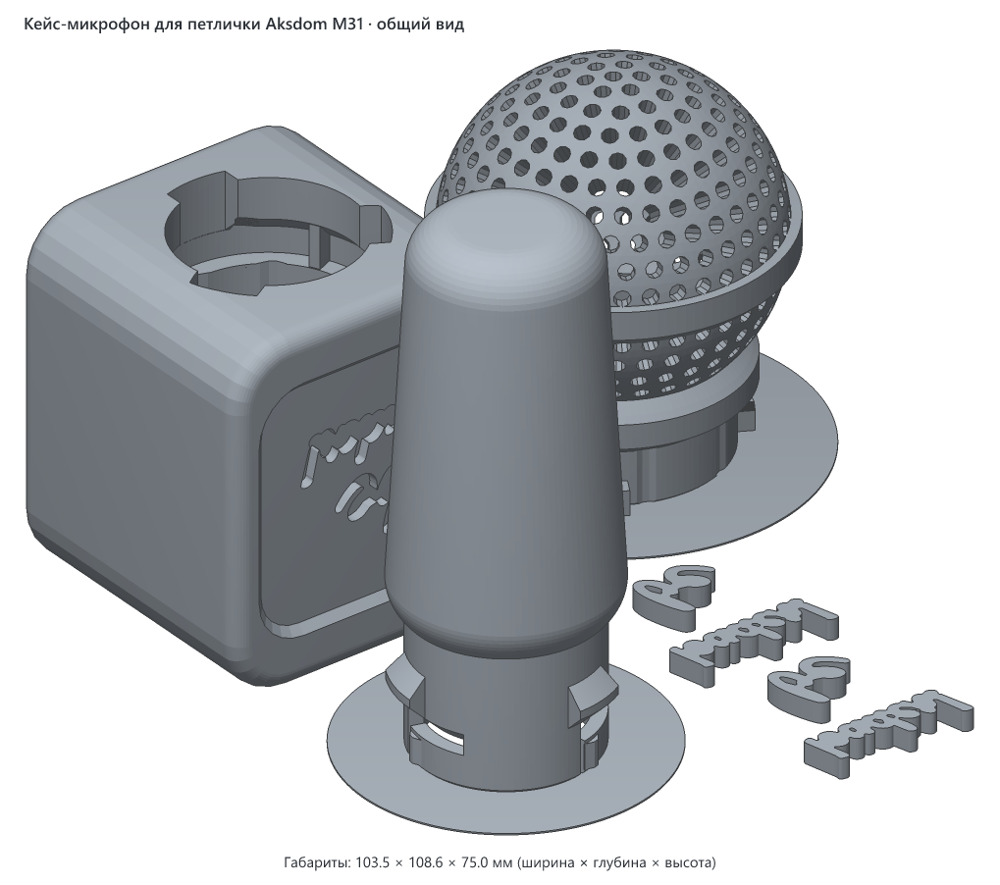
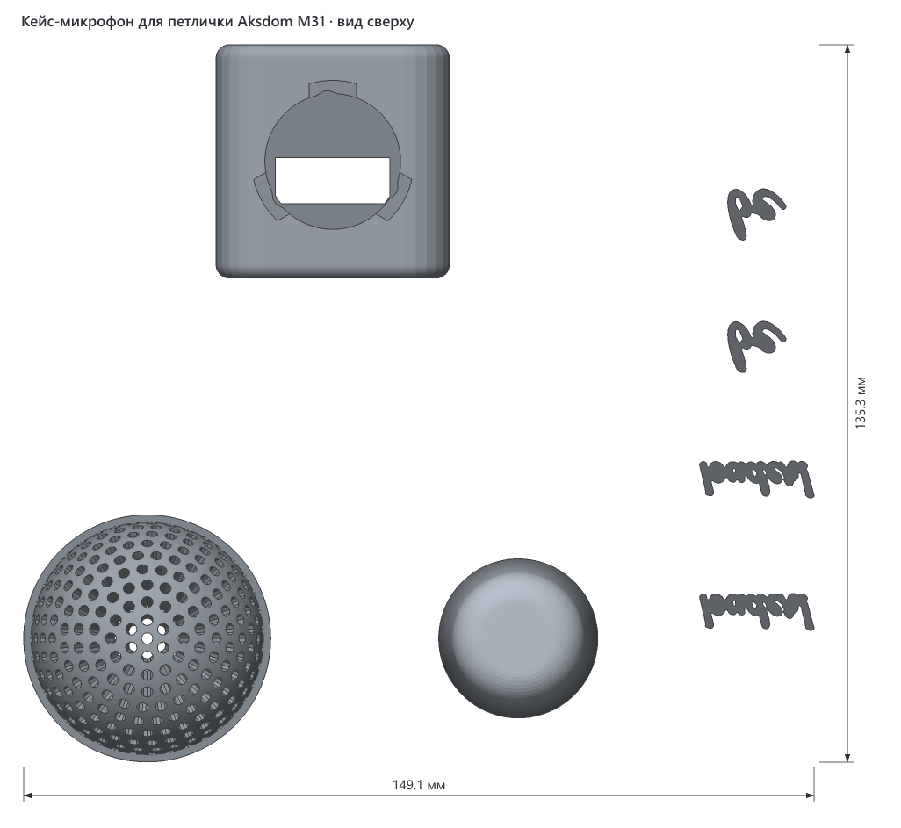
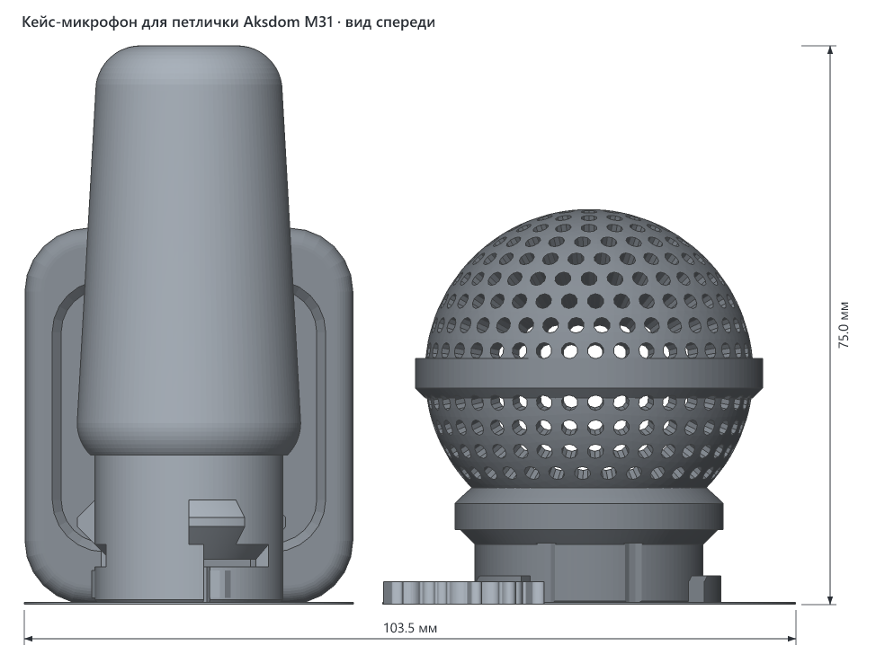
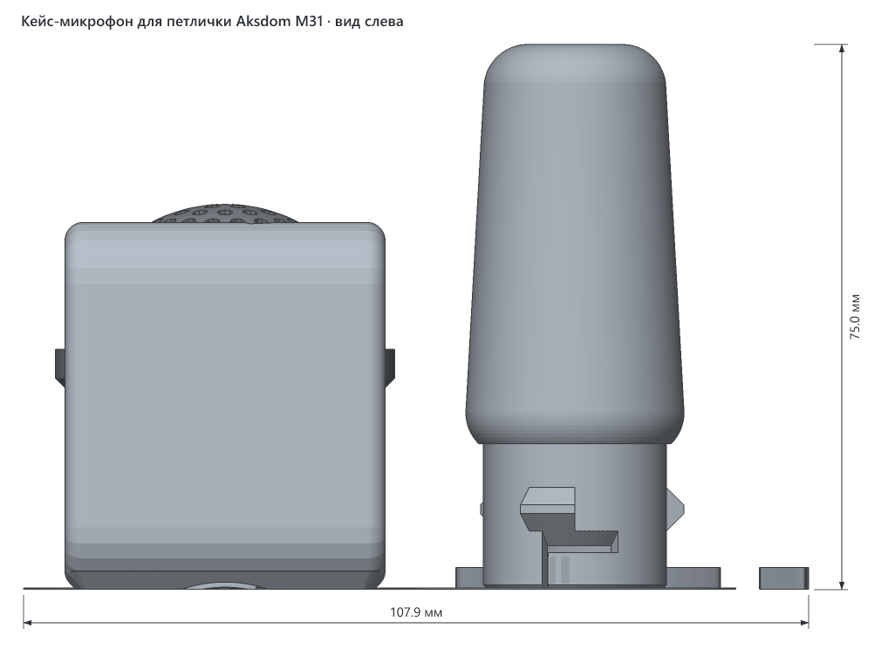
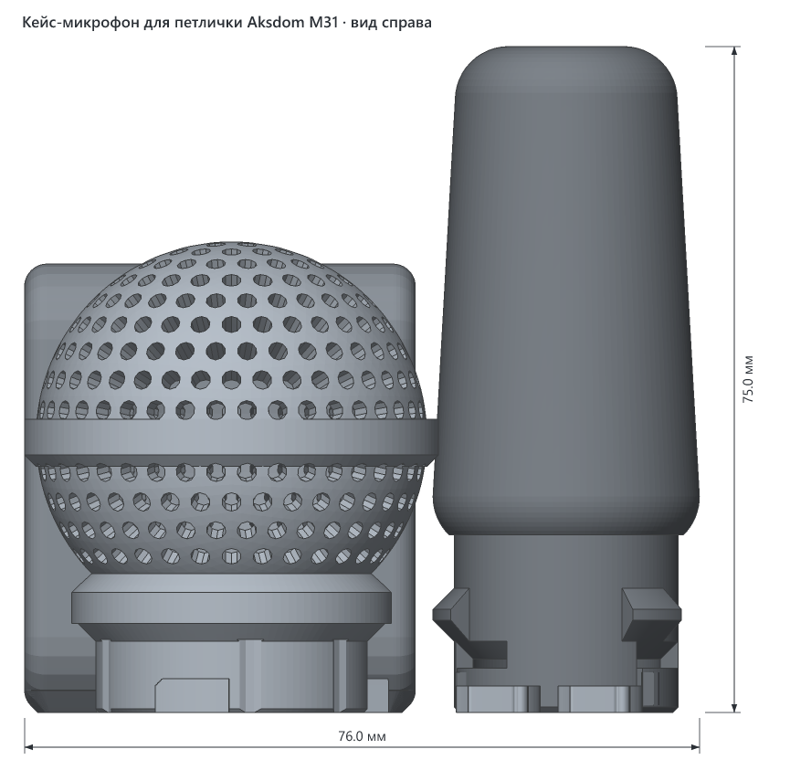

# Кейс-микрофон для петлички Aksdom M31

> **Версия:** нет, модель в разработке · **Статус:** черновик · **Обновлено:** 2026-11-05

**Пока только на пробу.** Первая пробная печать оборвалась на середине из-за обрезанного файла. Вторая, с боксом 56 × 44 × 70 мм, ушла в нити. Третья, 2026-11-03, напечатана целиком в нынешнем размере: голова и ручка белым PETG, слова чёрным PETG, бокс оранжевым PLA+. На ней голова качалась, слова не вошли в выемки, а лицо бокса со стороны головы вышло с рваным краем. Это ошибки модели, а не печати, поэтому бокс переделан: голова садится на конус, выемки шире, у лица углы со скосом. Четвёртая печать, 2026-11-05, — такой бокс жёлтой нитью с прежними головой и ручкой. Голова и ручка на нём сидят плотно и защёлкиваются, но у отверстия под голову три дуги вышли рваными. Это были язычки щелчка: их верх у стола печатался нитками в воздухе. Язычки убраны, щелчок перенесён в паз под плитой. Голова, ручка и слова остались прежними. Бокс без язычков ещё не печатался. Колодец на настоящем передатчике не проверялся. Папка `v1/` — это будущая первая версия, а не готовая.

## Что это

Корпус в виде репортёрского микрофона под беспроводную петличку Aksdom M31 с артикулом Wildberries 444481160. В шаре, боксе и ручке спрятан передатчик петлички, сам он остаётся рабочим: снимаешь видео и держишь в руке настоящий с виду микрофон с надписью на боксе.

Идея взята у блогера из Instagram, но форма, стыки и надпись свои. Фронт бокса и панель под надпись взяты с рисунка автора. Заказчику микрофон показался большим, поэтому крылья с рисунка убраны, а бокс сделан квадратным и как можно меньше: размер задаёт передатчик.

## Как пользоваться

Задумано так, пока не проверено печатью:

1. Голова снимается поворотом на 45° против часовой, если смотреть сверху.
2. Передатчик вставляется сверху торцом с микрофоном вверх, в колодец с запасом не меньше 1 мм со всех сторон. Прищепку сжимают и сажают на перегородку внутри: прищепка зажимает её, как край кармана, и передатчик не болтается и не стучит в запись.
3. Голова ставится на место до щелчка. Шар пустой, отверстия в нём сквозные, звук доходит до микрофона.
4. Чтобы вынуть, снимают голову. Верх передатчика выступает из бокса на 21–25 мм, за него берутся и сжимают прищепку.

Ручка соединяется с боксом так же, байонетом: поворот на 45° по часовой, если смотреть со стороны ручки.

## Совместимость

- **Нужный стол:** от 61 × 68 мм с запасом 5 мм на сторону (деталь можно повернуть на столе на 90°), высота печати от 75 мм. Самая большая деталь в плане — бокс с подложкой, самая высокая — ручка. Все детали разом, с надписью и подложками, стоят на столе от 130 × 123 мм.
- **Помещается на:** Creality K1C, Creality K1, Creality K1 Max, Creality Ender-3 V3 SE, Bambu Lab A1 mini, Bambu Lab A1, Bambu Lab P1P, Bambu Lab P1S, Bambu Lab X1 Carbon, Prusa MINI+, Prusa MK4S, Prusa Core One, Elegoo Neptune 4, Elegoo Centauri Carbon, Anycubic Kobra 3 — и на любой другой принтер с подходящим столом ([справочник принтеров](../../PRINTERS.md)).
- **Не помещается на:** —.
- **Проверено печатью:** голова, ручка и слова в нынешнем виде напечатаны на третьей пробной печати, голова и ручка с каймой допечатались до конца. На боксе четвёртой печати голова и ручка защёлкиваются плотно. Бокс без язычков ещё не печатался. Вторая пробная печать ушла в нити: детали сорвало со стола, см. «Заметки».

| Нить | Подходит? | Почему |
|---|---|---|
| PETG | да, выбрана | Прочнее PLA, защёлки менее хрупкие, терпит тепло до ~70 °C. Может тянуть нити в отверстиях шара. |
| PLA, PLA+ | для бокса можно | Бокс третьей печати был из PLA+. В боксе ничего не пружинит: щелчок головы даёт жёсткий зуб, а гнётся юбка головы. Но PLA размягчается около 55–60 °C: в машине летом или на солнце за стеклом бокс поведёт, и голова будет болтаться. |
| ABS / ASA | только в закрытом принтере | Иначе большие плоские грани отрывает от стола. |
| TPU | нет | Детали должны быть жёсткими. |

В модели есть посадки с зазором. На другом принтере и другой нити они сядут иначе. Если байонеты сядут туго или будут качаться, зазоры можно поменять в параметрах байонетов в начале `v1/src/mic_case.py` и пересобрать модель.

## Габариты

Эскиз, размеры могут поменяться после пробной печати.

| Деталь | Ширина (X) | Глубина (Y) | Высота (Z) |
|---|---|---|---|
| Голова | 47 мм | 47 мм | 53 мм |
| Бокс | 44 мм | 44 мм | 50,5 мм |
| Ручка | 30 мм | 30 мм | 75 мм |

В сборке длина 148,5 мм, шар Ø44 мм. Ручка выступает из бокса на 55 мм и сужается от Ø30 мм у бокса до Ø25 мм внизу.

## Виды

Детали на столе, как они стоят при печати, без подложек:

Ещё варианты цветов: [часть 2](v1/img/colors-2.png), [часть 3](v1/img/colors-3.png). Цвета подобраны по фото катушек, вживую будут другими. Чем печатать каждый вариант, сказано в [таблице наборов](v1/plates/README.md#наборы).

## Печать

Рекомендации, печатью ещё не проверены.

| Параметр | Значение |
|---|---|
| Материал / цвет | PETG, каждая деталь своим цветом, поэтому хватит принтера с одной нитью: см. «Печать по цветам» ниже. Первый экземпляр, вариант 37: голова и ручка белые, бокс многоцветный пастельный, надпись чёрная. На третьей пробной печати бокс был из оранжевого PLA+ |
| Сопло / высота слоя | 0.4 мм / 0.2 мм |
| Стенки / заполнение | 3 стенки, 15 %: для пробной сборки хватит |
| Поддержки | выключить. Детали устроены так, чтобы печататься без них. На первой пробной печати автоматические поддержки залезли в колодец и в выемки под надпись, и их пришлось выковыривать |
| Ориентация на столе | в файле детали уже стоят как надо: бокс вверх дном, голова юбкой вниз, ручка хвостовиком вниз, слова лицом вниз. Детали стоят тесно, чтобы сопло меньше ездило между ними |
| Подложки | уже в модели у каждой детали: кольцо 8 мм в первый слой (0,25 мм) вокруг её пятна на столе. Кайму в слайсере выключите. После печати подложки отрывают, как кайму. На лапках головы и на торце хвостовика ручки отрывайте начисто и зачистите следы: с наплывом они туго пройдут в вырезы бокса. У бокса подложка примыкает к лицу со стороны головы, кромку после неё подрежьте ножом |
| Деталей | 7: голова, бокс, ручка и 4 слова надписи, по два с каждой стороны бокса |
| Время / расход (по слайсеру) | будет после нарезки. Промежуточный вариант с боксом 56 × 44 × 70 мм по слайсеру весил 78 г и печатался 4 ч при 2 стенках и 15 %, этот по объёму меньше на 37 % |

### Печать по цветам

Принтер с одной нитью печатает кейс в несколько заходов: одна печать — один цвет. Детали одного цвета стоят на одном столе, между печатями меняется нить. Например, вариант 37 — это три печати: голова и ручка белым, бокс пастельным, слова чёрным.

Раскладки лежат в [`v1/plates/`](v1/plates/README.md). Каждое сочетание деталей там один раз, всего 10 файлов на все 48 вариантов. Там же [таблица наборов](v1/plates/README.md#наборы): какой вариант какими файлами и какой нитью печатать. Цвета в файлах нет, его даёт нить. Надпись в файлах — пример. От надписи зависят и слова, и выемки в боксе, поэтому со своей надписью раскладки пересобираются целиком, см. «Исходники».

Файл `v1/aksdom-m31-reporter-mic-case-v1.3mf` — все детали на одном столе, для печати одним цветом, например для пробной сборки.

## Исходники

Модель сделана кодом, папка `v1/src/`:

- `mic_case.py` — геометрия, параметры в начале файла. Проверка пересечений, зазоров, прогон передатчика сверху до посадки, вход лапок и поворот байонетов: `uv run mic_case.py`. Все детали на одном столе: `uv run mic_case.py --print`, другая надпись: `--top слово --bottom слово --out файл.3mf`. Раскладки по цветам и таблица наборов: `uv run mic_case.py --plates`, другая надпись: `--top слово --bottom слово --out папка`. Для картинок видов `--print --no-pad --out файл.3mf`: детали без подложек.
- `color_sets.py` — 48 цветовых наборов: цвета головы, бокса, ручки и надписи. Из них строятся и картинки цветов, и раскладки.
- `lettering.py` — связная надпись. Текст задаётся параметром, в файле стоит пример.
- `sheets.py` — эти картинки: `uv run sheets.py sizes fit bayonet ball colors`. Другая надпись: `--top слово --bottom слово --out папка`.

Шрифт Satisfy (Apache 2.0) в репозиторий не положен. Скачайте `Satisfy-Regular.ttf` с Google Fonts в папку `v1/src/fonts/` или укажите путь в переменной окружения `MIC_FONT`.

## Файлы

| Файл | Что это |
|---|---|
| `v1/aksdom-m31-reporter-mic-case-v1.3mf` | все детали на одном столе, одним цветом: голова, бокс, ручка и 4 слова, надпись пример |
| [`v1/plates/`](v1/plates/README.md) | раскладки по цветам для принтера с одной нитью и таблица наборов |
| `v1/src/` | код |
| `v1/img/` | картинки |
| [`aksdom-m31-reporter-mic-case-ball-test/`](aksdom-m31-reporter-mic-case-ball-test/README.md) | пробник верха шара: печатается ли он без поддержек |

## Заметки

**Откуда размеры.** В продаже размера передатчика M31 нет: в карточке Wildberries только 80 × 60 × 30 мм, похоже на зарядный кейс, а 32 × 17 × 10 мм продавец называл для другой модели, M-A1. Поэтому передатчик снят с четырёх фото рядом с линейкой.

Линейка лежит на листе, а передатчик выше неё, поэтому на фото он выходит крупнее настоящего. Точно перспективу по таким снимкам не восстановить, так что в расчёт взята верхняя оценка без поправки. Настоящий передатчик примерно 47 × 17 × 11 мм, зазоры у него будут больше расчётных.

| Размер | В расчёте |
|---|---|
| Длина | 50,5 мм |
| Ширина | 18 мм, кнопка и ползунок выступают ещё на 0,8 мм с одной стороны |
| Толщина без прищепки | 12,2 мм |
| Толщина с прищепкой | 19 мм у зажима, 15,7 мм у зубцов: прищепка стоит с наклоном |
| Прищепка | 40,5 × 11 мм, зажим на 2,7 мм ниже верхнего торца, ось на 14,3 мм |

Контур модели передатчика сверен наложением на выпрямленные фото. Отверстие микрофона в верхнем торце: это видно на картинке продавца, где ветрозащита надета на торец рядом с кнопкой и ползунком. Лицевая сторона и сам торец на фото замера не сняты.

**Что осталось до первой версии.**

- Напечатать бокс без язычков и собрать с головой и ручкой третьей печати. Край отверстия под голову должен выйти ровным. Голова должна сесть на конус и не качаться, поворот на 45° идти рукой, со щелчком и упором: щелчок теперь даёт юбка головы. Если щелчок выйдет слишком тугим или слабым, поправить высоту зуба `BUMP_H` в `v1/src/mic_case.py`.
- Посмотреть, как вышел верх шара: на первой печати он не допечатался, на второй шар был Ø46, теперь Ø44. Если конус внутри провис или нити затянули отверстия, сравнить варианты на [пробнике верха шара](aksdom-m31-reporter-mic-case-ball-test/README.md) и подобрать ретракт.
- Проверить перегородку: прищепка должна садиться на неё рукой и держать передатчик без стука. Потом то же на настоящем передатчике.
- Проверить, входят ли слова в выемки с зазором 0,4 мм и держится ли надпись на космофене. Клей может оставить белёсый налёт, поэтому капать лучше в выемку.
- Посмотреть, как ложится многоцветная нить: цвет меняется по длине катушки, поэтому полосы на боксе могут выйти не такими, как на картинке. Там переход условный.

**Почему так устроено.**

- Голова и ручка на байонете, а не на резьбе: так решил автор. Хвостовик ручки длинный, Ø25 × 20 мм: он глубоко заходит в бокс и держит рычаг.
- Бокс печатается вверх дном. Тогда низ верхней плиты, на который давят лапки головы, получается плоским без поддержек, а зубья щелчка стоят на плите. В обычном положении под ними была бы пустота.
- Плита снизу бокса изнутри косая, под 45°, а лапки ручки сделаны как зуб резьбы: вверх дном такой скос держит сам себя и заодно центрует ручку.
- Щелчок у ручки дают пружинящие язычки с зубьями на конце хвостовика: сами лапки слишком жёсткие, чтобы пружинить. У головы язычков нет: на боксе три жёстких зуба в пазу под плитой, а пружинит юбка головы, она прогибается на 0,2 мм. Зуб заходит в канавку юбки в двух положениях, открыто и закрыто. Зубья стоят там, где лапки не проходят ни открытыми, ни закрытыми.
- Раньше зуб головы сидел на язычке в плите бокса, за прорезью. Но конус под шейкой срезал верх язычка в клин, и у стола язычок вместе с тонкой стенкой прорези печатался нитками в воздухе: на четвёртой печати край отверстия под голову вышел рваным. Теперь у лица бокса только сплошное кольцо с конусом и три выреза под лапки.
- По бокам, справа и слева, конус у самого лица выходит за плоский край скругления. Там остаются два места длиной около 6 мм, где первые слои тонкие. Они спрятаны под шейкой головы.
- Вырезы под лапки заканчиваются под шейкой и плечом ручки, чтобы на собранном микрофоне их было почти не видно.
- Под шейкой головы скос 45°: без него шейка висела бы в воздухе при печати. Этим скосом голова и садится на такой же конус в боксе, поэтому встаёт по оси и не качается. Конус занимает по кругу около 260°, остальное — вырезы под лапки. Раньше между скосом и конусом был зазор, а голова стояла шейкой на лице бокса. Лицо по бокам срезано скруглением углов, поэтому опора оставалась только спереди и сзади, две узкие дужки. Направляющая под юбку высотой всего 3,8 мм её не держала, и на третьей печати голова качалась.
- Лапки головы ходят под плитой с зазором 0,2 мм. При печати ступеньки слоёв на конусе бокса и на скосе головы ложатся друг в друга и голову не поднимают: это проверено нарезкой обеих деталей по слоям 0,2 мм. Плита толщиной 6 мм кратна слою, поэтому слайсер её не округлит.
- У лица бокса скругления углов переходят в скос 45° высотой 2,5 мм. Бокс печатается этой стороной на столе, а почти горизонтальный край скругления висел бы в воздухе: на третьей печати кромка там вышла рваной. На вид углы почти те же.
- Плечо ручки начинается со скоса 45° и поэтому немного мягче, чем на рисунке: ручка печатается хвостовиком вниз.
- Полость в конце хвостовика с потолком под 45°: плоский потолок висел бы над пропилами язычков и мог прирасти к ним, а поддержку в закрытую полость не поставить.
- Голова стоит на столе кольцом юбки около 220 мм² и несёт сверху шар Ø44, ручка высотой 75 мм стоит на торце хвостовика около 100 мм²: внутри него полость пружины. Вторую пробную печать сорвало со стола и она ушла в нити: принтер отработал файл до конца без ошибок. Автокайма слайсера тогда досталась только ручке, а какая деталь сорвалась первой, неизвестно. Поэтому у каждой детали в модели есть подложка: кольцо 8 мм в первый слой вокруг её пятна на столе, оно не зависит от слайсера. На третьей печати голова и ручка с каймой допечатались до конца.
- Слова печатаются лицом вниз: лицо выходит гладким, а сторона, которая входит в паз, без наплыва первого слоя.
- Верх полости шара сделан конусом 52°, снаружи шар тот же. Купол с тонкой стенкой наверху почти плоский и висел бы в воздухе, а поддержки внутри пришлось бы вынимать через горло. Поясок снизу со скосом 45° по той же причине.
- Запас вокруг передатчика не меньше 1 мм, чтобы он свободно входил и вынимался. Держит его родная прищепка на перегородке, иначе он бы стучал.
- Перегородка толщиной 2 мм стоит поперёк колодца между передатчиком и прищепкой, от дна до верха бокса. Прищепка зажимает её, как край кармана. Вверх дном перегородка стоит прямо на столе, а ниже расходится под 45° в стенки воронки, поэтому печатается без поддержек. Раньше вместо неё была короткая пластина с вырезом, её края держались на стенках воронки, и из-за этого бокс нельзя было сделать ниже 70 мм.
- Перегородка кончается ниже ушка прищепки, поэтому верх передатчика выходит из бокса на 21–25 мм, в шар. Так бокс ниже, а за верх легко взяться и сжать прищепку.
- Колодец на 0,5 мм глубже на сторону: на зубцах прищепки стоят штырьки длиной около 2 мм, они упираются в перегородку и отжимают планку.
- Дно колодца перед перегородкой двускатное: вверх дном плоское было бы мостом 15 мм. Оно стоит вплотную к гнезду ручки, посередине открыто в него, а по краям остаётся 1,5 мм над пазами щелчка. Передатчик в эту щель не провалится: он уже упирается в скаты.
- Крыльев нет, хотя на рисунке они есть: с ними бокс был шириной 82 мм, и заказчику микрофон показался большим.
- Размер задаёт передатчик. Бокс квадратный, 44 × 44 мм: меньше не даёт байонет головы. Его кольцевой паз Ø37,4 стоит вокруг горла Ø27, через которое проходит передатчик с прищепкой, и снаружи остаётся стенка 3,3 мм. Шар Ø44 по ширине бокса.
- Надпись уменьшена под панель бокса 44 мм: нижнее слово шириной 32,4 мм, самое тонкое место 1,0 мм. Буквы утолщены на 0,25 мм на сторону: при прежних 0,34 у такой мелкой надписи заливало петли букв и слова сливались, а меньше 0,22 длинное слово рвётся на куски.
- Надпись связная: отдельные буквы длинного слова выходят со штрихом около 1 мм, их не напечатать и не наклеить. Поэтому каждое слово одна деталь, точка присоединена к букве. Деталь толщиной 3 мм, половина в выемке, половина снаружи, клеится на космофен.
- Выемка шире слова на 0,4 мм на сторону. При 0,15 слова на третьей печати не вошли: выемка в вертикальной стенке, её верхние края печатаются навесом и проседают, а изгибы букв выходят ступеньками слоёв. Размер слов от зазора не зависит, поэтому уже напечатанные слова подходят к новому боксу.
- Верхнее слово крупнее в 1,5 раза, иначе надпись теряется в панели.

## История версий

Версий пока нет: первая появится после успешной печати.

## Лицензия

[CC BY 4.0](https://creativecommons.org/licenses/by/4.0/deed.ru): можно бесплатно печатать, изменять и распространять, в том числе в коммерческих целях. Нужно указать автора — iruch, <https://github.com/iruch/3d-print-models>.
