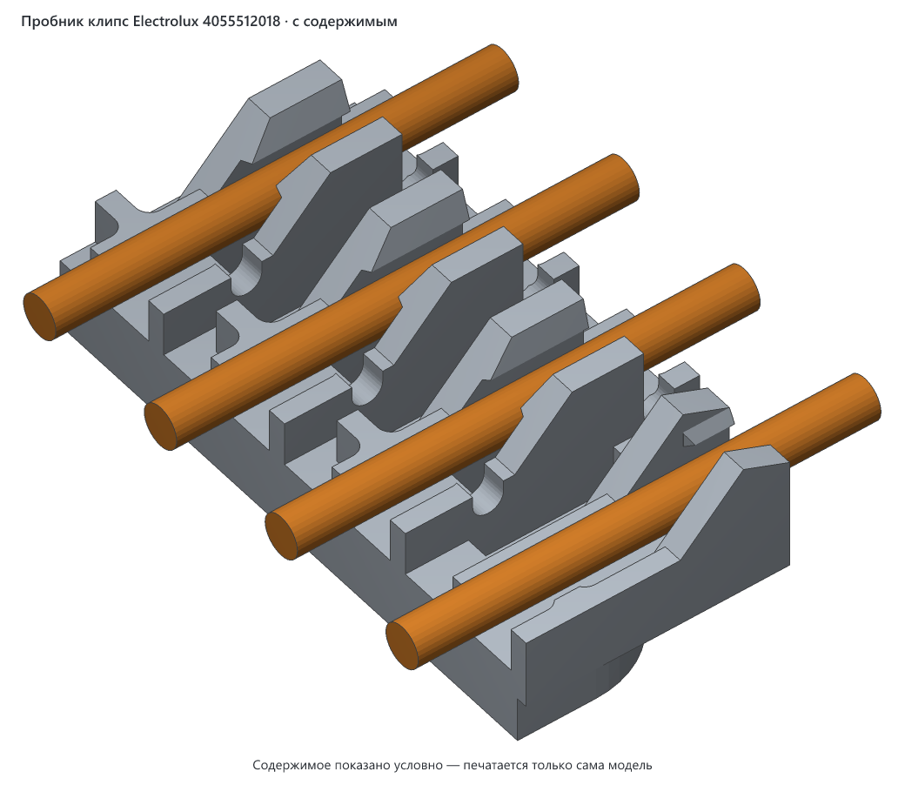
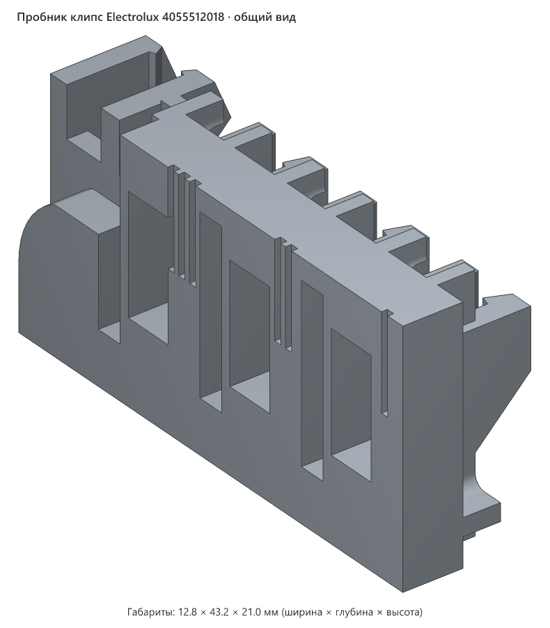
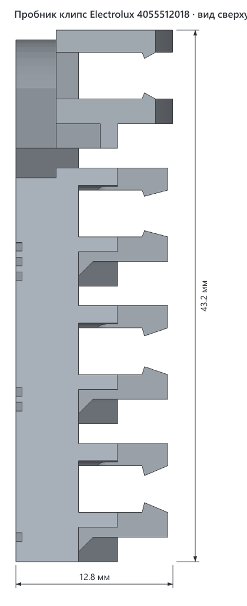
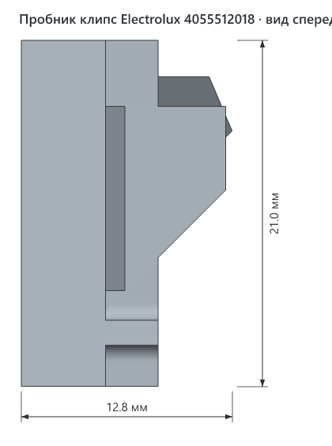
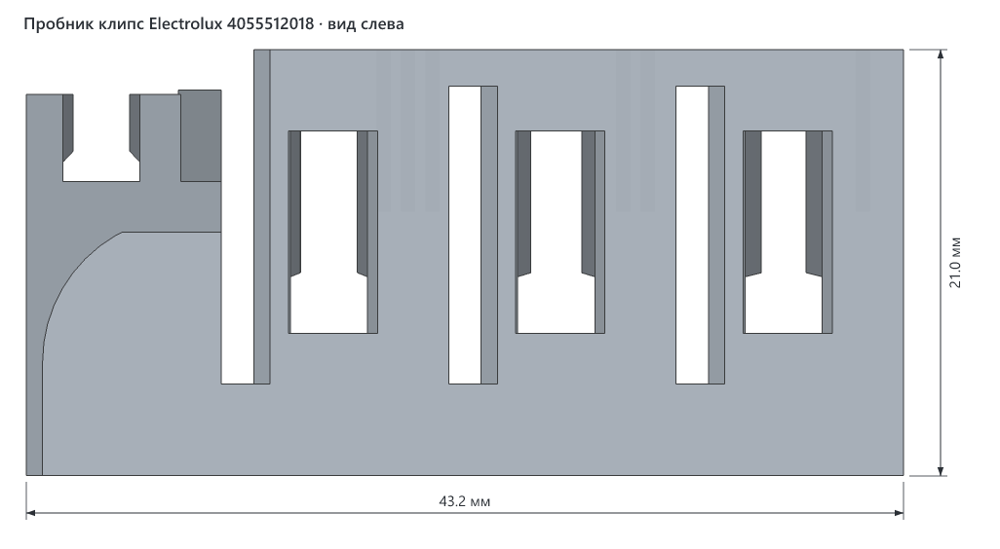
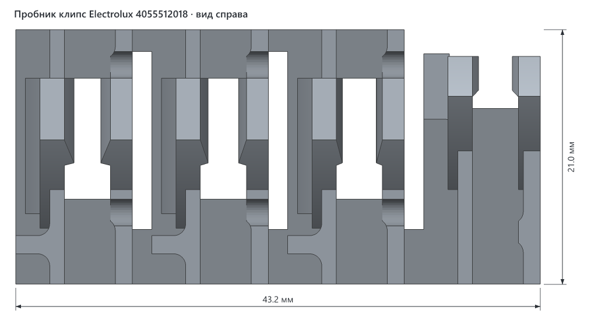

# Пробник клипс для каретки Electrolux 4055512018

> **Версия:** v1 · **Статус:** черновик · **Обновлено:** 2026-10-31
> **Для какой модели:** [Каретка колёс верхней корзины Electrolux 4055512018](../electrolux-4055512018-wheel-carrier/README.md)



## Что это

Маленький кусок каретки только с клипсами. У [каретки v1](../electrolux-4055512018-wheel-carrier/README.md) клипсы отломились от одного прикосновения, поэтому новую форму сначала проверяем на пробнике, а не на целой детали.

В пробнике четыре пары клипс. Три рабочие отличаются зазором между зацепами, четвёртая — короткая пара от крючка:

| Метка | Какая пара | Зазор между зацепами |
|---|---|---|
| 1 насечка | рабочая | 2.2 мм |
| 2 насечки | рабочая | 2.5 мм |
| 3 насечки | рабочая | 2.8 мм |
| без насечек, короткая | у крючка | 2.8 мм |

Насечки — на лицевой стороне, напротив своей пары.

Чем клипсы отличаются от v1:

- стенки 2.0 и 1.8 мм вместо 1.2 и 1.4 мм;
- зацепы меньше: зазор 2.2–2.8 мм вместо 1.2 мм, стенка гнётся намного слабее;
- пара у крючка выросла из пластины и срослась с язычком, а не висит на тонкой полоске;
- нижний угол стенок скошен под 45°: поддержки не нужны;
- сквозные отверстия и полукруглые прорези по бокам наружной стенки такие же, как на оригинале.

## Как пользоваться

1. Напечатайте пробник той же нитью, какой будете печатать каретку. Поддержки выключите.
2. Проверьте клипсы пальцами: они должны слегка пружинить и не отламываться.
3. Наденьте каждую пару на проволоку корзины, в свободном месте между поперечными проволоками.
4. Выберите пару с самым узким зазором, которая защёлкивается без трещин. Она должна держаться на проволоке сама.

Если пара садится слишком туго, зазор надо увеличить. Если падает с проволоки, зазор надо уменьшить. Размеры задаются в начале `v1/src/clip_test.py`.

## Совместимость

- **Нужный стол:** от 23 × 54 мм с запасом 5 мм на сторону (модель можно повернуть на столе на 90°), высота печати от 21 мм.
- **Помещается на:** Creality K1C, Creality K1, Creality K1 Max, Creality Ender-3 V3 SE, Bambu Lab A1 mini, Bambu Lab A1, Bambu Lab P1P, Bambu Lab P1S, Bambu Lab X1 Carbon, Prusa MINI+, Prusa MK4S, Prusa Core One, Elegoo Neptune 4, Elegoo Centauri Carbon, Anycubic Kobra 3 — и на любой другой принтер с подходящим столом ([справочник принтеров](../../PRINTERS.md)).
- **Не помещается на:** —.
- **Проверено печатью:** ещё не печатался.
- **Материалы:** та же нить, которой будете печатать каретку, иначе проверка теряет смысл. Какие нити подходят, написано в [описании каретки](../electrolux-4055512018-wheel-carrier/README.md#материалы).
- **Слайсер:** 3mf содержит только геометрию и открывается в любом слайсере: Creality Print, Bambu Studio, OrcaSlicer, PrusaSlicer, Cura.
- **Посадки:** подобрать нужно именно здесь. Диаметр проволоки не мерили, зазоры рассчитаны на проволоку около 3 мм. На другом принтере и другой нити зазоры могут сесть иначе.

## Габариты (v1)

| Толщина | Ширина | Высота на столе |
|---|---|---|
| 12.8 мм | 43.2 мм | 21.0 мм |

## Виды (v1)











## Печать

Настройки — общие рекомендации, печатью ещё не проверены.

| Параметр | Значение |
|---|---|
| Материал / цвет | та же нить, что для каретки, цвет любой |
| Сопло / высота слоя | 0.4 мм / 0.2 мм |
| Стенки / заполнение | 4 стенки, заполнение 100 %: от них зависит прочность |
| Генератор стенок | Arachne, если он есть в слайсере: тонкие стенки пропечатываются без пустот |
| Поддержки | выключить: клипсы скошены под 45°, а над ячейками и отверстиями остаются только короткие мосты |
| Кайма (brim) | 3–5 мм, если нить плохо держится на столе |
| Ориентация на столе | стоя, как в файле: так же, как печатается каретка |
| Деталей на столе | 1 |
| Объём тела | 4.4 см³, около 6 г PETG при 100 % заполнения |

## Исходники

`v1/src/clip_test.py` вырезает пробник из геометрии `v1/src/carrier.py`, поэтому клипсы в нём такие же, как будут на каретке. Зазоры заданы в начале `clip_test.py`, форма клипс — в начале `carrier.py`.

```bash
cd models/electrolux-4055512018-clip-test/v1/src
uv run clip_test.py                 # пробник для печати
uv run clip_test.py --filled scene.3mf   # сцена для картинки с проволокой
```

## Файлы (v1)

| Файл | Что это |
|---|---|
| `v1/electrolux-4055512018-clip-test-v1.3mf` | пробник для печати, только геометрия |
| `v1/src/clip_test.py` | генератор пробника |
| `v1/src/carrier.py` | генератор каретки с новыми клипсами, из него вырезан пробник |
| `v1/img/*.png` | общий вид, проекции с размерами и вид с проволокой (`filled.png`) |

## Заметки

- Канал под проволоку в пробнике сквозной: пробник проверяет только клипсы. На настоящей каретке поперёк канала стоят рёбра, и то, как они встретятся с проволокой, пробник не покажет.
- Прочность рассчитана по простой формуле изгиба, печатью и нагрузкой не проверена.

## История версий

| Версия | Дата | Что изменилось и почему | Печать |
|---|---|---|---|
| v1 | 2026-10-31 | Первая версия: новая форма клипс и три зазора на выбор | не печаталась |

## Лицензия

[CC BY 4.0](https://creativecommons.org/licenses/by/4.0/deed.ru): можно бесплатно печатать, изменять и распространять, в том числе в коммерческих целях. Нужно указать автора — iruch, <https://github.com/iruch/3d-print-models>.
