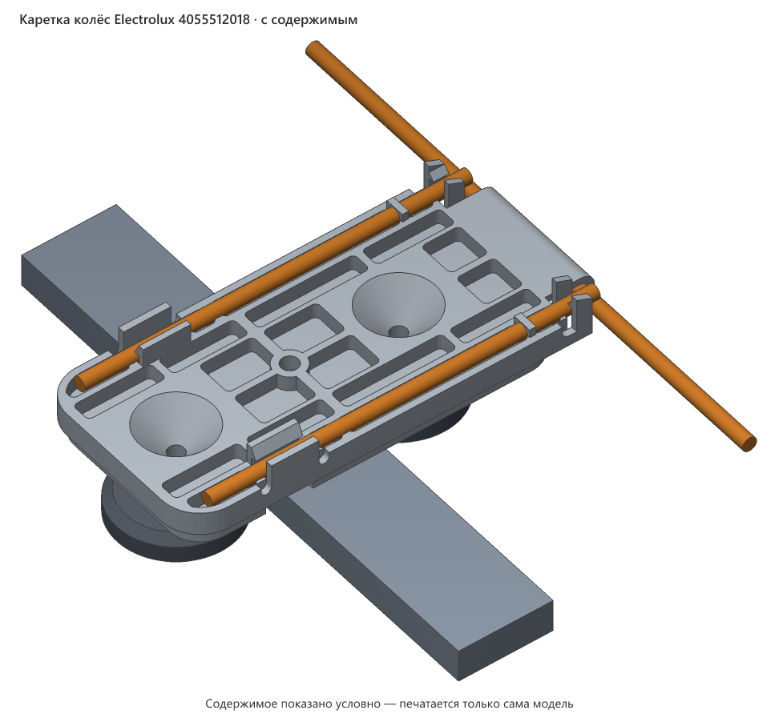
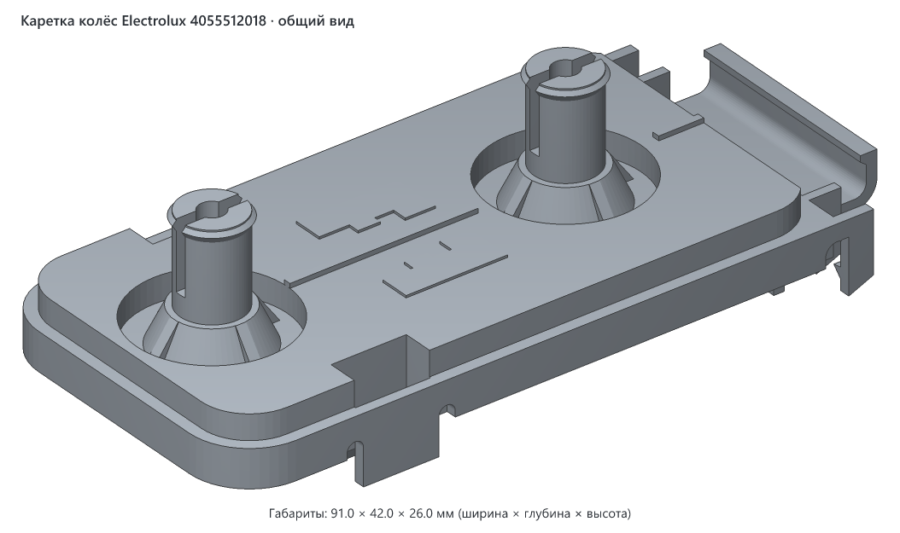
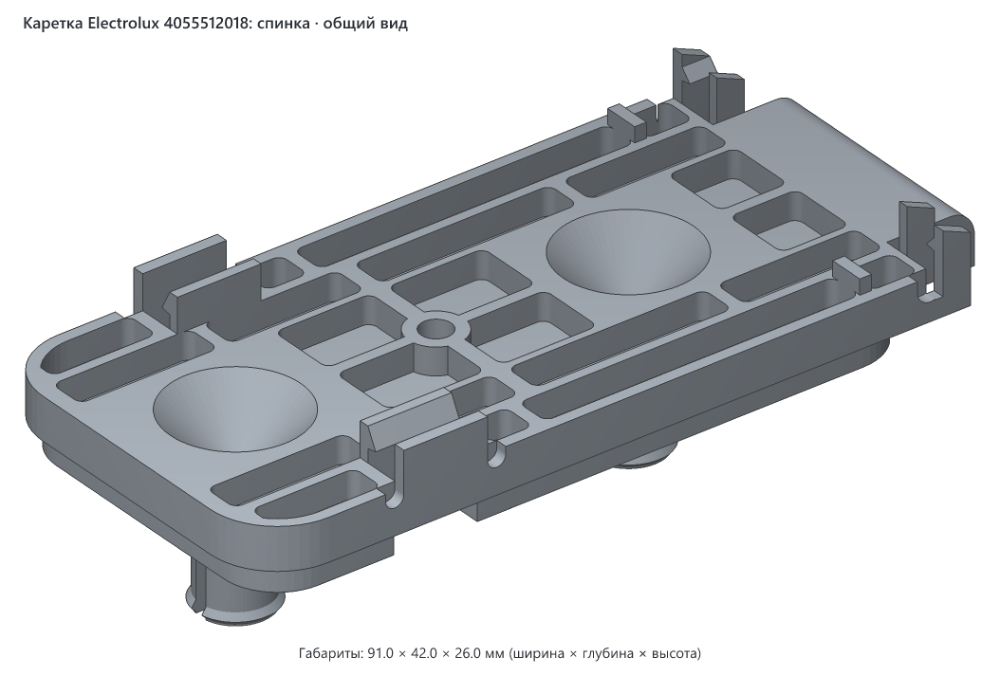
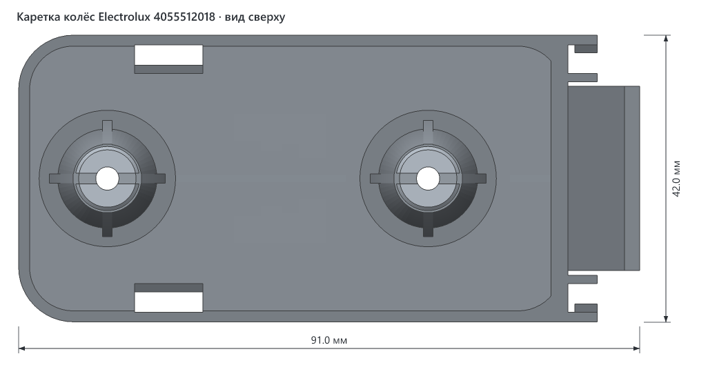
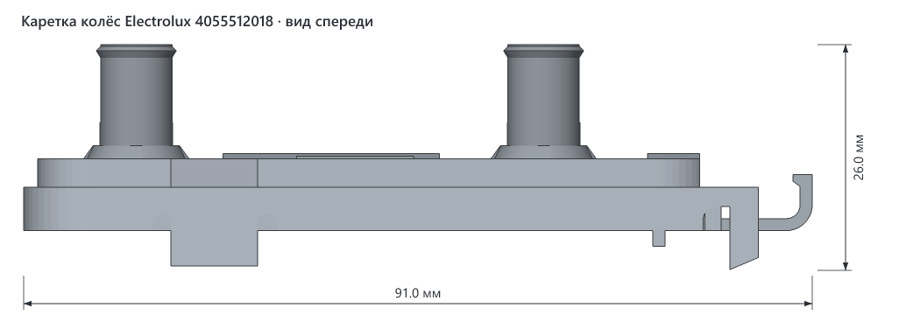
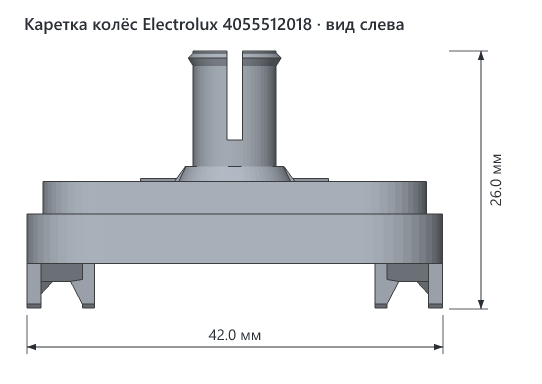
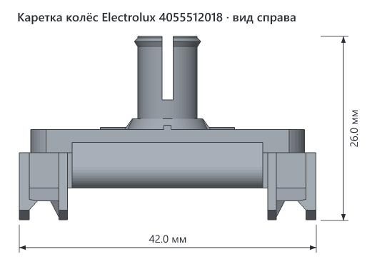

# Каретка колёс верхней корзины Electrolux 4055512018

> **Версия:** v1 · **Статус:** черновик · **Обновлено:** 2026-10-30



## Что это

Напечатанная замена каретки верхней корзины посудомоечной машины. Каретка — это пластина с двумя колёсами. На корзине их четыре, и на них она выдвигается. Если у каретки ломаются усики, она перестаёт держаться на корзине.

Сделана для машины **Electrolux EEM923100L** как замена оригинальной детали **4055512018**. Это не оригинальная запчасть Electrolux. Печатается только пластина с осями, колёса переставляются со сломанной детали.

**Как стоит в машине.** Каретка стоит вертикально на боковой стенке корзины, колёсами наружу, крючком вверх:

- язычок проходит между двумя проволоками, а крючок надевается на горизонтальную проволоку;
- те две проволоки заходят в пары стенок (усики), а зацепы не дают им выйти;
- направляющая машины проходит между колёсами: одно катится сверху, другое снизу.

## Как пользоваться

1. Снимите колёса со сломанной детали: сожмите разрезной конец оси плоскогубцами и стяните колесо. Если не выходит, ось старой детали можно разрезать, она всё равно не нужна.
2. Наденьте колёса на оси новой детали до щелчка.
3. Заведите крючок на горизонтальную проволоку и прижмите деталь к корзине, чтобы усики защёлкнулись на проволоке.

## Совместимость

### Посудомоечные машины

Проектировалась под **Electrolux EEM923100L**, на других машинах не проверялась. Оригинальная деталь 4055512018 по данным [магазина запчастей](https://electrolux-spares.com.ua/p/00000062264) подходит и к другим моделям. Список может быть неполным.

<details>
<summary>Модели из списка магазина</summary>

**Electrolux:** CSF5200LOW, EDA22110L, EDA917102L, EDA917122L, EEA12100L, EEA12101L, EEA17100IX, EEA17100L, EEA17110L, EEA17200IX, EEA17200L, EEA22100L, EEA23200L, EEA23210L, EEA23220L, EEA27205L, EEA27400L, EEA27410L, EEA28400L, EEA71210L, EEA717100L, EEA717110L, EEA912100L, EEA917100L, EEA917103L, EEA917120L, EEA917123L, EEM23100L, EEM62310L, EEM72310L, EEM923100L, EEQ43100L, EEQ643100L, EEQ843100L, EES47400L, EMA22130L, EMA917101L, EMA917121L, ESA12100SW, ESA12110SW, ESA17200UW, ESA17200UX, ESA17210SW, ESA17210SX, ESA22100SW, ESA22100SX, ESA22110SW, ESA42110SW, ESA42110SX, ESA43110SX, ESA47301SW, ESA47301SX, ESA47400UW, ESA47400UX, ESA63200SX, ESA63210SX, ESA84311SX, ESF5206LOW, ESF5206LOX, ESF5209LOX, ESF9526LOW, ESF9526LOX, ESI5205LOX, ESL5205LO, ESL5212LO, ESL5213LO, ESL5315LO, ESM23100SX, ESM82310SX, ETA22120L, KEAD2100L, KEAD8400L, KEAF2100L, KEAF7100L, KEAF7200L, KEAF7215L, KEQC3100L, KESC7415L, SEA91210SW, SEA91211SW, SMA91210SW

**AEG:** FD390V, FD395V, FEB31600ZM, FEB32610ZM, FFB33607ZM, FFB33607ZW, FFX52507ZW, FFX52607ZW, FSB32610Z, FSB32620Z, FSB34707Z, FSB53647Z, FSE31407Z, FSE54600Z, FSK31610Z, FSK32610Z, FSK52642Z, FSX51407Z, GG370VI, GG371VI

**Zanussi:** ZDF22002WA, ZDF22002XA, ZDI22003XA, ZDLI1510, ZDLN1510, ZDLN1511, ZDLN1512, ZDLN1513, ZDLN1521, ZDLN1522, ZDLN91511, ZDLX1510, ZDSN151X1, ZDSN151X2, ZDSN152X2, ZDT21006FA, ZDT22003FA, ZSFN121W1, ZSFN121W3, ZSFN131W1, ZSFN132W1, ZSLN1211, ZSLN2211, ZSLN91211, ZSSN121X1

</details>

### Принтеры

- **Нужный стол:** от 36 × 52 мм с запасом 5 мм на сторону, высота печати от 91 мм: деталь печатается стоя.
- **Помещается на:** Creality K1C, Creality K1, Creality K1 Max, Creality Ender-3 V3 SE, Bambu Lab A1 mini, Bambu Lab A1, Bambu Lab P1P, Bambu Lab P1S, Bambu Lab X1 Carbon, Prusa MINI+, Prusa MK4S, Prusa Core One, Elegoo Neptune 4, Elegoo Centauri Carbon, Anycubic Kobra 3 — и на любой другой принтер с подходящим столом ([справочник принтеров](../../PRINTERS.md)).
- **Не помещается на:** —.
- **Проверено печатью:** ещё не печаталась.

### Материалы

Внутри посудомоечной машины горячая вода и моющие средства, поэтому материал здесь важнее, чем обычно. Таблица — вывод по свойствам материалов, в машине пока не проверено.

| Нить | Подходит? | Почему |
|---|---|---|
| ASA | да, лучший выбор | держит горячую воду и моющие средства, нужен закрытый принтер |
| ABS | да | то же, что ASA, нужен закрытый принтер |
| PETG | запасной вариант | размягчается около 80 °C: на горячей мойке под нагрузкой деталь может повести |
| PLA | нет | размягчается около 60 °C, в посудомойке деформируется |
| TPU | нет | слишком мягкий: усики не удержат проволоку |

### Слайсер

3mf содержит только геометрию и уже стоит в положении для печати. Его можно открыть в любом слайсере: Creality Print, Bambu Studio, OrcaSlicer, PrusaSlicer, Cura.

## Габариты (v1)

| Длина | Ширина | Высота с осями и усиками |
|---|---|---|
| 91.0 мм | 42.0 мм | 26.0 мм |

Расстояние между осями 47 мм.

## Виды (v1)













## Печать

В файле деталь стоит на скруглённом торце. Так слои идут вдоль усиков и осей, и они гнутся вдоль слоёв, а не на разрыв между ними. Поддержки нужны, потому что форма повторяет оригинал, сделанный литьём: оси и крючок висят в воздухе.

Настройки — общие рекомендации, печатью ещё не проверены.

| Параметр | Значение |
|---|---|
| Материал / цвет | ASA или ABS, цвет любой |
| Сопло / высота слоя | 0.4 мм / 0.2 мм или меньше |
| Стенки / заполнение | 4 стенки, заполнение 100 %: деталь тонкая и нагруженная |
| Кайма (brim) | 5–8 мм: опора у детали небольшая |
| Поддержки | включить: нужны под осями, под площадкой у нижнего торца, под стенками у крючка и под самим крючком |
| Ориентация на столе | стоя на скруглённом торце, как в файле |
| Деталей на столе | 1 |
| Объём тела | 20.6 см³, около 22 г ASA при 100 % заполнения |

## Исходники

`v1/src/carrier.py` — генератор на Python (библиотеки `numpy` и `manifold3d`). Все размеры собраны в параметрах в начале файла.

```bash
cd models/electrolux-4055512018-wheel-carrier/v1/src
uv run carrier.py                        # деталь для печати
uv run carrier.py --filled --pose back scene.3mf   # сцена для картинки с проволокой и колёсами
```

## Файлы (v1)

| Файл | Что это |
|---|---|
| `v1/electrolux-4055512018-wheel-carrier-v1.3mf` | деталь для печати, только геометрия |
| `v1/src/carrier.py` | генератор модели |
| `v1/img/*.png` | общий вид, вид со спинки, проекции с размерами и вид на корзине (`filled.png`) |

## Заметки

- Деталь — копия оригинала 4055512018 по фото из каталога и фото сломанной детали. Размеры сняты по рулетке, не штангенциркулем, поэтому могут отличаться на десятые доли миллиметра и больше. Диаметр оси 8.4 мм — оценка.
- Форма зацепов на усиках и точный контур рёбер восстановлены по фото и могут немного отличаться от оригинала.
- Если зацепы окажутся слишком тугими или слабыми, правятся `BARB_Y` и `BARB_GAP` в начале генератора.

## История версий

| Версия | Дата | Что изменилось и почему | Печать |
|---|---|---|---|
| v1 | 2026-10-30 | Первая версия: копия оригинала по фото из каталога и фото сломанной детали | не печаталась |

## Лицензия

[CC BY 4.0](https://creativecommons.org/licenses/by/4.0/deed.ru): можно бесплатно печатать, изменять и распространять, в том числе в коммерческих целях. Нужно указать автора — iruch, <https://github.com/iruch/3d-print-models>.
