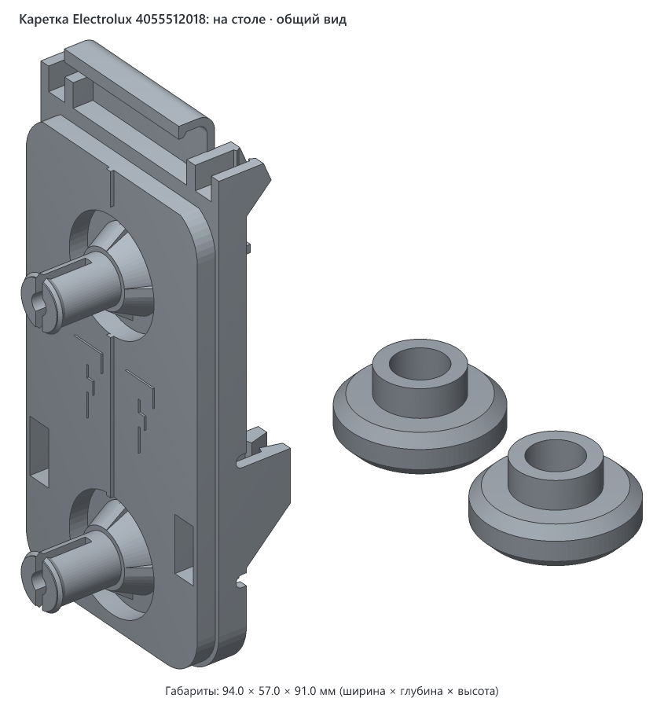

# Каретка колёс верхней корзины Electrolux 4055512018

> **Версия:** v1 · **Статус:** рабочая · **Обновлено:** 2026-10-31

> **Проверена на корзине.** Встала лучше родной детали. Как переносит горячие мойки, пока неизвестно, поэтому после первых моек проверьте, не повело ли деталь.


## Что это

Напечатанная замена каретки верхней корзины посудомоечной машины. Каретка — это пластина с двумя колёсами. На корзине их четыре, и на них она выдвигается. Если у каретки ломаются усики, она перестаёт держаться на корзине.

Сделана для машины **Electrolux EEM923100L** как замена оригинальной детали **4055512018**. Это не оригинальная запчасть Electrolux. В файле для печати каретка и два ролика.

**Как стоит в машине.** Каретка стоит вертикально на боковой стенке корзины, колёсами наружу, крючком вверх:

- язычок проходит между двумя проволоками, а крючок надевается на горизонтальную проволоку;
- те две проволоки заходят в пары стенок (усики), а зацепы не дают им выйти;
- направляющая машины проходит между колёсами: одно катится сверху, другое снизу.

## Как пользоваться

1. Снимите поддержки и зачистите оси мелкой наждачкой. Колесо крутится прямо на оси, и следы от поддержек остаются на той стороне, на которую оно опирается.
2. Наденьте напечатанные ролики на оси до щелчка. Отверстие в них подогнано под напечатанную ось. Ролик должен свободно крутиться от лёгкого толчка пальцем. Небольшой люфт — это нормально. Если заедает, зачистите ось ещё.
3. Вместо напечатанных можно поставить родные ролики со сломанной детали: сожмите разрезной конец старой оси плоскогубцами и стяните ролик. Они глаже напечатанных, но их отверстие не мерили, поэтому могут не подойти к оси.
4. Заведите крючок на горизонтальную проволоку и прижмите деталь к корзине, чтобы усики защёлкнулись на проволоке. Проволока должна уйти под зубья нижней пары и лежать там свободно.

## Совместимость

### Посудомоечные машины

Проектировалась под **Electrolux EEM923100L**, на других машинах не проверялась. Оригинальная деталь 4055512018 по данным [магазина запчастей](https://electrolux-spares.com.ua/p/00000062264) подходит и к другим моделям. Список может быть неполным.

<details>
<summary>Модели из списка магазина</summary>

**Electrolux:** CSF5200LOW, EDA22110L, EDA917102L, EDA917122L, EEA12100L, EEA12101L, EEA17100IX, EEA17100L, EEA17110L, EEA17200IX, EEA17200L, EEA22100L, EEA23200L, EEA23210L, EEA23220L, EEA27205L, EEA27400L, EEA27410L, EEA28400L, EEA71210L, EEA717100L, EEA717110L, EEA912100L, EEA917100L, EEA917103L, EEA917120L, EEA917123L, EEM23100L, EEM62310L, EEM72310L, EEM923100L, EEQ43100L, EEQ643100L, EEQ843100L, EES47400L, EMA22130L, EMA917101L, EMA917121L, ESA12100SW, ESA12110SW, ESA17200UW, ESA17200UX, ESA17210SW, ESA17210SX, ESA22100SW, ESA22100SX, ESA22110SW, ESA42110SW, ESA42110SX, ESA43110SX, ESA47301SW, ESA47301SX, ESA47400UW, ESA47400UX, ESA63200SX, ESA63210SX, ESA84311SX, ESF5206LOW, ESF5206LOX, ESF5209LOX, ESF9526LOW, ESF9526LOX, ESI5205LOX, ESL5205LO, ESL5212LO, ESL5213LO, ESL5315LO, ESM23100SX, ESM82310SX, ETA22120L, KEAD2100L, KEAD8400L, KEAF2100L, KEAF7100L, KEAF7200L, KEAF7215L, KEQC3100L, KESC7415L, SEA91210SW, SEA91211SW, SMA91210SW

**AEG:** FD390V, FD395V, FEB31600ZM, FEB32610ZM, FFB33607ZM, FFB33607ZW, FFX52507ZW, FFX52607ZW, FSB32610Z, FSB32620Z, FSB34707Z, FSB53647Z, FSE31407Z, FSE54600Z, FSK31610Z, FSK32610Z, FSK52642Z, FSX51407Z, GG370VI, GG371VI

**Zanussi:** ZDF22002WA, ZDF22002XA, ZDI22003XA, ZDLI1510, ZDLN1510, ZDLN1511, ZDLN1512, ZDLN1513, ZDLN1521, ZDLN1522, ZDLN91511, ZDLX1510, ZDSN151X1, ZDSN151X2, ZDSN152X2, ZDT21006FA, ZDT22003FA, ZSFN121W1, ZSFN121W3, ZSFN131W1, ZSFN132W1, ZSLN1211, ZSLN2211, ZSLN91211, ZSSN121X1

</details>

### Принтеры

- **Нужный стол:** от 104 × 67 мм с запасом 5 мм на сторону, высота печати от 91 мм: каретка печатается стоя, ролики лежат в стороне от неё.
- **Помещается на:** Creality K1C, Creality K1, Creality K1 Max, Creality Ender-3 V3 SE, Bambu Lab A1 mini, Bambu Lab A1, Bambu Lab P1P, Bambu Lab P1S, Bambu Lab X1 Carbon, Prusa MINI+, Prusa MK4S, Prusa Core One, Elegoo Neptune 4, Elegoo Centauri Carbon, Anycubic Kobra 3 — и на любой другой принтер с подходящим столом ([справочник принтеров](../../PRINTERS.md)).
- **Не помещается на:** —.
- **Проверено печатью:** встала на корзину лучше родной детали.

### Материалы

Внутри посудомоечной машины горячая вода и моющие средства, поэтому материал здесь важнее, чем обычно. Таблица — вывод по свойствам материалов, в машине пока не проверено.

| Нить | Подходит? | Почему |
|---|---|---|
| ASA | да | держит горячую воду и моющие средства лучше PETG, нужен закрытый принтер |
| ABS | да | то же, что ASA, нужен закрытый принтер |
| PETG | да, этой нитью печатает автор | не требует закрытого принтера. Размягчается около 80 °C, поэтому после первых горячих моек проверьте, не повело ли деталь |
| PLA | нет | размягчается около 60 °C, в посудомойке деформируется |
| TPU | нет | слишком мягкий: усики не удержат проволоку |

### Слайсер

3mf содержит только геометрию и уже стоит в положении для печати. Его можно открыть в любом слайсере: Creality Print, Bambu Studio, OrcaSlicer, PrusaSlicer, Cura.

## Габариты (v1)

| Длина | Ширина | Высота с осями и усиками |
|---|---|---|
| 91.0 мм | 42.0 мм | 29.5 мм |

Расстояние между осями 47 мм.

## Виды (v1)


## Печать

В файле каретка стоит на скруглённом торце, а ролики лежат в стороне ободом вниз и печатаются без поддержек. Так слои идут вдоль усиков и осей, и они гнутся вдоль слоёв, а не на разрыв между ними. Поддержки нужны, потому что форма повторяет оригинал, сделанный литьём: оси и крючок висят в воздухе.



Настройки — общие рекомендации: с какими настройками напечатана v1, не записано. На ранней пробной печати стояли другие: слой 0.2 мм, 2 стенки, заполнение 15 %, древовидные поддержки, профиль Hyper PETG, 250 °C / стол 70 °C.

| Параметр | Значение |
|---|---|
| Материал / цвет | PETG, цвет любой |
| Сопло / высота слоя | 0.4 мм / 0.2 мм или меньше |
| Стенки / заполнение | 4 стенки, заполнение 100 %: деталь тонкая и нагруженная |
| Кайма (brim) | 5–8 мм: опора у детали небольшая |
| Поддержки | включить: у каретки нужны под осями, под площадкой у нижнего торца и под самим крючком; клипсы скошены под 45° и ролики печатаются без них |
| Ориентация на столе | стоя на скруглённом торце, как в файле |
| Деталей на столе | 3: каретка и два ролика |
| Объём тела | 27.3 см³ вместе с роликами, около 35 г PETG при 100 % заполнения |

## Исходники

`v1/src/carrier.py` — генератор на Python (библиотеки `numpy` и `manifold3d`). Все размеры собраны в параметрах в начале файла.

```bash
cd models/electrolux-4055512018-wheel-carrier/v1/src
uv run carrier.py                        # каретка и два ролика для печати
uv run carrier.py --filled --pose back scene.3mf   # сцена для картинки с проволокой и колёсами
```

## Файлы (v1)

| Файл | Что это |
|---|---|
| `v1/electrolux-4055512018-wheel-carrier-v1.3mf` | каретка и два ролика для печати, только геометрия |
| `v1/src/carrier.py` | генератор модели |
| `v1/img/*.png` | общий вид, вид со спинки, проекции с размерами, вид на корзине (`filled.png`) и расположение на столе (`print.png`) |

## Заметки

**Сверка с оригиналом.** Спинка наложена контуром на выпрямленное фото оригинала, буквы F и сквозные отверстия сверены с фото оригинала рядом с пробной печатью. Рёбра, кольцо, следы выталкивателей, буквы и отверстия совпали. Нижняя пара клипс и ребро между её стенками сделаны иначе, об этом ниже.

**Где модель сознательно отличается от оригинала.** Всё это нужно, чтобы печатная деталь держалась на проволоке:

- нижняя пара выше и длиннее: стенки 8 мм вместо 4.1 мм и 18 мм вместо 10;
- зубья нижней пары треугольные, 1.0 × 3.9 мм, длиной 13 мм;
- между стенками нижней пары нет поперечного ребра за сквозным отверстием, полукруглая прорезь перенесена на новый конец стенки;
- стенки клипс 2.0 и 1.8 мм;
- нижний по печати угол стенок скошен под 45°, чтобы клипсам не нужна была поддержка;
- пара у крючка срослась с пластиной и язычком, полукруглой прорези перед ней нет: на этой полоске клипса ломалась на пробной печати;
- паз между стенками 3.8 мм вместо 4.2 мм из-за более толстой наружной стенки. Со стороны колёс отверстие 4.4 × 10 мм, как на оригинале.

**Почему нижняя пара выше и длиннее оригинала.** Поперёк паза стоят рёбра. На короткой низкой паре проволока ложилась на них, вершина зацепа была всего в 2.2 мм от задней плоскости, и при диаметре 3.3 мм проволока не проходила под зацепы примерно на 0.5 мм. Стенки всё время оставались разведёнными, и это напряжение выталкивало проволоку: на пробной печати она выскакивала. Теперь вершина зуба в 4.5 мм от задней плоскости. Проволока диаметром 3.0–3.6 мм ложится под зубья свободно, и у неё остаётся 1.1–1.8 мм хода. Зубья заходят на проволоку 3.3 мм на 0.75 мм с каждой стороны.

**Почему верхняя пара короче нижней.** Удлинить её некуда: сразу за ней идёт горизонтальная проволока. Стенка торчит за край пластины всего на 4.3 мм, поэтому такой же крупный зуб дал бы деформацию от 11 %, а PETG выдерживает примерно 3 %.

**Что не проверено:**

- Работа в мойке. Деталь встала на корзину, но данных о горячих мойках и долгой работе пока нет. Материал и настройки, которыми она напечатана, не записаны.
- Диаметр проволоки 3.3 мм снят с кадра видео, штангенциркулем его не мерили.
- Сколько раз можно снимать и ставить деталь. Деформация стенок нижней пары при защёлкивании по простой формуле около 3.6 %. Это выше запаса PETG в 3 %, но установку на корзину стенки выдержали.
- Высота букв 0.3 мм взята с пробной печати, на ней буквы читаются. На оригинале рельеф может быть ниже.
- Размеры сняты по рулетке и фото, не штангенциркулем, и могут отличаться на десятые доли миллиметра. Диаметр оси 8.4 мм и контур ролика — оценки.

**Почему клипсы нельзя скопировать с литой детали.** У оригинала стенки 1.2–1.4 мм, а зазор между зацепами 1.2 мм. Проволока толщиной около 3 мм должна развести такие стенки так сильно, что деформация выходит около 18 %, а напечатанный PETG выдерживает примерно 3 %. На пробной печати такие клипсы отломились в руках. Пара у крючка к тому же висела на полоске 1.4 × 2.2 мм. Настройки печати здесь не главное: стенки такой толщины и так почти целиком состоят из периметров.

Зубья нижней пары задаются параметрами `TOOTH_STOP`, `TOOTH_RISE` и `TOOTH_GAP`, а пара у крючка — параметрами `WIRE_NOM` и `FLAP_SNAP` в начале генератора.

## История версий

| Версия | Дата | Что изменилось и почему | Печать |
|---|---|---|---|
| v1 | 2026-10-31 | Первая версия: копия оригинала, клипсы усилены для печати, нижняя пара выше и длиннее | напечатана: встала на корзину лучше родной детали, данных о мойках пока нет |

## Лицензия

[CC BY 4.0](https://creativecommons.org/licenses/by/4.0/deed.ru): можно бесплатно печатать, изменять и распространять, в том числе в коммерческих целях. Нужно указать автора — iruch, <https://github.com/iruch/3d-print-models>.
