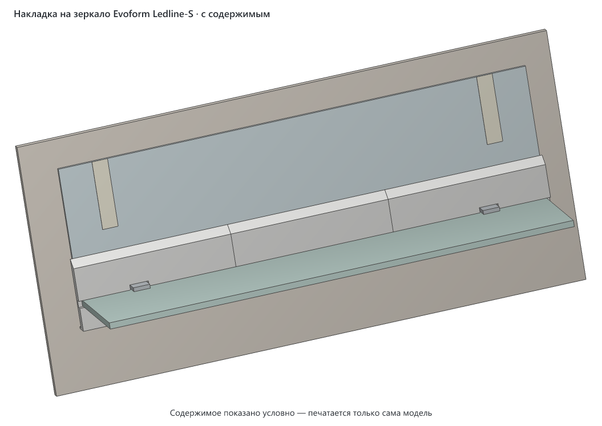
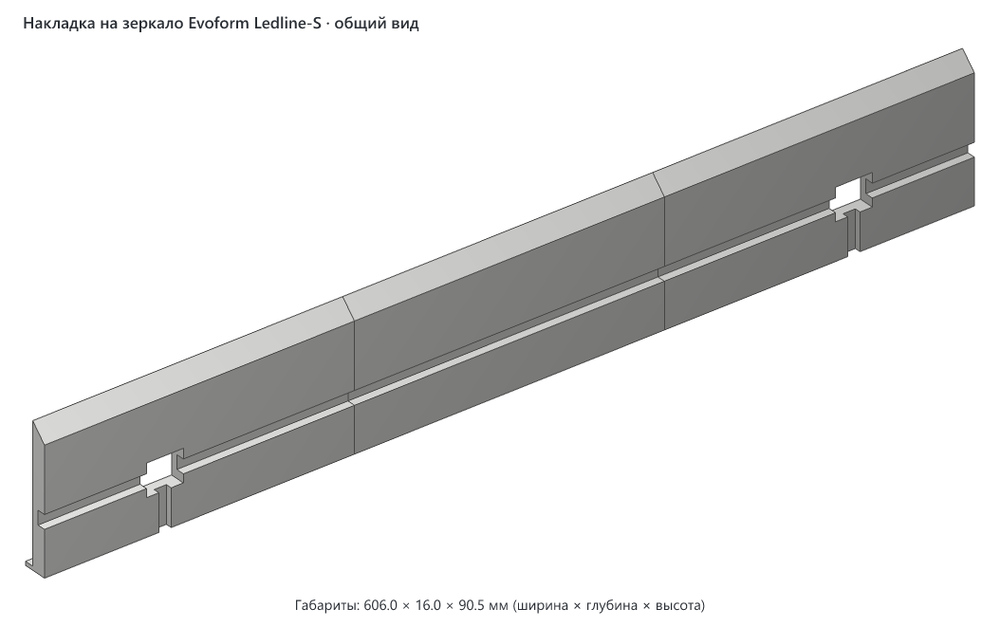
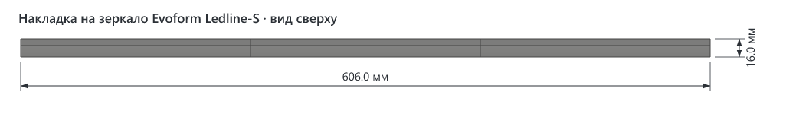
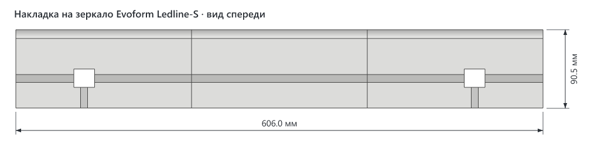
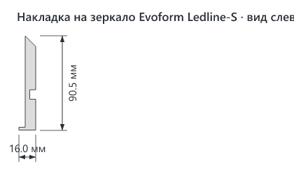
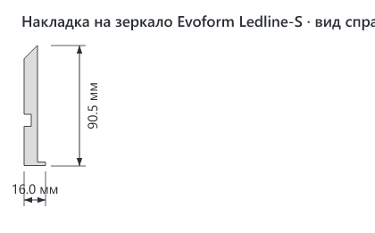

# Накладка на нижнюю кромку зеркала Evoform Ledline-S 60 × 75 с полкой

> **Версия:** v1 · **Статус:** черновик · **Обновлено:** 2026-11-05



## Что это

Накладка для зеркала с подсветкой и стеклянной полкой Evoform Ledline-S 60 × 75 см (артикул BY 2162). Если при установке зеркала побили нижние углы и пошли трещины, накладка закрывает нижние 85 мм стекла по всей ширине. Полка остаётся на своём месте: она ставится обратно, поверх накладки.

Накладка состоит из трёх деталей по 202 мм. Каждая — пластина толщиной 10 мм, прилегает к стеклу.
- **Окна под держатели.** В левой и правой деталях есть окна под штатные держатели полки.
- **Разрез под полку.** Во всех трёх деталях на высоте полки идёт разрез. Полка проходит через него в держатели до упора.
- **Как держится.** Каждая деталь лежит на полке верхней кромкой разреза: полка заходит в разрез на 5 мм. За краем полки остаётся перемычка 4,5 мм, она соединяет верх и низ детали и не даёт ей уйти вперёд.
- **Без крепежа.** Клей, шпонки и винты не нужны. На стекло накладка не давит, к нему она только прилегает.
- **Дно.** Внизу у детали дно, оно заходит под кромку стекла. Если из треснувшего угла выпадет кусок, он упадёт на дно, а не в раковину.

Сверху накладка скошена под 45°, вода и пыль на ней не задерживаются. До полос подсветки она не доходит: они начинаются примерно в 113 мм над кромкой.

## Как пользоваться

1. **Снимите полку.** Ослабьте стопорные винты снизу держателей и выньте полку вперёд.
2. **Заклейте трещины** прозрачным скотчем, не нажимая на треснувший кусок. Если кусок шевелится, дальше не идите (см. «Безопасность»).
3. **Приложите детали к стеклу.** Левая и правая надеваются окнами на держатели, средняя встаёт между ними. Дно каждой детали заходит под кромку стекла. Пока полки нет, придержите детали полоской малярного скотча.
4. **Вставьте полку** спереди через разрез, в держатели до упора. Детали лягут на неё сами.
5. **Затяните стопорные винты.** Отвёртка проходит снизу по пазу, который идёт под каждым держателем.

Снять накладку можно в обратном порядке, ничего не ломая.

### Безопасность

Полка — стекло 8 × 596 × 130 мм, она весит около 1,5 кг. Половина её веса и всего, что на ней стоит, ложится на правый держатель. Если правый держатель стоит в треснувшем стекле, а кусок вокруг него поддастся, полка упадёт. Накладка этого не предотвращает: она держится на полке, а не наоборот. Поэтому:
- перед установкой нажмите на правый держатель пальцем вниз, слабее, чем давит полка. Если что-то сдвинулось или хрустнуло, полку на этот держатель не ставьте, стекло нужно менять;
- на ту половину полки, что над треснувшим углом, ничего тяжёлого не ставьте;
- если появилась новая трещина, щелчок или кусок сдвинулся, полку снимите.

Вес зеркала держатели не несут: оно висит на пластинах, которые приклеены к стеклу сзади. Эти пластины надеты на винты в стене (по карточке товара).

## Совместимость

- **Для какого зеркала:** Evoform Ledline-S 60 × 75 (BY 2162) со штатной полкой 8 мм. Под другое зеркало накладку нужно пересчитать: ширину стекла, положение и размер держателей, толщину полки и её зазор до стекла. Всё это параметры в начале генератора.
- **Нужный стол:** деталь с подложкой занимает 218 × 99 мм, высота печати 16 мм. Запаса 5 мм на сторону тут нет: на стол 220 × 220 мм деталь встаёт впритык, по 1 мм до края. Подложку на 8 мм шире детали урезать нельзя, а деталь короче не сделать: на три части делится вся ширина зеркала.
- **Помещается на:** Creality K1C, Creality K1, Creality K1 Max, Creality Ender-3 V3 SE, Bambu Lab A1, Bambu Lab P1P, Bambu Lab P1S, Bambu Lab X1 Carbon, Prusa MK4S, Prusa Core One, Elegoo Neptune 4, Elegoo Centauri Carbon, Anycubic Kobra 3. На 220 × 220 мм (K1C, K1, Ender-3 V3 SE) — впритык. Подойдёт и любой другой принтер со столом от 220 мм по одной стороне ([справочник принтеров](../../PRINTERS.md)).
- **Не помещается на:** Bambu Lab A1 mini, Prusa MINI+.
- **Проверено печатью:** ещё не печаталась.

| Нить | Подходит? | Почему |
|---|---|---|
| PLA | не рекомендуется | Влажность ванной PLA переносит, но он мягчеет уже около 55 °C и хрупкий: длинная деталь с разрезом и окном может треснуть, пока её надевают на держатель |
| PETG | да | Не боится влаги, держит тепло до ~70 °C, упругий. Автор печатает белым PETG |
| ABS / ASA | можно | Только в закрытом принтере: длинную плоскую деталь на открытом столе поведёт |
| TPU | нет | Деталь должна быть жёсткой и лежать ровно |

Посадки с зазором: держатель проходит в окно с зазором 1,5 мм с каждой стороны, полка входит в разрез с зазором 1 мм снизу. На другом принтере и другой нити зазоры могут выйти иначе. Поэтому первой печатайте одну деталь, лучше правую, и примерьте её на зеркале с полкой.

## Габариты (v1)

| Деталь | Ширина (X) | Глубина (Y) | Высота (Z) |
|---|---|---|---|
| каждая из трёх | 202 мм | 16 мм (пластина 10 мм, дно уходит под стекло ещё на 6 мм) | 90,5 мм |
| вся накладка | 606 мм | 16 мм | 90,5 мм |

Накладка выходит за боковые края стекла на 3 мм с каждой стороны и опускается на 5,5 мм ниже кромки.

## Виды (v1)

Три детали в сборе, без подложек.











## Печать

| Параметр | Значение |
|---|---|
| Материал / цвет | PETG, у автора белый |
| Сопло / высота слоя | 0,4 мм / 0,2 мм |
| Стенки / заполнение | 3–4 стенки, заполнение 20–25 %. Деталь несёт только свой вес |
| Поддержки | не нужны. Над разрезом мост 9 мм, скос сверху 45° |
| Подложки | есть в модели у каждой детали: кольцо в первый слой, после печати оторвать, как кайму. Вдоль разреза, у окон и у пазов подложки нет, там начисто |
| Ориентация на столе | лицом на стол, так в файле. Длинной стороной вдоль Y, по центру стола |
| Деталей на столе | одна. Три детали — три отдельных файла |
| Время / расход (по слайсеру) | ещё не считалось. Объём тела 162–167 см³ на деталь |

Перед печатью посмотрите в слайсере, нет ли предупреждений у края стола. С подложкой деталь занимает 218 мм из 220. Прошивка K1 чертит линию прочистки у левого края стола, поэтому деталь лежит вдоль Y, до левого края больше 60 мм. Где именно идёт линия, взято по памяти о прошивке, на этом принтере не проверено.

## Исходники

Генератор: [`v1/src/mirror_trim.py`](v1/src/mirror_trim.py), Python, manifold3d. Все размеры — параметры в начале файла, у каждого подписано, откуда он взят: замер, карточка товара или оценка.

```bash
cd models/evoform-ledline-s-mirror-trim/v1
uv run src/mirror_trim.py --part right    # правая деталь с подложкой
uv run src/mirror_trim.py --part middle   # средняя
uv run src/mirror_trim.py --part left     # левая
uv run src/mirror_trim.py --pose use      # три детали в сборе для картинок видов
uv run src/mirror_trim.py --filled        # сцена с зеркалом и полкой для filled.png
node ../../../tools/render-3mf.mjs evoform-ledline-s-mirror-trim-v1-use.3mf img --name "Накладка на зеркало Evoform Ledline-S" --color "#f4f4f2"
node ../../../tools/render-3mf.mjs evoform-ledline-s-mirror-trim-v1-filled.3mf img --filled --name "Накладка на зеркало Evoform Ledline-S" --color "#f4f4f2"
```

## Файлы (v1)

| Файл | Что это |
|---|---|
| `v1/evoform-ledline-s-mirror-trim-v1-right.3mf` | правая деталь, с окном под правый держатель |
| `v1/evoform-ledline-s-mirror-trim-v1-middle.3mf` | средняя деталь, без окон |
| `v1/evoform-ledline-s-mirror-trim-v1-left.3mf` | левая деталь, с окном под левый держатель |
| `v1/src/mirror_trim.py` | генератор |
| `v1/img/` | картинки видов |

## Заметки

- Схема автора: пластина с окнами, разрез под полку во всех деталях, полка поверх. Толщины тоже задал автор. Полка до упора стоит в 5 мм от зеркала, поэтому в разрезе деталь 4,5 мм. Над полкой и под ней 10 мм, чтобы полка заходила в разрез на 5 мм и надёжно держала накладку.
- Не замерено, это оценки. Губки держателя взяты по 5 мм: 18 = 5 + 8 + 5, от них зависит высота разреза относительно окна. Вылет держателя от стекла взят около 21 мм по видео. Расстояние 65 мм до держателя взято от края стекла до ближнего края держателя, так сходится с фото. Если окно не налезет на держатель или разрез не совпадёт с полкой, поправить один параметр и перегенерировать.
- Деталь висит на полке, поэтому её высоту задаёт полка, а не кромка стекла. Дно опущено на 3 мм ниже кромки с запасом, чтобы не упереться в стекло, даже если полка стоит чуть ниже расчёта.
- Высота 85 мм над кромкой взята с запасом: по фото трещины поднимаются примерно до 55 мм.

## История версий

| Версия | Дата | Что изменилось и почему | Печать |
|---|---|---|---|
| v1 | 2026-11-05 | Первая версия: три детали, окна под держатели, разрез под полку | не печаталась |

## Лицензия

[CC BY 4.0](https://creativecommons.org/licenses/by/4.0/deed.ru): можно бесплатно печатать, изменять и распространять, в том числе в коммерческих целях. Нужно указать автора — iruch, <https://github.com/iruch/3d-print-models>.
