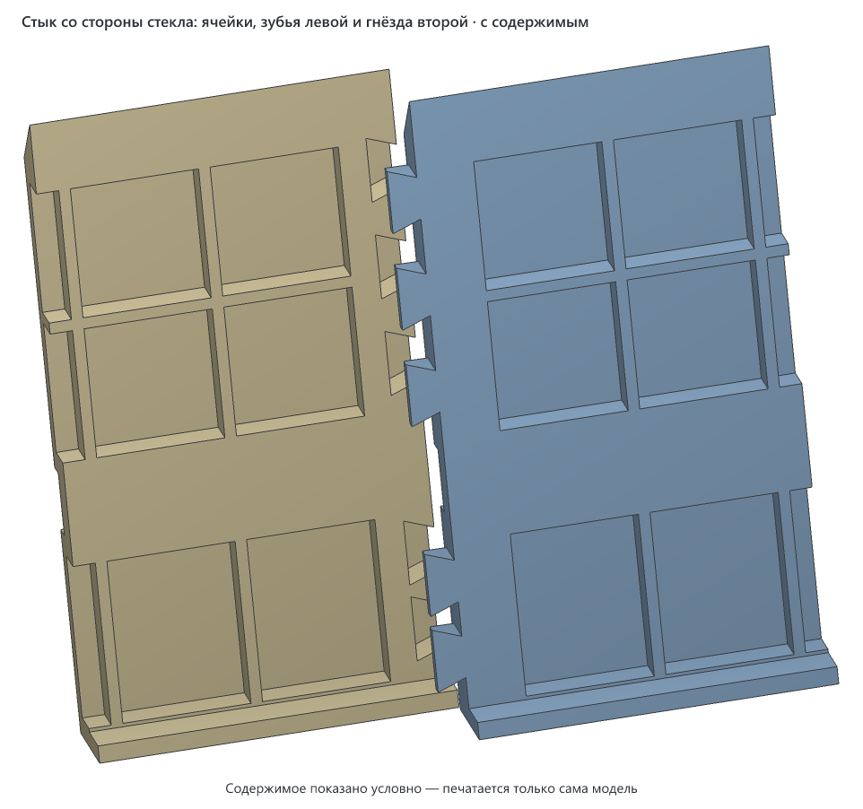

# Накладка на нижнюю кромку зеркала Evoform Ledline-S 60 × 75 с полкой

> **Версия:** v1 · **Статус:** черновик · **Обновлено:** 2026-11-05


## Что это

Накладка для зеркала с подсветкой и стеклянной полкой Evoform Ledline-S 60 × 75 см (артикул BY 2162). Если при установке зеркала побили нижние углы и пошли трещины, накладка закрывает нижние 85 мм стекла по всей ширине. Полка остаётся на своём месте: она ставится обратно, поверх накладки.

Накладка — пластина толщиной 7 мм из четырёх деталей по 154,5 мм. Она прилегает к стеклу и на 3 мм выходит за его боковые края.
- **Окна под держатели.** В крайних деталях есть окна под штатные держатели полки.
- **Разрез под полку.** Во всех деталях на высоте полки идёт разрез. Полка проходит через него в держатели до упора.
- **Как держится.** Каждая деталь лежит на полке верхней кромкой разреза: полка заходит в разрез на 2 мм. За краем полки остаётся перемычка 4,5 мм, она соединяет верх и низ детали и не даёт ей уйти вперёд. Клей и винты не нужны. На стекло накладка не давит, только прилегает.
- **Стыки.** Детали вставляются друг в друга зубьями «ласточкин хвост» глубиной 4 мм, по пять на стык. Зубья есть только в задней части толщины, поэтому спереди шов прямой. Планку собирают на столе и надевают на зеркало целиком.
- **Сзади ячейки.** Лицо 2,4 мм сплошное, сзади ячейки, открытые к стеклу. Сплошные рёбра 3 мм идут по краям, вдоль разреза и вокруг окон, торцы сплошные. Так деталь меньше коробится на столе, и на неё уходит вдвое меньше пластика, чем на сплошную.
- **Дно.** Внизу у детали дно, оно заходит под кромку стекла. Если из треснувшего угла выпадет кусок, он упадёт на дно, а не в раковину.

Сверху накладка скошена под 45°, вода и пыль на ней не задерживаются. До полос подсветки она не доходит: они начинаются примерно в 113 мм над кромкой.

## Как пользоваться

1. **Сначала напечатайте пробник** (см. «Пробник») и примерьте его. Только потом печатайте детали.
2. **Срежьте остаток подложки с торцов.** Подложка идёт вокруг всей детали, торцы тоже. На торцах, которыми детали стыкуются, остаток срежьте ножом заподлицо, иначе шов не сойдётся.
3. **Снимите полку.** Ослабьте стопорные винты снизу держателей и выньте полку вперёд.
4. **Заклейте трещины** прозрачным скотчем, не нажимая на треснувший кусок. Если кусок шевелится, дальше не идите (см. «Безопасность»).
5. **Соберите планку на столе.** Детали пронумерованы слева направо, если смотреть на зеркало.
   - Положите деталь 3 лицом на стол.
   - Поднесите деталь 2, тоже лицом вниз, так, чтобы её зубья встали над гнёздами детали 3, и вдавите сверху.
   - Так же вставьте деталь 4 в другой торец детали 3.
   - Последней вставьте деталь 1 в свободный торец детали 2.

   Зубья входят туго.

   

6. **Наденьте планку на зеркало** целиком: крайние детали окнами на держатели, дно под кромку стекла. Зубья окажутся у стекла, и выйти из гнёзд оно им не даст. Пока полки нет, придержите планку рукой.
7. **Вставьте полку** спереди через разрез, в держатели обязательно до упора. Планка ляжет на неё сама. Она лежит на полке полоской 2 мм: если полка не дойдёт до упора на 2 мм, планка с неё соскользнёт.
8. **Затяните стопорные винты.** Отвёртка проходит снизу по пазу, который идёт под каждым держателем.

Снять накладку можно в обратном порядке, ничего не ломая.

### Безопасность

Полка — стекло 8 × 596 × 130 мм, она весит около 1,5 кг. Половина её веса и всего, что на ней стоит, ложится на правый держатель. Если правый держатель стоит в треснувшем стекле, а кусок вокруг него поддастся, полка упадёт. Накладка этого не предотвращает: она держится на полке, а не наоборот. Поэтому:
- перед установкой нажмите на правый держатель пальцем вниз, слабее, чем давит полка. Если что-то сдвинулось или хрустнуло, полку на этот держатель не ставьте, стекло нужно менять;
- на ту половину полки, что над треснувшим углом, ничего тяжёлого не ставьте;
- если появилась новая трещина, щелчок или кусок сдвинулся, полку снимите.

Вес зеркала держатели не несут: оно висит на пластинах, которые приклеены к стеклу сзади. Эти пластины надеты на винты в стене (по карточке товара).

## Совместимость

- **Для какого зеркала:** Evoform Ledline-S 60 × 75 (BY 2162) со штатной полкой 8 мм. Под другое зеркало накладку нужно пересчитать: ширину стекла, положение и размер держателей, толщину полки и её зазор до стекла. Всё это параметры в начале генератора.
- **Нужный стол:** от 215 × 144 мм с запасом 5 мм на сторону (деталь можно повернуть на столе на 90°), высота печати от 13 мм. Это деталь вместе с подложкой 20 мм и «ушками» на углах. Пробник — от 152 × 114 мм.
- **Помещается на:** Creality K1C, Creality K1, Creality K1 Max, Creality Ender-3 V3 SE, Bambu Lab A1, Bambu Lab P1P, Bambu Lab P1S, Bambu Lab X1 Carbon, Prusa MK4S, Prusa Core One, Elegoo Neptune 4, Elegoo Centauri Carbon, Anycubic Kobra 3. Подойдёт и любой другой принтер с подходящим столом ([справочник принтеров](../../PRINTERS.md)).
- **Не помещается на:** Bambu Lab A1 mini, Prusa MINI+. Пробник — на все.
- **Проверено печатью:** вариант из 4 деталей ещё не печатался. Первая печать (3 сплошные детали) не удалась, см. «Заметки».

| Нить | Подходит? | Почему |
|---|---|---|
| PLA | не рекомендуется | Влажность ванной PLA переносит, но он мягчеет уже около 55 °C и хрупкий: деталь с разрезом и окном может треснуть, пока её надевают на держатель |
| PETG | да | Не боится влаги, держит тепло до ~70 °C, упругий. Автор печатает белым PETG |
| ABS / ASA | можно | Только в закрытом принтере: длинную плоскую деталь на открытом столе поведёт |
| TPU | нет | Деталь должна быть жёсткой и лежать ровно |

Посадки с зазором:
- держатель проходит в окно с зазором 1,5 мм с каждой стороны;
- полка входит в разрез с зазором 1 мм снизу;
- зубья входят в гнёзда с зазором 0,1 мм по контуру.

На другом принтере и другой нити зазоры могут выйти иначе, поэтому сначала пробник.

## Габариты (v1)

| Деталь | Ширина (X) | Глубина (Y) | Высота (Z) |
|---|---|---|---|
| каждая из четырёх | 154,5 мм (у деталей 1, 2 и 4 в том числе зубья 4 мм) | 13 мм (пластина 7 мм, дно уходит под стекло ещё на 6 мм) | 90,5 мм |
| вся накладка | 606 мм | 13 мм | 90,5 мм |

Накладка выходит за боковые края стекла на 3 мм с каждой стороны и опускается на 5,5 мм ниже кромки.

## Виды (v1)

Четыре детали в сборе, без подложек.


## Печать

| Параметр | Значение |
|---|---|
| Материал / цвет | PETG, у автора белый |
| Сопло / высота слоя | 0,4 мм / 0,2 мм |
| Стенки / заполнение | 4 стенки: тогда рёбра ячеек (1,6 мм) печатаются сплошными. Заполнение 20–25 %, оно пойдёт только в лицо и толстые рёбра |
| Поддержки | не нужны. Все нижние грани растут не круче 45°, кроме двух мостов с опорой с двух сторон: перемычки над разрезом (пролёт 9 мм) и паза под отвёртку (8 мм). Зубья снизу скошены под 45° |
| Подложки | есть в модели у каждой детали: кольцо в первый слой по 20 мм со всех сторон и «ушки» на углах. После печати оторвать, как кайму. Вдоль разреза, у окон и у пазов подложки нет. На торцах со стыками остаток срезать ножом заподлицо |
| Ориентация на столе | лицом на стол, так в файле. Длинной стороной вдоль X, ближе к заднему краю стола (Y от 80 мм) |
| Деталей на столе | одна. Четыре детали — четыре файла |
| Время / расход (по слайсеру) | ещё не считалось. Объём тела 58–59 см³ на деталь (сплошная деталь первой печати — 117) |

На K1C перед печатью прошивка чертит линию прочистки буквой Г у переднего левого угла стола. На фото первой печати она шла примерно при X 36…92 и Y до 45 мм, точно не замерено. Поэтому детали лежат дальше от переднего края: подложка начинается не ближе 80 мм.

## Пробник

`v1/evoform-ledline-s-mirror-trim-v1-4p-test.3mf`, три куска на одном столе, вместе около 32 см³:
- **окно:** кусок детали 1 с окном под левый держатель и разрезом. Наденьте его окном на левый держатель и пропустите полку через разрез в держатели;
- **зубья и гнёзда:** конец детали 1 с зубьями и начало детали 2 с гнёздами. Вдавите зубья в гнёзда.

Что смотреть:
- **Зубья** входят туго, но без силы и не болтаются. Если не лезут, поправить `ЗУБ_ЗАЗОР` на 0,15–0,2; если болтаются, на 0,05.
- **Окно** садится на держатель, а полка идёт в разрез до упора. Если окно не садится, держатель стоит не там, где посчитано, см. оценки в «Заметках».
- **Углы** не отходят от стола.

## Исходники

Генератор: [`v1/src/mirror_trim.py`](v1/src/mirror_trim.py), Python, manifold3d. Все размеры — параметры в начале файла, у каждого подписано, откуда он взят: замер, карточка товара или оценка.

```bash
cd models/evoform-ledline-s-mirror-trim/v1
uv run src/mirror_trim.py --part 1        # деталь 1 (левая) с подложкой -> ...-v1-4p-1.3mf; так же 2, 3, 4
uv run src/mirror_trim.py --test          # пробник окна и стыка -> ...-v1-4p-test.3mf
uv run src/mirror_trim.py --pose use      # четыре детали в сборе для картинок видов
uv run src/mirror_trim.py --filled        # сцена с зеркалом и полкой для filled.png
uv run src/mirror_trim.py --seam          # стык со стороны стекла для seam.png (рендер --filled в отдельную папку, filled.png переименовать)
node ../../../tools/render-3mf.mjs evoform-ledline-s-mirror-trim-v1-4p-use.3mf img --name "Накладка на зеркало Evoform Ledline-S, 4 детали" --color "#f4f4f2"
node ../../../tools/render-3mf.mjs evoform-ledline-s-mirror-trim-v1-4p-filled.3mf img --filled --name "Накладка на зеркало Evoform Ledline-S, 4 детали" --color "#f4f4f2"
```

## Файлы (v1)

| Файл | Что это |
|---|---|
| `v1/evoform-ledline-s-mirror-trim-v1-4p-test.3mf` | пробник: окно, зубья, гнёзда. Печатать первым |
| `v1/evoform-ledline-s-mirror-trim-v1-4p-1.3mf` | деталь 1, левая: окно под левый держатель, зубья в деталь 2 |
| `v1/evoform-ledline-s-mirror-trim-v1-4p-2.3mf` | деталь 2: гнёзда под деталь 1, зубья в деталь 3 |
| `v1/evoform-ledline-s-mirror-trim-v1-4p-3.3mf` | деталь 3: гнёзда с обеих сторон, под детали 2 и 4 |
| `v1/evoform-ledline-s-mirror-trim-v1-4p-4.3mf` | деталь 4, правая: окно под правый держатель, зубья в деталь 3 |
| `v1/evoform-ledline-s-mirror-trim-v1-right.3mf`, `-middle.3mf`, `-left.3mf`, `-right-tooth45.3mf`, `-middle-tooth45.3mf`, `-left-tooth45.3mf` | устарели: первый вариант из 3 сплошных деталей, на печати выгнулся. Оставлены по просьбе автора, чтобы не перезаписывать то, с чего он печатал. С деталями `-4p` не сочетаются |
| `v1/src/mirror_trim.py` | генератор |
| `v1/img/` | картинки видов. `seam.png` — стык со стороны стекла, `seam-tooth45.png` — стык устаревшего варианта |

## Заметки

- Схема автора: пластина с окнами, разрез под полку во всех деталях, полка поверх. Толщины тоже задал автор. Полка до упора стоит в 5 мм от зеркала, поэтому в разрезе деталь 4,5 мм. Над полкой и под ней 7 мм: полка заходит в разрез на 2 мм. Деталь прижимается верхом к стеклу (центр тяжести ближе к стеклу, чем полоска опоры), вперёд её не пускает перемычка.
- **Первая печать, 2026-11-05: правая из трёх сплошных деталей, остановлена.** Что пошло не так:
  - Деталь выгнулась дугой примерно на 1 мм, её края отошли от стола, и верх пошёл плохо.
  - Торец со стыком печатался без подложки: её убрали, чтобы остаток не мешал шву. Этот торец и поднялся.
  - Подложка была 8 мм.
  - Пластина была сплошной, 7 мм. Сплошные слои сильнее стягивают деталь при остывании, и сзади шёл большой сплошной верхний слой.
  - Зубья стыка висели в воздухе плоским низом и провисли.

  Поэтому теперь:
  - подложка 20 мм со всех сторон, торцы тоже, и «ушки» на углах;
  - сзади ячейки;
  - низ зубьев под 45°;
  - деталь лежит вне зоны прочистки;
  - деталей четыре, чтобы всё это поместилось на стол.
- Зубья 4 мм. Длиннее под 45° в пластину 7 мм не помещаются: низ зуба начинается в 1,5 мм за лицом и к концу зуба поднимается до 5,5 мм.
- Не замерено, это оценки:
  - губки держателя взяты по 5 мм (18 = 5 + 8 + 5), от них зависит высота разреза относительно окна;
  - вылет держателя от стекла взят около 21 мм по видео;
  - 65 мм взято от края стекла до ближнего края держателя, так сходится с фото.

  Если окно не налезет на держатель или разрез не совпадёт с полкой, поправить один параметр и перегенерировать.
- Деталь висит на полке, поэтому её высоту задаёт полка, а не кромка стекла. Дно опущено на 3 мм ниже кромки с запасом, чтобы не упереться в стекло, даже если полка стоит чуть ниже расчёта.
- Высота 85 мм над кромкой взята с запасом: по фото трещины поднимаются примерно до 55 мм.

## История версий

| Версия | Дата | Что изменилось и почему | Печать |
|---|---|---|---|
| v1 | 2026-11-05 | Четыре детали с ячейками сзади, окна под держатели, разрез под полку, зубья на стыках, подложка 20 мм. До этого были три сплошные детали, они выгнулись на столе | черновик, ещё не печатался |

## Лицензия

[CC BY 4.0](https://creativecommons.org/licenses/by/4.0/deed.ru): можно бесплатно печатать, изменять и распространять, в том числе в коммерческих целях. Нужно указать автора — iruch, <https://github.com/iruch/3d-print-models>.
