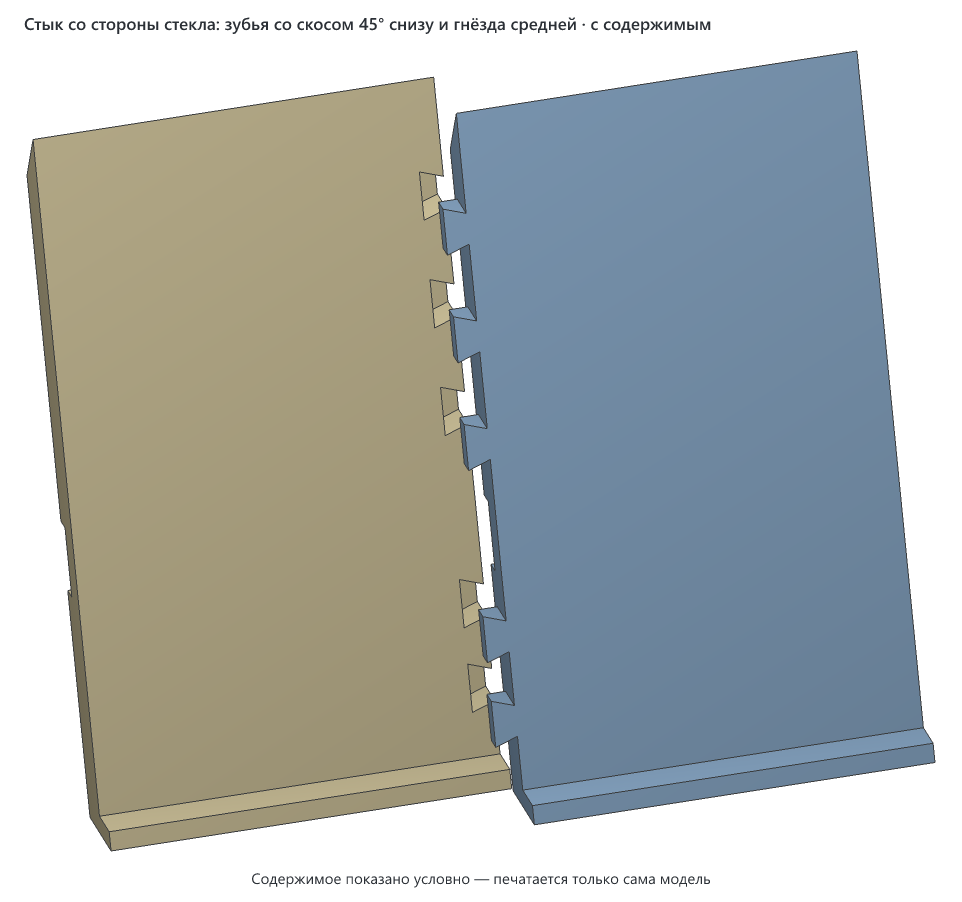

# Накладка на нижнюю кромку зеркала Evoform Ledline-S 60 × 75 с полкой

> **Версия:** v1 · **Статус:** черновик · **Обновлено:** 2026-11-05


## Что это

Накладка для зеркала с подсветкой и стеклянной полкой Evoform Ledline-S 60 × 75 см (артикул BY 2162). Если при установке зеркала побили нижние углы и пошли трещины, накладка закрывает нижние 85 мм стекла по всей ширине. Полка остаётся на своём месте: она ставится обратно, поверх накладки.

Накладка состоит из трёх деталей: крайние по 202 мм вместе с зубьями, средняя 207,6 мм. Каждая — пластина толщиной 7 мм, прилегает к стеклу.
- **Окна под держатели.** В левой и правой деталях есть окна под штатные держатели полки.
- **Разрез под полку.** Во всех трёх деталях на высоте полки идёт разрез. Полка проходит через него в держатели до упора.
- **Стыки.** На внутреннем торце крайних деталей по пять зубьев «ласточкин хвост», в средней под них гнёзда. Зубья есть только в задней половине толщины, со стороны стекла, поэтому спереди шов прямой. Планку собирают на столе и надевают на зеркало целиком.
- **Как держится.** Каждая деталь лежит на полке верхней кромкой разреза: полка заходит в разрез на 2 мм. За краем полки остаётся перемычка 4,5 мм, она соединяет верх и низ детали и не даёт ей уйти вперёд.
- **Без крепежа.** Клей и винты не нужны. На стекло накладка не давит, к нему она только прилегает.
- **Дно.** Внизу у детали дно, оно заходит под кромку стекла. Если из треснувшего угла выпадет кусок, он упадёт на дно, а не в раковину.

Сверху накладка скошена под 45°, вода и пыль на ней не задерживаются. До полос подсветки она не доходит: они начинаются примерно в 113 мм над кромкой.

## Как пользоваться

1. **Снимите полку.** Ослабьте стопорные винты снизу держателей и выньте полку вперёд.
2. **Заклейте трещины** прозрачным скотчем, не нажимая на треснувший кусок. Если кусок шевелится, дальше не идите (см. «Безопасность»).
3. **Соберите планку на столе.** Положите среднюю деталь лицом на стол. Левую, тоже лицом вниз, поднесите к средней так, чтобы её зубья встали над гнёздами, и вдавите сверху. Так же поставьте правую. Зубья входят туго.

   

4. **Наденьте планку на зеркало** целиком: крайние детали окнами на держатели, дно под кромку стекла. Зубья встанут к стеклу, и выйти из гнёзд оно им не даст. Пока полки нет, придержите планку рукой.
5. **Вставьте полку** спереди через разрез, в держатели обязательно до упора. Детали лягут на неё сами. Они лежат на полке полоской 2 мм: если полка не дойдёт до упора на 2 мм, детали с неё соскользнут.
6. **Затяните стопорные винты.** Отвёртка проходит снизу по пазу, который идёт под каждым держателем.

Снять накладку можно в обратном порядке, ничего не ломая.

### Безопасность

Полка — стекло 8 × 596 × 130 мм, она весит около 1,5 кг. Половина её веса и всего, что на ней стоит, ложится на правый держатель. Если правый держатель стоит в треснувшем стекле, а кусок вокруг него поддастся, полка упадёт. Накладка этого не предотвращает: она держится на полке, а не наоборот. Поэтому:
- перед установкой нажмите на правый держатель пальцем вниз, слабее, чем давит полка. Если что-то сдвинулось или хрустнуло, полку на этот держатель не ставьте, стекло нужно менять;
- на ту половину полки, что над треснувшим углом, ничего тяжёлого не ставьте;
- если появилась новая трещина, щелчок или кусок сдвинулся, полку снимите.

Вес зеркала держатели не несут: оно висит на пластинах, которые приклеены к стеклу сзади. Эти пластины надеты на винты в стене (по карточке товара).

## Совместимость

- **Для какого зеркала:** Evoform Ledline-S 60 × 75 (BY 2162) со штатной полкой 8 мм. Под другое зеркало накладку нужно пересчитать: ширину стекла, положение и размер держателей, толщину полки и её зазор до стекла. Всё это параметры в начале генератора.
- **Нужный стол:** от 110 × 220 мм с запасом 5 мм на сторону (деталь можно повернуть на столе на 90°), высота печати от 13 мм. С подложкой крайняя деталь занимает 100 × 210 мм, средняя 100 × 208 мм. К торцам, которыми детали стыкуются, подложка не подходит.
- **Помещается на:** Creality K1C, Creality K1, Creality K1 Max, Creality Ender-3 V3 SE, Bambu Lab A1, Bambu Lab P1P, Bambu Lab P1S, Bambu Lab X1 Carbon, Prusa MK4S, Prusa Core One, Elegoo Neptune 4, Elegoo Centauri Carbon, Anycubic Kobra 3. Подойдёт и любой другой принтер с подходящим столом ([справочник принтеров](../../PRINTERS.md)).
- **Не помещается на:** Bambu Lab A1 mini, Prusa MINI+.
- **Проверено печатью:** ещё не печаталась.

| Нить | Подходит? | Почему |
|---|---|---|
| PLA | не рекомендуется | Влажность ванной PLA переносит, но он мягчеет уже около 55 °C и хрупкий: длинная деталь с разрезом и окном может треснуть, пока её надевают на держатель |
| PETG | да | Не боится влаги, держит тепло до ~70 °C, упругий. Автор печатает белым PETG |
| ABS / ASA | можно | Только в закрытом принтере: длинную плоскую деталь на открытом столе поведёт |
| TPU | нет | Деталь должна быть жёсткой и лежать ровно |

Посадки с зазором: держатель проходит в окно с зазором 1,5 мм с каждой стороны, полка входит в разрез с зазором 1 мм снизу, зубья входят в гнёзда с зазором 0,1 мм по контуру. На другом принтере и другой нити зазоры могут выйти иначе. Поэтому первой печатайте одну деталь, лучше правую, и примерьте её на зеркале с полкой.

## Габариты (v1)

| Деталь | Ширина (X) | Глубина (Y) | Высота (Z) |
|---|---|---|---|
| левая, правая | 202 мм (из них 2,8 мм — зубья) | 13 мм (пластина 7 мм, дно уходит под стекло ещё на 6 мм) | 90,5 мм |
| средняя | 207,6 мм | 13 мм | 90,5 мм |
| вся накладка | 606 мм | 13 мм | 90,5 мм |

Накладка выходит за боковые края стекла на 3 мм с каждой стороны и опускается на 5,5 мм ниже кромки.

## Виды (v1)

Три детали в сборе, без подложек.


## Печать

| Параметр | Значение |
|---|---|
| Материал / цвет | PETG, у автора белый |
| Сопло / высота слоя | 0,4 мм / 0,2 мм |
| Стенки / заполнение | 3–4 стенки, заполнение 20–25 %. Деталь несёт только свой вес |
| Поддержки | не нужны для файлов `-tooth45`: над разрезом мост 9 мм, над пазом под отвёртку мост 8 мм, скос сверху 45°, низ зубьев скошен под 45°. В первых файлах без суффикса низ зубьев плоский и висит в воздухе на 2,8 мм: он провисает, а поддержку из-под него не вынуть |
| Подложки | есть в модели у каждой детали: кольцо в первый слой, после печати оторвать, как кайму. Вдоль разреза, у окон, у пазов и у торцов, которыми детали стыкуются, подложки нет, там начисто |
| Ориентация на столе | лицом на стол, так в файле. Длинной стороной вдоль Y, по центру стола |
| Деталей на столе | одна. Три детали — три отдельных файла |
| Время / расход (по слайсеру) | ещё не считалось. Объём тела 116–125 см³ на деталь |

С подложкой деталь занимает до 210 мм из 220. Прошивка K1 чертит линию прочистки у левого края стола, поэтому деталь лежит вдоль Y, до левого края больше 60 мм. Где именно идёт линия, взято по памяти о прошивке, на этом принтере не проверено.

## Исходники

Генератор: [`v1/src/mirror_trim.py`](v1/src/mirror_trim.py), Python, manifold3d. Все размеры — параметры в начале файла, у каждого подписано, откуда он взят: замер, карточка товара или оценка.

```bash
cd models/evoform-ledline-s-mirror-trim/v1
uv run src/mirror_trim.py --part right    # правая деталь с подложкой -> ...-v1-right-tooth45.3mf
uv run src/mirror_trim.py --part middle   # средняя -> ...-v1-middle-tooth45.3mf
uv run src/mirror_trim.py --part left     # левая -> ...-v1-left-tooth45.3mf
uv run src/mirror_trim.py --pose use      # три детали в сборе для картинок видов
uv run src/mirror_trim.py --filled        # сцена с зеркалом и полкой для filled.png
uv run src/mirror_trim.py --seam          # стык со стороны стекла для seam-tooth45.png (рендер --filled в отдельную папку, filled.png переименовать)
node ../../../tools/render-3mf.mjs evoform-ledline-s-mirror-trim-v1-use.3mf img --name "Накладка на зеркало Evoform Ledline-S" --color "#f4f4f2"
node ../../../tools/render-3mf.mjs evoform-ledline-s-mirror-trim-v1-filled.3mf img --filled --name "Накладка на зеркало Evoform Ledline-S" --color "#f4f4f2"
```

## Файлы (v1)

| Файл | Что это |
|---|---|
| `v1/evoform-ledline-s-mirror-trim-v1-right-tooth45.3mf` | правая деталь, с окном под правый держатель. Печатать эти три |
| `v1/evoform-ledline-s-mirror-trim-v1-middle-tooth45.3mf` | средняя деталь, без окон, с гнёздами под зубья |
| `v1/evoform-ledline-s-mirror-trim-v1-left-tooth45.3mf` | левая деталь, с окном под левый держатель |
| `v1/evoform-ledline-s-mirror-trim-v1-right.3mf`, `-middle.3mf`, `-left.3mf` | первые файлы: низ зубьев плоский и провисает на печати. Оставлены, пока автор допечатывает правую по ним. Средняя из них с правой `-tooth45` не сойдётся, новая средняя подходит к обеим правым |
| `v1/src/mirror_trim.py` | генератор |
| `v1/img/` | картинки видов. `seam-tooth45.png` — стык со стороны стекла, `seam.png` — он же у первых файлов |

## Заметки

- Схема автора: пластина с окнами, разрез под полку во всех деталях, полка поверх. Толщины тоже задал автор. Полка до упора стоит в 5 мм от зеркала, поэтому в разрезе деталь 4,5 мм.
- Над полкой и под ней сначала было 10 мм, и полка заходила в разрез на 5 мм. Автор решил, что это слишком толсто, и сделал 7 мм. Теперь полка заходит на 2 мм. Детали это держит: каждая весит меньше 150 г даже сплошная. Центр тяжести у неё ближе к стеклу, чем полоска, которой она лежит на полке, поэтому деталь прижимается верхом к стеклу, а вперёд её не пускает перемычка. Запас меньше: полку нужно вставлять до упора.
- Не замерено, это оценки. Губки держателя взяты по 5 мм: 18 = 5 + 8 + 5, от них зависит высота разреза относительно окна. Вылет держателя от стекла взят около 21 мм по видео. Расстояние 65 мм до держателя взято от края стекла до ближнего края держателя, так сходится с фото. Если окно не налезет на держатель или разрез не совпадёт с полкой, поправить один параметр и перегенерировать.
- Деталь висит на полке, поэтому её высоту задаёт полка, а не кромка стекла. Дно опущено на 3 мм ниже кромки с запасом, чтобы не упереться в стекло, даже если полка стоит чуть ниже расчёта.
- Высота 85 мм над кромкой взята с запасом: по фото трещины поднимаются примерно до 55 мм.
- Зубья 2,8 мм. В первых файлах низ зуба был плоским и висел в воздухе. Слайсер о консолях короче 3 мм не предупреждает, но такой низ на печати провисает под своим весом, а поддержку из-под зуба потом не вынуть. В файлах `-tooth45` низ зуба скошен под 45° от шва: на шве зуб начинается в 1,5 мм за лицом, на конце в 4,3 мм, и каждый слой выступает над нижним не больше чем на высоту слоя. Гнёзда в средней сделаны глубже, до 1,3 мм от лица. Поэтому в новую среднюю входят и новые зубья, и старые, если подрезать провис ножом. Зазор в гнезде 0,1 мм подобран на глаз. Если зубья не лезут, поправить `ЗУБ_ЗАЗОР` на 0,15–0,2; если болтаются — на 0,05. Сначала примерить на одном стыке.

## История версий

| Версия | Дата | Что изменилось и почему | Печать |
|---|---|---|---|
| v1 | 2026-11-05 | Первая версия: три детали, окна под держатели, разрез под полку | не печаталась |

## Лицензия

[CC BY 4.0](https://creativecommons.org/licenses/by/4.0/deed.ru): можно бесплатно печатать, изменять и распространять, в том числе в коммерческих целях. Нужно указать автора — iruch, <https://github.com/iruch/3d-print-models>.
