# Направляющие ролики для нити из сушилки к Creality K1C

> **Версия:** v1 · **Статус:** черновик · **Обновлено:** 2026-11-05

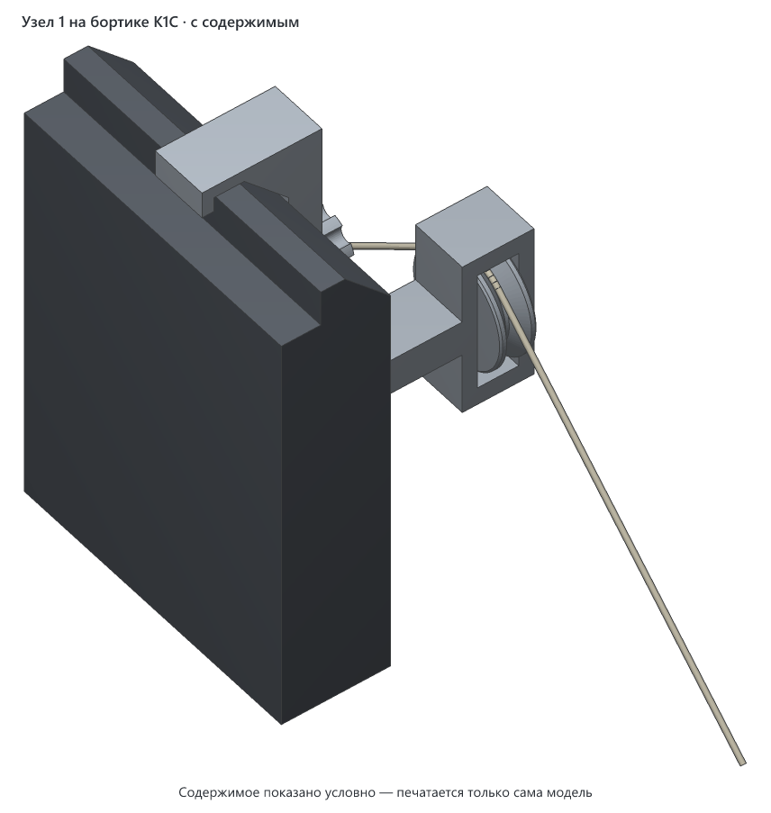

## Что это

Пара роликов на клипсах для случая, когда сушилка для нити стоит справа от Creality K1C и печать идёт прямо из неё. Без направляющих нить висит в воздухе от выхода сушилки до нитеприёмника на задней стенке принтера. Вход у нитеприёмника смотрит вниз, поэтому у самого входа нить разворачивается в воздухе почти на 180°. Она трётся о край входа, сворачивается в петли и заламывается, а лёгкая узкая сушилка ползёт за нитью. Ролики ведут нить по заданному пути.

- **Узел 1:** ролик над сушилкой. Поднимает нить от выхода сушилки и передаёт назад.
- **Узел 2:** ролик у заднего правого угла принтера, ниже нитеприёмника. Подаёт нить во вход снизу, почти по оси.

Оба узла крепятся только к правому бортику и боковине принтера:
- внутрь рамы ничего не заходит, там вдоль бортика идёт кабель-канал головы;
- на стол ничего не ставится, при быстрой печати он шатается;
- на заднюю стенку тоже ничего не крепится.

Каждый узел снимается рукой.

**В v1 оба узла.** Узел 1 стоит на бортике и держится. Узел 2 напечатан и примерен, нижняя часть переделана: ролик развёрнут к нитеприёмнику.

Узел 2 — тот же кронштейн, что узел 1, только длиннее и с коротким плечом: центр ролика на 26 см ниже верха принтера и в 4,5 см от стенки. У узла 1 — 7 см. Нить подходит ближе к принтеру и легче входит в нитеприёмник. Целиком такой кронштейн на стол 220 × 220 не помещается, поэтому он из двух частей одной длины: нижняя входит Т-головкой в Т-паз верхней.

## Как пользоваться

1. **Соберите узел.** Ролик положите в окно вилки и вставьте ось шляпкой наружу: в наружную щёку она входит свободно, во внутреннюю туго. Гайку вставьте в шестигранный карман со стороны стойки, которая смотрит к принтеру, винт вкрутите снаружи, но не до стекла: держать узел он не нужен, см. шаг 3.
2. **Наденьте клипсу на правый бортик**, примерно в 15 см от переднего края, над задней половиной сушилки. Плита ложится на плоский верх бортика, выступ встаёт вплотную к внутренней кромке, клипса ложится на наружную фаску. Нижний край фаски, кромка рамы, должен заскочить в уступ клипсы под фаской. Это защёлка, она и держит клипсу на корпусе. Ниже стойка идёт вдоль бокового стекла.
3. **Винт не закручивайте, пока узел стоит на принтере.** Он упирается в стекло ниже фаски, а выступ клипсы намного выше. Поэтому винт клипсу не прижимает, а поворачивает и снимает с бортика. Зато так он работает как съёмник: чтобы снять узел, закрутите барашек, и защёлка отпустит. Крутите рукой, без инструмента: стекло под винтом прогибается. Если клипса не отходит, а стекло заметно прогнулось, остановитесь и снимите клипсу рукой.
4. **Проверьте ход головы.** При выключенных моторах проведите голову рукой по всему ходу: ничто не должно задевать узел.
5. **Заведите нить.** Она идёт от выхода сушилки вверх к ролику, под скобу над роликом, по канавке и дальше назад, к узлу 2.
6. **Перед тем как открыть сушилку,** снимите нить с роликов и снимите узел: крышка сушилки откидывается назад-вверх и заденет его.

Крышку сверху на K1C с надетым узлом поставить нельзя: клипса стоит на бортике.

**Узел 2:**
1. **Соберите низ.** Ролик и ось ставятся так же, как в узле 1.
2. **Соедините части.** Т-головку нижней части вдвиньте в паз верхней сзади вперёд, до упора в переднюю крышку паза. Барашковый винт-фиксатор вкрутите через крышку в головку. Он только не даёт головке выехать назад, сильно не затягивайте.
3. **Вставьте винт-съёмник** с гайкой, как в узле 1, и тоже не закручивайте его до стекла.
4. **Наденьте клипсу на правый бортик** у заднего угла, так же как узел 1. Место выбирайте так, чтобы стойка не упиралась в винты стекла: они стоят в заднем верхнем углу боковины.
5. **Заведите нить.** От ролика 1 она идёт назад и вниз, огибает ролик 2 снизу по канавке, между роликом и нижней перемычкой, и уходит вверх во вход нитеприёмника.

## Совместимость

- **Для какого принтера:** Creality K1C. Клипса сделана под профиль его верхнего бортика: плоский верх, внутренняя кромка и наружная фаска 15 × 15 мм под 45°, а боковое стекло ниже фаски утоплено примерно на 2 мм. У K1 рама, судя по описаниям, та же, но на нём узел не проверяли. На другие принтеры клипса не встанет.
- **Нужный стол для печати:** узел 1 — от 139 × 165 мм с запасом 5 мм на сторону, все детали узла с подложками на одном столе. Узел 2 — от 192 × 184 мм, его нижняя часть отдельно — от 78 × 184 мм. Модель можно повернуть на столе на 90°. Высота печати от 27 мм, у узла 2 от 28 мм. Пробник клипсы: от 103 × 92 мм.
- **Узел 2 не помещается на** Bambu Lab A1 mini и Prusa MINI+. На остальные принтеры справочника помещается.
- **Помещается на:** Creality K1C, Creality K1, Creality K1 Max, Creality Ender-3 V3 SE, Bambu Lab A1 mini, Bambu Lab A1, Bambu Lab P1P, Bambu Lab P1S, Bambu Lab X1 Carbon, Prusa MINI+, Prusa MK4S, Prusa Core One, Elegoo Neptune 4, Elegoo Centauri Carbon, Anycubic Kobra 3. Подойдёт и любой другой принтер с подходящим столом ([справочник принтеров](../../PRINTERS.md)).
- **Не помещается на:** все принтеры из справочника подходят.
- **Проверено печатью:** пробники клипсы и одна неполная печать узла.
  - По пробникам поправлены посадка на бортике и длина винта. Третий пробник сорвался на печати: винт без подложки съехал со стола. Четвёртый сел на бортик сам, на защёлку под рамой, а винт при закручивании его снимал.
  - Узел целиком печатался 04.11. За три слоя до конца сопло сорвало кронштейн со стола: подложки у него ещё не было. Ролик вышел нормально. По четвёртому пробнику в этой печати посередине фаски был добавлен 1 мм пластика, и с ним клипса не защёлкнулась. Добавку убрали.
  - Теперь подложки есть у всех деталей. С ними и без добавки узел ещё не печатался.

| Нить | Подходит? | Почему |
|---|---|---|
| PLA | для кронштейнов не рекомендуется, для мелких деталей можно | Верх закрытого принтера нагревается. PLA мягчеет уже при ~55 °C, и клипса может поплыть. Ролики, оси, винты и гайки почти не нагружены, их можно печатать из PLA, если снаружи у бортика не горячее ~50 °C. Автор печатает их жёлтым PLA, в деле ещё не проверено |
| PETG | да | Держит тепло до ~70 °C, упругая, печатная резьба на ней работает. Автор печатает ею |
| ABS / ASA | да | Тепло держат ещё лучше. Печатать в закрытом принтере |
| TPU | нет | Клипса и стойка должны быть жёсткими |

Печатная резьба и посадка оси сделаны с зазорами под автора: 0,35 мм по радиусу в резьбе, ось сидит во внутренней щеке туго. На другом принтере и другой нити они могут сесть иначе. Профиль бортика снят рулеткой и примеркой на одном принтере. Поэтому сначала напечатайте пробник клипсы (`v1/k1c-dryer-roller-guide-v1-clip-test.3mf`) и примерьте его.

## Габариты (v1)

Узел 1 в сборе, как стоит на принтере:

| Ширина (X, наружу от боковины) | Глубина (Y, вдоль бортика) | Высота (Z) |
|---|---|---|
| 111.3 мм | 38.0 мм | 131.0 мм |

Ролик на плече в 70 мм от нижнего края фаски (по оси), на 100 мм ниже верха бортика.

Узел 2 в сборе:

| Ширина (X, наружу от боковины) | Глубина (Y, вдоль бортика) | Высота (Z) |
|---|---|---|
| 87.3 мм | 34.5 мм | 290.0 мм |

Центр ролика в 45 мм от стекла и на 260 мм ниже верха бортика, вилка с роликом развёрнута на 45° вокруг вертикали к нитеприёмнику. Шов посередине: верхняя часть 145 мм, нижняя 145 мм и ещё 20 мм Т-головки сверху.

## Виды (v1)

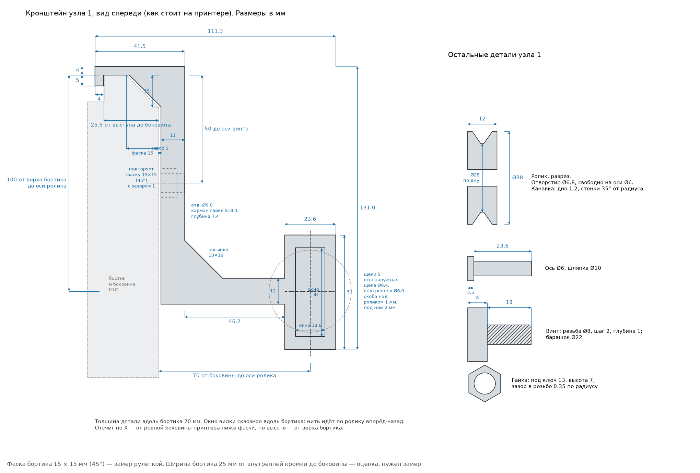

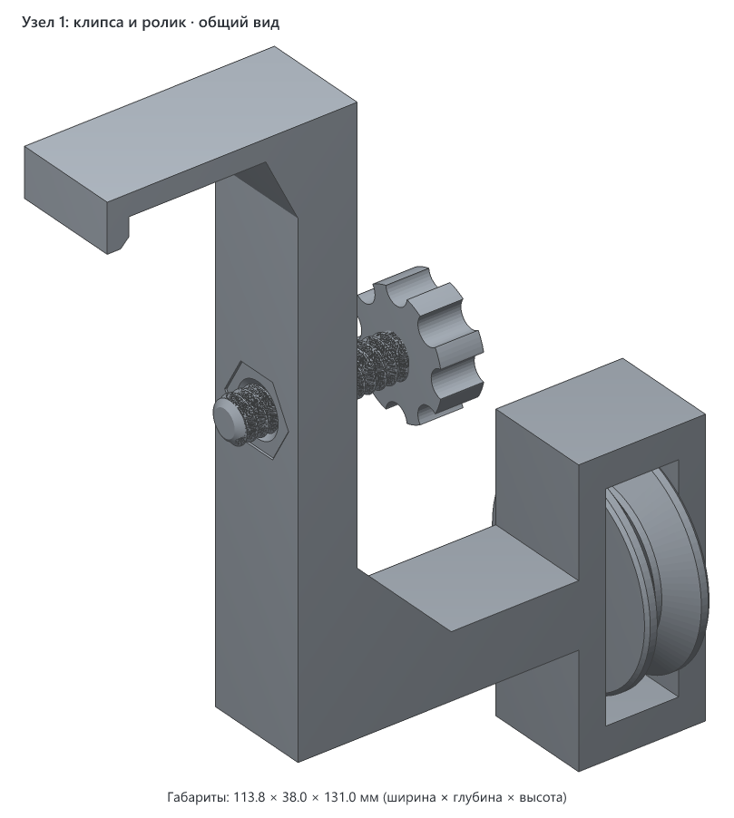

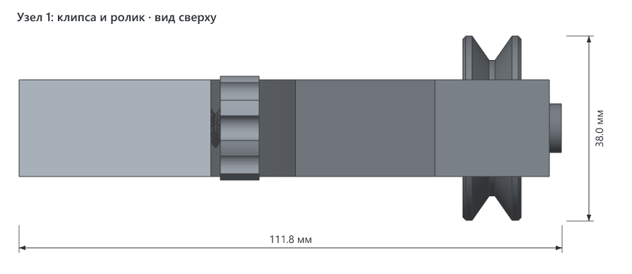

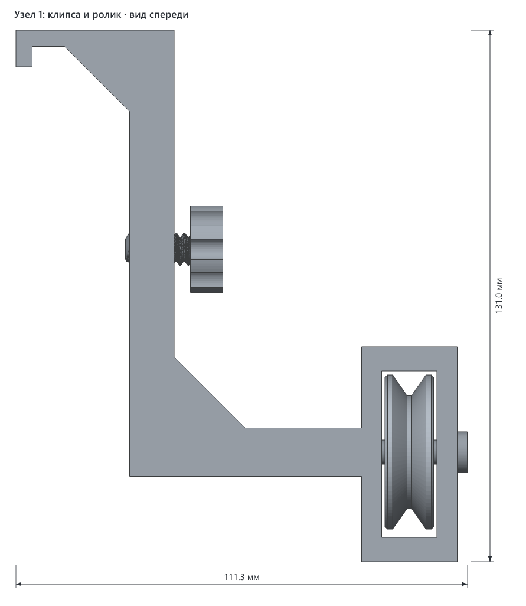

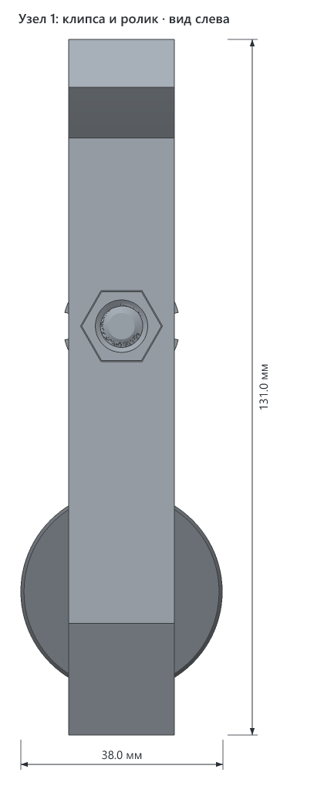

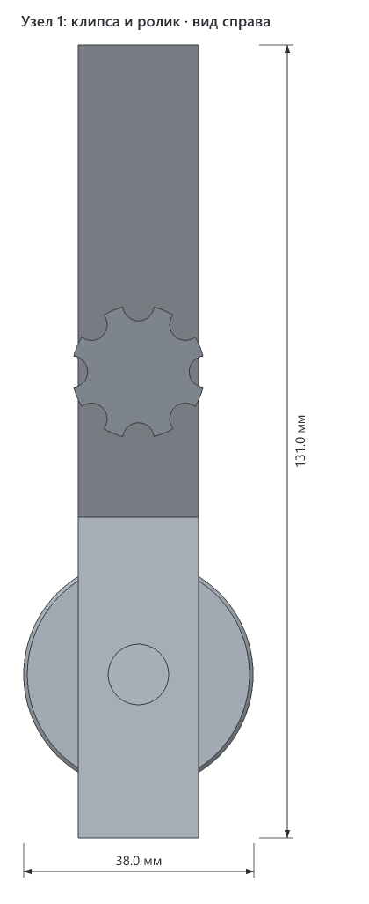

Узел 2:

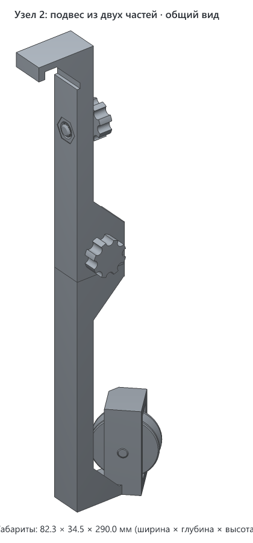

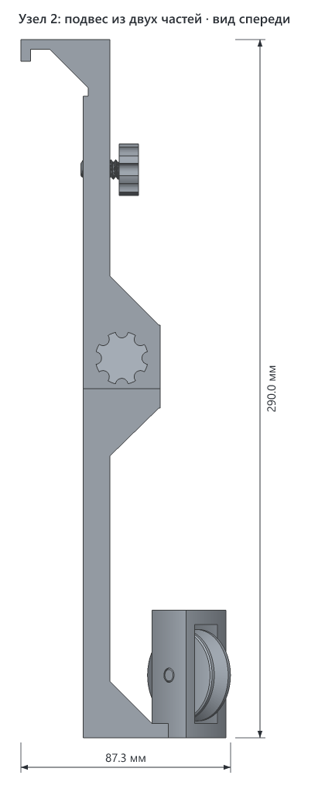

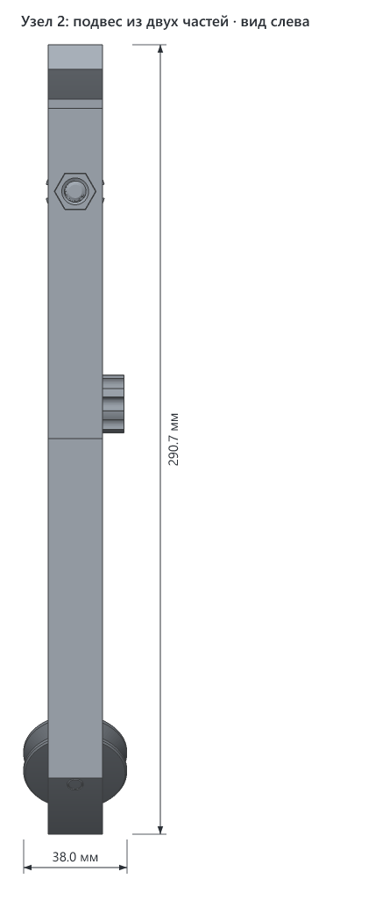

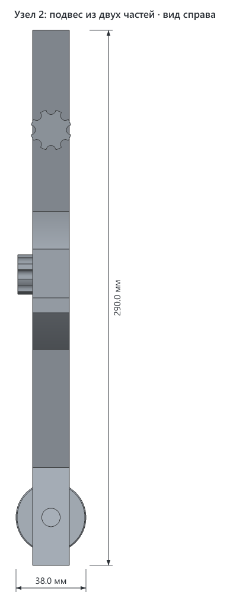

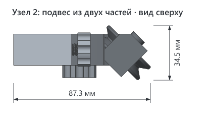

## Печать

| Параметр | Значение |
|---|---|
| Материал / цвет | кронштейны — PETG, у автора чёрный. Мелкие детали у автора жёлтым PLA, они вынесены на отдельный стол |
| Сопло / высота слоя | 0.4 мм / 0.2 мм |
| Стенки / заполнение | 4 стенки, 40 % заполнения: клипса и стойка держат нагрузку |
| Поддержки | не нужны |
| Подложки | уже есть в модели у каждой детали: тонкое кольцо в один первый слой, 8 мм вокруг детали. Без них сопло срывало детали со стола: сначала винт, потом кронштейн. Автокайма слайсера им ничего не дала. Там, куда входит бортик (под плитой, у выступа, на фаске и у защёлки), подложки нет: клипса садится туда без зазора, и остаток подложки помешал бы. После печати оторвите подложки, как кайму. У гайки отрывайте начисто, заусенец срежьте ножом, иначе она не войдёт в карман. У узла 2 подложки нет ещё у шва: плечи нижней части и низ верхней садятся друг на друга без зазора, а Т-головка входит в паз с зазором 0,2 мм |
| Ориентация на столе | как в файле: кронштейн лежит на боку, ролик плашмя, ось и винты стоят на шляпке и барашке, гайка плашмя. Верхняя часть узла 2 лежит передней гранью вниз: крышка паза на столе, паз открыт кверху, так он печатается без мостов |
| Деталей на столе | узел 1 — 5: кронштейн, ролик, ось, винт, гайка. Узел 2 — 7: верхняя и нижняя части, ролик, ось, винт-фиксатор, винт-съёмник, гайка |
| Время / расход (по слайсеру) | ещё не считали |

## Исходники

Модель сделана кодом: `v1/src/roller_guide.py` (Python, [manifold3d](https://github.com/elalish/manifold)). Параметры вынесены в начало файла.

- **Профиль бортика:** `ПРОФИЛЬ_*`. Ширина и фаска сняты рулеткой, глубина стекла (`ПРОФИЛЬ_СТЕКЛО`) — по примерке пробника.
- **Зазоры клипсы:** `ЗАЗОР_ФАСКИ` и `ВЫСТУП_ЗАЗОР` (оба 0, подобраны примеркой), `ЗАЗОР_РАМЫ` (под фаской), `СТОЙКА_ЗАЗОР` (до стекла).
- **Положение ролика:** `РОЛИК_X`, `РОЛИК_Z`.
- **Резьба:** `ВИНТ_*`, `ЗАЗОР_РЕЗЬБЫ`.
- **Посадка оси:** `ОСЬ_*`.
- **Подложки:** `ПОДЛОЖКА_Ш`, `ПОДЛОЖКА_Н`, отступ от посадочных граней клипсы `ПОДЛОЖКА_ОТСТУП`. Подложки есть только в файлах для печати, в сборке и на картинках их нет. Где детали лежат на столе, задано в `РАСКЛАДКА` и `РАСКЛАДКА_2`: если после правок подложки сойдутся ближе 2 мм, генератор остановится с ошибкой.
- **Узел 2:** положение ролика `У2_РОЛИК_X`, `У2_РОЛИК_Z`; стык `СТЫК_Ш`, `Т_*`, `ВОРОТ_Н`, винт-фиксатор `ФИКСАТОР_L`. Шов `ШОВ` считается сам, ровно посередине подвеса. Клипса, стойка, плечо и вилка у узла 2 строятся теми же функциями, что у узла 1.

```bash
cd models/k1c-dryer-roller-guide/v1/src
uv run roller_guide.py ../k1c-dryer-roller-guide-v1.3mf                      # узел 1 на одном столе
uv run roller_guide.py --clip-test ../k1c-dryer-roller-guide-v1-clip-test.3mf  # пробник клипсы
uv run roller_guide.py --pose use use.3mf                                    # сборка на принтере, для видов
uv run roller_guide.py --filled scene-filled.3mf                             # сцена с бортиком и нитью
uv run roller_guide.py --node2 ../k1c-dryer-roller-guide-v1-node-2.3mf      # узел 2 на одном столе
uv run roller_guide.py --node2 --lower ../k1c-dryer-roller-guide-v1-node-2-lower.3mf  # только нижняя часть узла 2
uv run roller_guide.py --small ../k1c-dryer-roller-guide-v1-small-parts.3mf       # мелкие детали обоих узлов
uv run roller_guide.py --screw ../k1c-dryer-roller-guide-v1-screw.3mf             # один запасной винт-съёмник
uv run roller_guide.py --node2 --pose use use2.3mf                          # узел 2 в сборе, для видов
node ../../../../tools/render-3mf.mjs use.3mf ../img --name "Узел 1: клипса и ролик"
node ../../../../tools/render-3mf.mjs scene-filled.3mf ../img --filled --name "Узел 1 на бортике K1C"
node ../../../../tools/render-3mf.mjs use2.3mf ../img/node-2 --name "Узел 2: подвес из двух частей"
```

## Файлы (v1)

| Файл | Что это |
|---|---|
| `v1/k1c-dryer-roller-guide-v1.3mf` | узел 1 для печати: кронштейн с клипсой, ролик, ось, винт и гайка на одном столе |
| `v1/k1c-dryer-roller-guide-v1-clip-test.3mf` | пробник: верх клипсы высотой 66 мм с винтом и гайкой, чтобы примерить к бортику |
| `v1/k1c-dryer-roller-guide-v1-node-2.3mf` | узел 2 для печати: верхняя и нижняя части, ролик, ось, винт-фиксатор, винт-съёмник и гайка на одном столе |
| `v1/k1c-dryer-roller-guide-v1-node-2-lower.3mf` | только нижняя часть узла 2, если остальное уже есть |
| `v1/k1c-dryer-roller-guide-v1-small-parts.3mf` | мелкие детали обоих узлов на одном столе (от 125 × 146 мм): 2 ролика, 2 оси, 2 винта-съёмника, винт-фиксатор узла 2, 2 гайки. Чтобы напечатать их другим цветом |
| `v1/k1c-dryer-roller-guide-v1-screw.3mf` | один винт-съёмник без гайки (резьба 16 мм, с барашком 24), стол от 48 × 48 мм. Взамен сломанного или потерянного |
| `v1/src/roller_guide.py` | генератор |
| `v1/src/drawing.py` | чертёж с размерами `v1/img/dims.png` |
| `v1/img/` | картинки |

## Заметки

- **Почему винт снимает клипсу, а не держит.** Винт давит в стекло на 50 мм ниже верха, а выступ держится за внутреннюю кромку у самого верха. Две силы на разной высоте поворачивают клипсу: низ стойки уходит от стекла, плита приподнимается с наружной стороны, и защёлка соскакивает. Прижимать бортик по горизонтали так нельзя. Держит клипсу защёлка: кромка рамы под фаской заходит в уступ клипсы.
- **Профиль бортика** замерен рулеткой: от внутренней кромки до нижнего края фаски 22–23 мм, наружная фаска 15 × 15 мм под 45°, так что плоский верх около 8 мм. Клипса рассчитана на 23 мм. Боковое стекло ниже фаски утоплено от её края. Рулеткой этого не видно, нашлось только примеркой. В модели заложено 2 мм, точно не мерили.
- **Клипса должна сесть на корпус сама, винт только поджимает.** Если где-то остаётся зазор, винт его не выберет: стекло под винтом прогибается, и люфт остаётся, как ни крути. Так было на обоих неудачных пробниках:
  - в первом стойка стояла в 6 мм от боковины, клипса болталась;
  - во втором стекло в модели стояло вровень с краем фаски, и стойке не хватило до него около 2 мм. Ещё у фаски оставалась щель около 2 мм: зазоры 0,5 мм у выступа и 1 мм у фаски складывались, когда винт прижимал выступ к кромке. Винту с резьбой 14 мм к тому же не хватало хода.

  Теперь:
  - у выступа и у фаски зазора нет: клипса садится на верх бортика, фаску и кромку вплотную;
  - стойка стоит в 1 мм от стекла, а под фаской на 5 мм обходит край рамы, с зазором 1 мм. Где кончается рама и начинается стекло, не мерили;
  - резьба винта 16 мм, с барашком 24. Когда торец винта касается стекла, барашек ещё в 4 мм от стойки, этот запас нужен на прогиб стекла.

  Четвёртый пробник с этими размерами сел на бортик сам и держался на защёлке под рамой без винта. Посередине грани фаски у него оставался зазор около 1 мм. В печати узла 04.11 этот зазор заполнили, и клипса перестала защёлкиваться совсем: зазор нужен защёлке. Добавку убрали, у фаски снова размеры четвёртого пробника.
- **Выступ** сделан прямоугольным, без скоса: так у него больше площадь упора.
- **Узел 1 нагружен вниз.** Нить тянет ролик вниз примерно с силой 1,2 натяжения нити. Узел работает как кронштейн полки: низ стойки давит в боковое стекло, верх держит ступенька. Нить от выхода сушилки идёт назад-вверх, примерно под 49° к вертикали, и тянет сушилку вдоль её длинной стороны, а не вбок.
- **Узел 2:**
  - от верха принтера до центра ролика 26 см, от стенки до центра ролика 4 см. Это примерка автора с нитью и рулеткой. После первой печати узла автор выдвинул ролик по плечу ещё на 5 мм наружу, теперь 45 мм. Вход нитеприёмника примерно на 15,5 см ниже верха и примерно в 3 см внутрь от боковины;
  - одной деталью такой подвес на стол 220 × 220 не помещается даже по диагонали. Деталь печатается лёжа, поэтому ограничивает стол, а не высота печати. С подложкой одной деталью выходит не больше ~22 см до центра ролика. Поэтому узел из двух частей;
  - стык сделан по схеме автора: нижняя часть входит Т-головкой в Т-паз верхней. У автора Т нарисована в виде сбоку. В модели она повёрнута на 90° и лежит в плоскости профиля: иначе полка паза при печати плашмя висела бы в воздухе над щелью. Головка вдвигается вдоль бортика сзади вперёд и упирается в переднюю крышку паза. Нить тянет ролик вперёд, к ролику 1, то есть головку как раз в крышку. Вверх, вниз и на излом держит сама Т. Давление снизу вверх держат плечи нижней части у шва: они упираются в полки паза без зазора. Винт-фиксатор только не даёт головке выехать назад;
  - нить огибает ролик 2 снизу, поэтому щель меньше нити (1 мм) у него под роликом, а не над ним, как у узла 1;
  - нить тянет ролик 2 вверх, примерно с силой 1,3 натяжения. Держит клипсу защёлка под рамой. Автор проверил на узле 1: если тянуть ролик рукой, клипса держится крепко;
  - вилка с роликом 2 развёрнута на 45° вокруг вертикали (`У2_ПОВОРОТ`): если смотреть сверху, задний край ролика уходит внутрь, к нитеприёмнику. Нить приходит вдоль боковины от узла 1 и на ролике поворачивает к нитеприёмнику. Сначала ось шла поперёк бортика, как у узла 1, и на примерке 05.11 нить сходила с ролика вбок. Чтобы нижняя часть по-прежнему печаталась плашмя, вилка стоит на плече снизу, под нижней перемычкой: ниже ролика нити нет. Грани повёрнутой вилки идут под 45°, поддержки не нужны. Шов от поворота не зависит, верхнюю часть перепечатывать не нужно;
  - в заднем верхнем углу боковины на стекле стоят два винта. Стойка идёт в 1 мм от стекла, поэтому клипсу надо ставить там, где стойка их не задевает.
- **Над роликом стоит скоба** с зазором 1 мм до его щёчек, меньше диаметра нити: провисшая нить с ролика не соскочит.

## История версий

| Версия | Дата | Что изменилось и почему | Печать |
|---|---|---|---|
| v1 | 2026-11-03 | Первая версия: узел 1 и узел 2 из двух частей | черновик: узел 1 стоит на бортике и держится. Узел 2 напечатан, на примерке нить сходила с ролика вбок, нижняя часть переделана: ролик развёрнут на 45° к нитеприёмнику |

## Лицензия

[CC BY 4.0](https://creativecommons.org/licenses/by/4.0/deed.ru): можно бесплатно печатать, изменять и распространять, в том числе в коммерческих целях. Нужно указать автора — iruch, <https://github.com/iruch/3d-print-models>.
