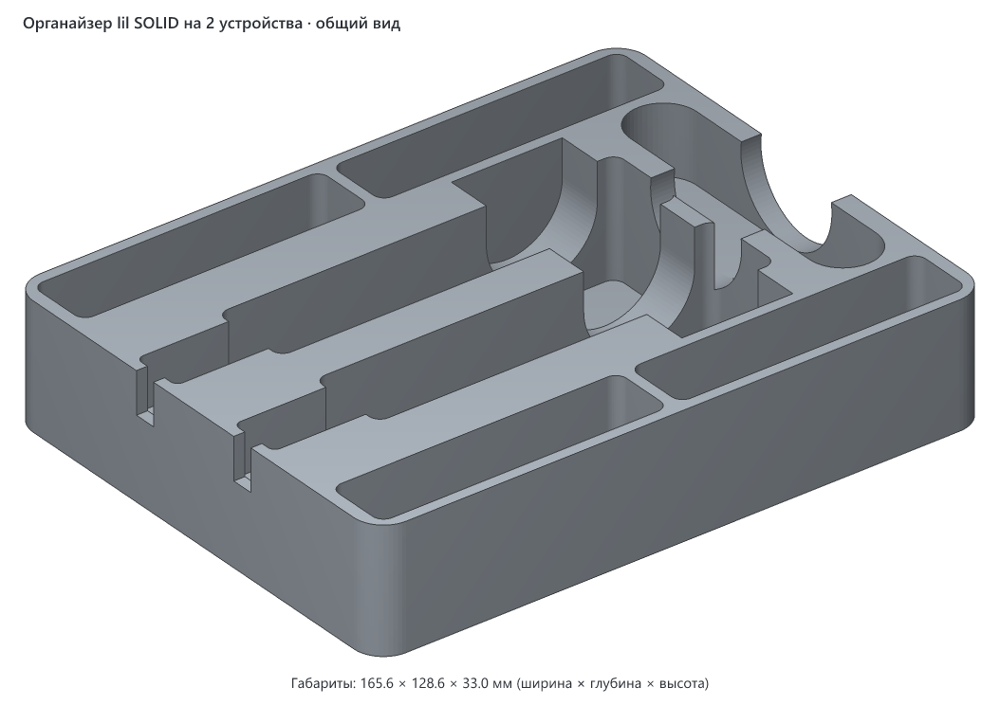
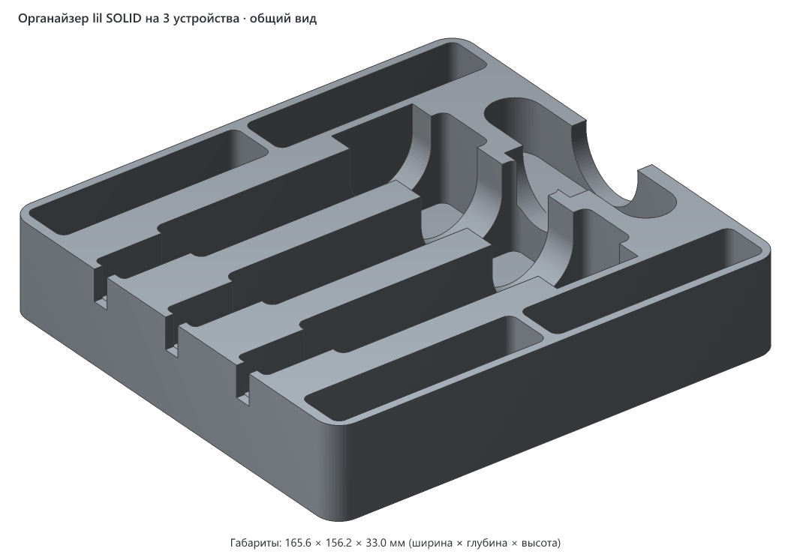
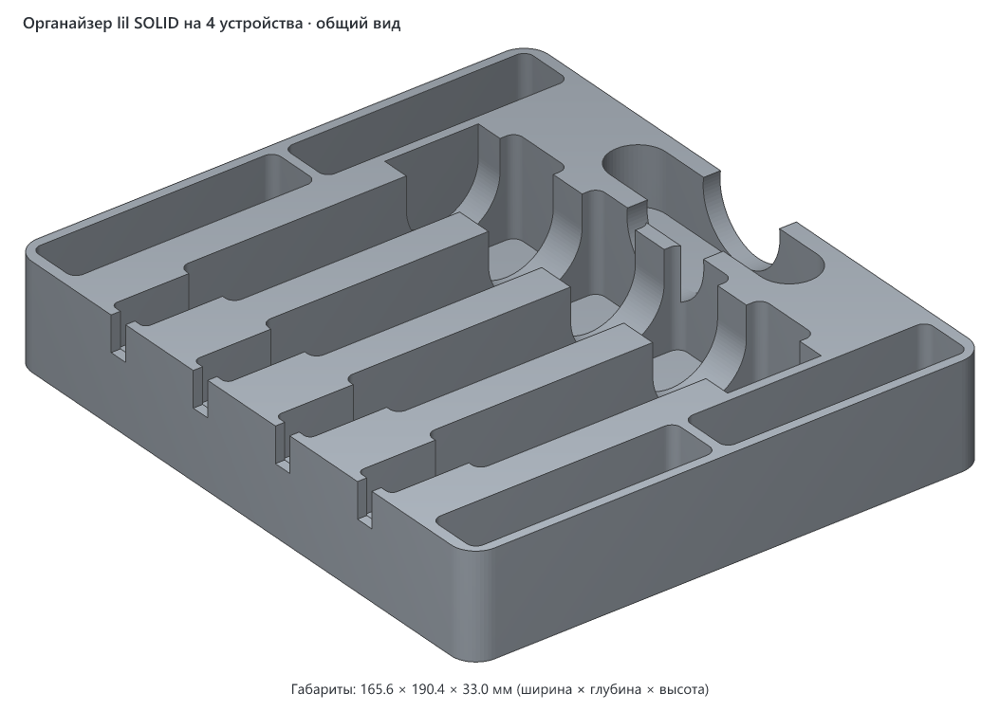

# Органайзер для IQOS lil SOLID

Настольный бокс для системы нагревания табака lil SOLID 3.0 и всего, что к ней нужно: устройств, пачек стиков HEETS и чистилки. Есть три варианта — на 2, 3 и 4 устройства. Во всех вариантах помещаются 4 пачки и чистилка, отличается только число лож под устройства и, соответственно, глубина бокса.

## Варианты

| | Вариант | Габариты, мм | Версия | Статус |
|---|---|---|---|---|
|  | [На 2 устройства](lil-solid-organizer-2-devices/README.md) | 165.6 × 128.6 × 33.0 | v1 | черновик |
|  | [На 3 устройства](lil-solid-organizer-3-devices/README.md) | 165.6 × 156.2 × 33.0 | v1 | черновик |
|  | [На 4 устройства](lil-solid-organizer-4-devices/README.md) | 165.6 × 190.4 × 33.0 | v1 | не указан |

Вариант на 4 устройства — исходный, с него всё началось. Варианты на 2 и 3 получены из того же генератора и ещё не печатались.

## Что это

Устройства стоят в ряд на ребре, индикатором вверх. У левого торца каждого ложа есть карман под штекер USB-C, а в левой стенке — прорезь для кабеля, поэтому устройства можно заряжать прямо в органайзере. Поперёк всех лож, ближе к правым концам, идёт полукруглый жёлоб: в него проходят пальцы, чтобы взять устройство.

Пачки стоят вертикально в четырёх карманах, два спереди и два сзади. Чистилка лежит в продолговатом гнезде справа. Посередине гнезда есть поперечная выемка, которая выходит через правую стенку: за неё чистилку удобно подцепить.

## Как пользоваться

- Устройство ставится в ложе на ребро, индикатором вверх, разъёмом USB-C влево — к карману под штекер.
- Кабель зарядки заводится сверху в прорезь в левой стенке.
- Пачки ставятся стоя в карманы спереди и сзади, чистилка кладётся в гнездо справа.

## Посадочные места

Одинаковые во всех вариантах. Размеры взяты из параметров `src/organizer.py`.

| Гнездо | Шт. | Размер гнезда, мм | Под что | Зазор на сторону |
|---|---|---|---|---|
| Ложе устройства | 2, 3 или 4 | 107.8 × 22.2, глубина 31.0 | lil SOLID 3.0: 105.8 × 30.8 × 21.4, стоит на ребре | 1.0 по длине, 0.4 по толщине |
| Карман под пачку | 4 | 77.8 × 17.8, глубина 22.0 | пачка HEETS гранью 75 × 15 | 1.4 |
| Гнездо чистилки | 1 | 81.0 × 18.0 со скруглёнными концами, глубина 18.5 | чистилка 80 × 17 | 0.5 |
| Карман под штекер USB-C | по одному на ложе | 27 × 14, начинается на высоте 19.3 | штекер кабеля в торце устройства | — |
| Прорезь под кабель | по одной на ложе | ширина 6, начинается на высоте 21.8, сквозь левую стенку | кабель зарядки | — |

Остальное: наружная стенка 3 мм, перегородки между ложами 12 мм, дно под устройствами 2 мм, углы скруглены радиусом 8 мм. Жёлоб под пальцы шириной 30 мм с дном на высоте 8 мм. Выемка у чистилки шириной около 32 мм с дном на высоте 14.5 мм.

В варианте на 2 устройства ряд лож короче чистилки. Поэтому ряды пачек там раздвинуты на 6.6 мм сильнее, чем нужно для лож: так чистилка помещается между ними со стенками по 3 мм.

## Печать

- Все варианты помещаются на стол K1C (220 × 220 мм) целиком.
- Печатается дном на стол, как лежит в файле. Поддержки не нужны: все выемки открыты сверху, нависаний нет (вывод по геометрии).
- В 3mf только геометрия, без настроек слайсера: файлы сгенерированы скриптом.
- Материал и цвет пока не указаны.

## Исходники

`src/organizer.py` — один генератор на все варианты, на Python (библиотеки `numpy` и `manifold3d`). Все размеры и зазоры собраны в параметрах в начале файла. Число устройств задаётся в командной строке.

```bash
cd models/lil-solid-organizer/src
uv run organizer.py 2      # → lil-solid-organizer-2-devices.3mf
uv run organizer.py 3      # → lil-solid-organizer-3-devices.3mf
uv run organizer.py 4      # → lil-solid-organizer-4-devices.3mf
uv run organizer.py test   # → пробник на 2 ложа и одну пачку, 138.8 × 92.2 × 33.0 мм
```

`uv` сам поставит Python и библиотеки. Без него: `pip install numpy manifold3d`, дальше `python` вместо `uv run`. Вторым аргументом можно задать имя выходного файла: `uv run organizer.py 3 out.3mf`.

## Заметки

- Перед печатью целого органайзера стоит напечатать пробник (`test`): он маленький и быстро покажет, как садятся устройство и пачка.
- Зазоры подобраны печатью, судя по комментариям в коде. Под устройство по длине было 0.4 мм — туго, стало 1.0. Под пачки было 0.4 — туго, стало 1.4.

## Лицензия

[CC BY 4.0](https://creativecommons.org/licenses/by/4.0/deed.ru): можно бесплатно печатать, изменять и распространять, в том числе в коммерческих целях. Нужно указать автора — iruch, <https://github.com/iruch/-crealityk1c>.
