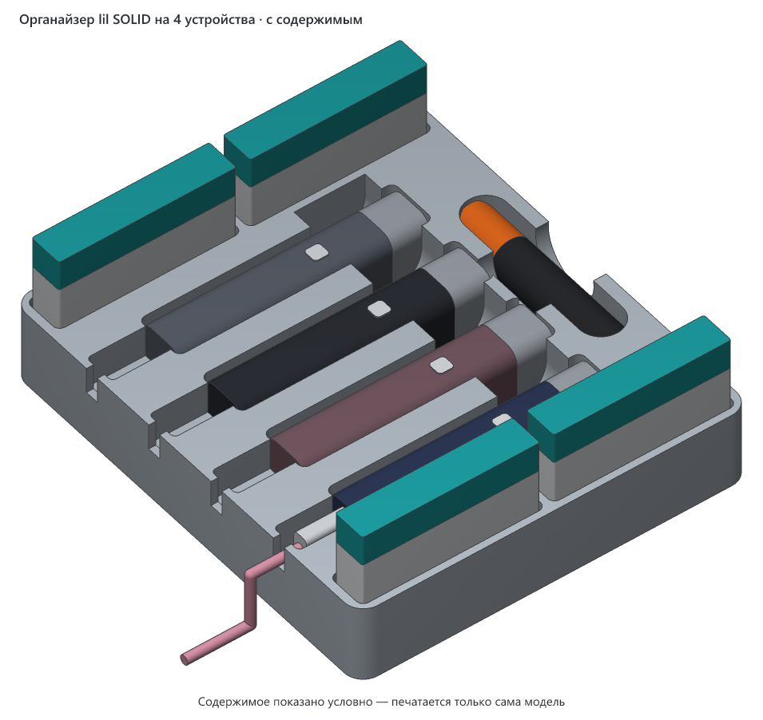

# Органайзер lil SOLID на 4 устройства

> **Версия:** v1 · **Статус:** на проверке · **Обновлено:** 2026-10-30
> **Семейство:** [Органайзер для IQOS lil SOLID](../README.md) — там подробное описание, посадочные места и другие варианты.



## Что это

Исходный и самый большой вариант органайзера: 4 устройства lil SOLID 3.0 с зарядкой на месте, 4 пачки HEETS и чистилка.

## Совместимость

- **Нужный стол:** от 176 × 201 мм с запасом 5 мм на сторону (модель можно повернуть на столе на 90°), высота печати от 33 мм.
- **Помещается на:** Creality K1C, Creality K1, Creality K1 Max, Creality Ender-3 V3 SE, Bambu Lab A1, Bambu Lab P1P, Bambu Lab P1S, Bambu Lab X1 Carbon, Prusa MK4S, Prusa Core One, Elegoo Neptune 4, Elegoo Centauri Carbon, Anycubic Kobra 3 — и на любой другой принтер с подходящим столом ([справочник принтеров](../../../PRINTERS.md)).
- **Не помещается на:** Bambu Lab A1 mini, Prusa MINI+ — у них стол 180 × 180 мм.
- **Проверено печатью:** Creality K1C, чёрная нить (какая именно — не указано).
- **Материалы:** PLA или PETG; ABS/ASA — только в закрытом принтере; TPU не подходит. Подробнее — в [описании семейства](../README.md#совместимость).
- **Посадки:** зазоры подобраны на Creality K1C. На другом принтере или другой нити устройство и пачки могут сесть туже — перед печатью целого бокса стоит напечатать пробник (см. [описание семейства](../README.md#заметки)).

## Габариты (v1)

| Ширина (X) | Глубина (Y) | Высота (Z) |
|---|---|---|
| 165.6 мм | 190.4 мм | 33.0 мм |

## Виды (v1)


## Печать

| Параметр | Значение |
|---|---|
| Материал / цвет | чёрный; материал не указан |
| Сопло / высота слоя | 0.4 мм / не указана |
| Стенки / заполнение | не указаны |
| Поддержки | не нужны |
| Ориентация на столе | дном на стол, как в файле |
| Деталей на столе | 1 |
| Объём тела | 535.0 см³ — сплошной объём; реальный расход нити зависит от заполнения |

## Исходники

Получен общим генератором семейства:

```bash
cd models/lil-solid-organizer/src
uv run organizer.py 4
```

## Файлы (v1)

| Файл | Что это |
|---|---|
| `v1/lil-solid-organizer-4-devices-v1.3mf` | модель для печати, только геометрия |
| `v1/img/*.png` | общий вид, проекции с размерами и вид с содержимым (`filled.png`) |

## Заметки

- v1 напечатана и используется: все отсеки заполняются, устройство заряжается прямо в ложе. Есть проблемы, их исправит следующая версия.
- 2026-10-30 3mf перегенерирован общим генератором. Геометрия совпадает с исходным файлом вершина в вершину. Поменялось только имя объекта внутри 3mf: раньше там стояло старое «lil SOLID organizer v4».

## История версий

| Версия | Дата | Что изменилось и почему | Печать |
|---|---|---|---|
| v1 | 2026-10-28 | Первая версия | напечатана чёрным; есть проблемы — исправит v2 |

## Лицензия

[CC BY 4.0](https://creativecommons.org/licenses/by/4.0/deed.ru): можно бесплатно печатать, изменять и распространять, в том числе в коммерческих целях. Нужно указать автора — iruch, <https://github.com/iruch/3d-print-models>.
