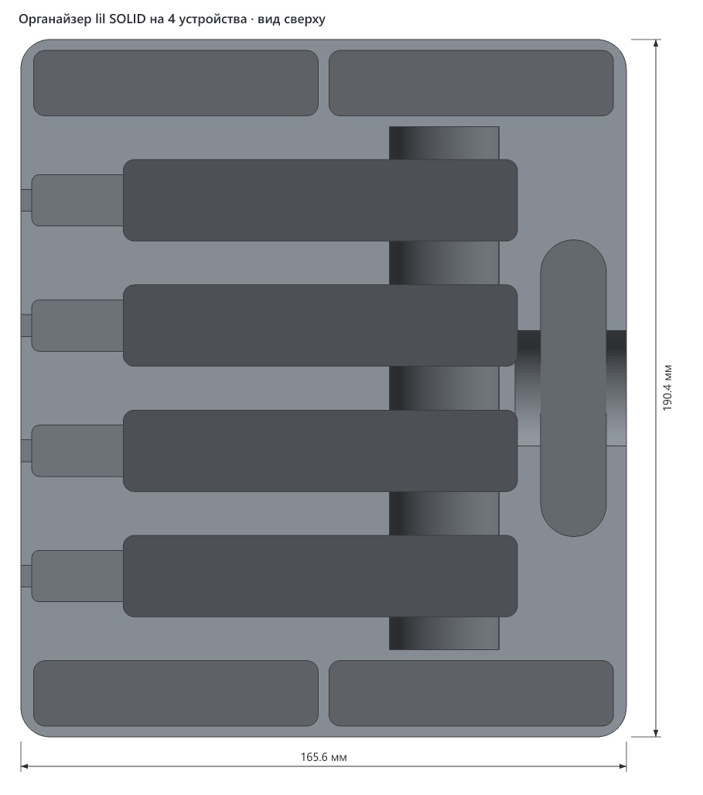
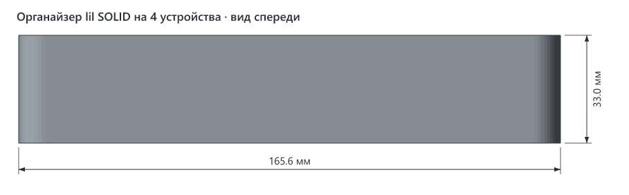
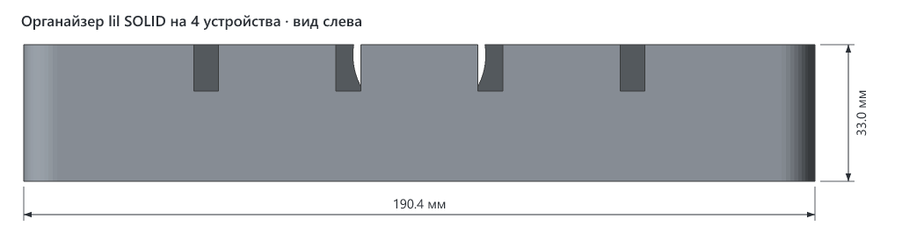
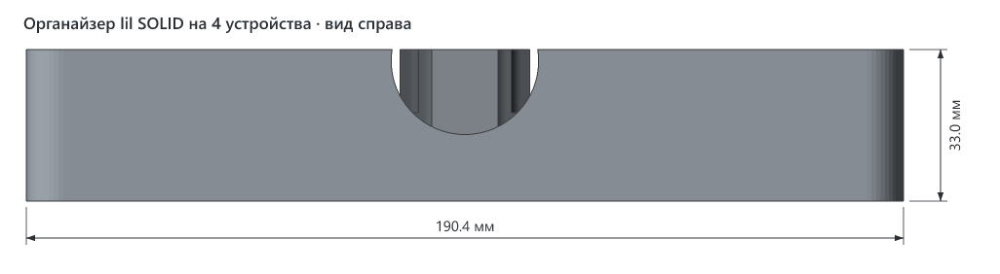

# Органайзер lil SOLID на 4 устройства

> **Версия:** v1 · **Статус:** не указан · **Обновлено:** 2026-10-30
> **Семейство:** [Органайзер для IQOS lil SOLID](../README.md) — там подробное описание, посадочные места и другие варианты.


## Что это

Исходный и самый большой вариант органайзера: 4 устройства lil SOLID 3.0 с зарядкой на месте, 4 пачки HEETS и чистилка.

## Габариты (v1)

| Ширина (X) | Глубина (Y) | Высота (Z) |
|---|---|---|
| 165.6 мм | 190.4 мм | 33.0 мм |

## Виды (v1)









## Печать

| Параметр | Значение |
|---|---|
| Материал / цвет | не указан |
| Сопло / высота слоя | 0.4 мм / не указана |
| Стенки / заполнение | не указаны |
| Поддержки | не нужны |
| Ориентация на столе | дном на стол, как в файле |
| Деталей на столе | 1 |
| Объём тела | 535.0 см³ — сплошной объём; реальный расход нити зависит от заполнения |

## Исходники

Получен общим генератором семейства:

```bash
cd models/lil-solid-organizer/src
uv run organizer.py 4
```

## Файлы (v1)

| Файл | Что это |
|---|---|
| `v1/lil-solid-organizer-4-devices-v1.3mf` | модель для печати, только геометрия |
| `v1/img/*.png` | общий вид и проекции с размерами |

## Заметки

- 2026-10-30 3mf перегенерирован общим генератором. Геометрия совпадает с исходным файлом вершина в вершину. Поменялось только имя объекта внутри 3mf: раньше там стояло старое «lil SOLID organizer v4».

## История версий

| Версия | Дата | Что изменилось и почему | Печать |
|---|---|---|---|
| v1 | 2026-10-28 | Первая версия | не указано |
