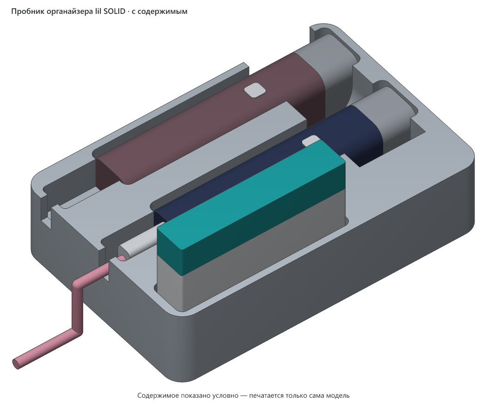
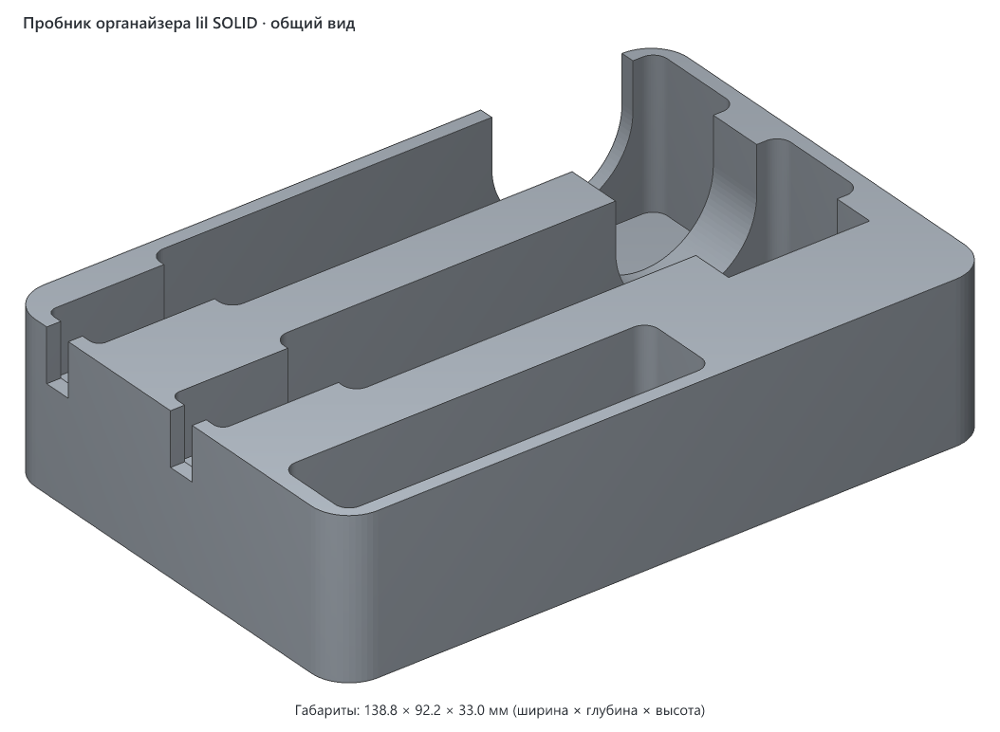
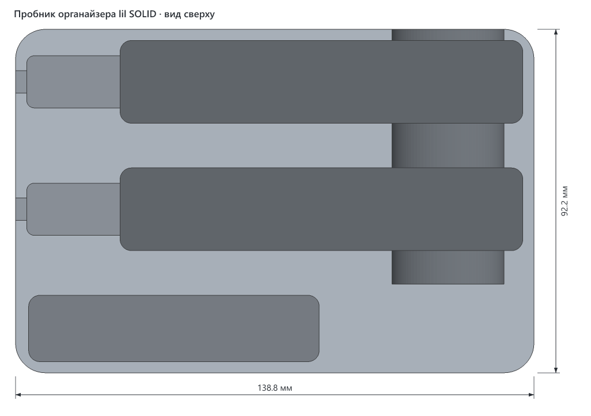
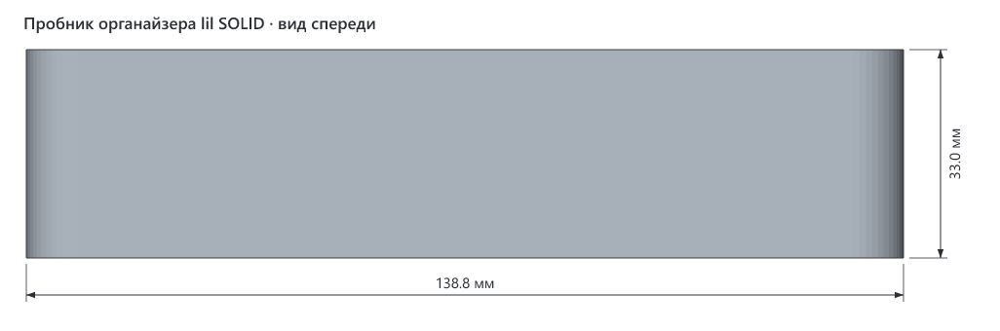
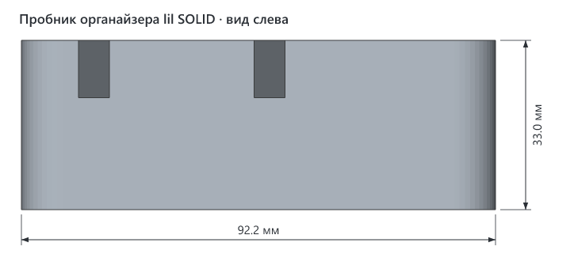
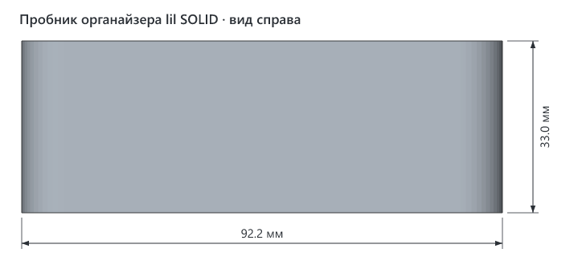

# Пробник посадки для органайзера lil SOLID

> **Версия:** v1 · **Статус:** черновик · **Обновлено:** 2026-10-30
> **Семейство:** [Органайзер для IQOS lil SOLID](../README.md) — там подробное описание, посадочные места и сами органайзеры.



## Что это

Кусок органайзера для проверки посадки перед печатью целого бокса. В нём два ложа под устройства lil SOLID 3.0 с карманами под штекер и прорезями под кабель, один карман под пачку HEETS и жёлоб под пальцы. Зазоры те же, что во всех вариантах органайзера. Чистилки и второго ряда пачек нет.

Зачем: на разных принтерах и разных нитях одни и те же гнёзда получаются чуть разными. Пробник по объёму в 1.7–2.5 раза меньше целого бокса. Он покажет, сядут ли устройство и пачка, до того как уйдёт нить на весь органайзер.

## Как пользоваться

1. Напечатайте пробник той же нитью и с теми же настройками, с какими собираетесь печатать органайзер.
2. Вставьте устройство в оба ложа и пачку в карман, воткните кабель в устройство через прорезь в стенке.
3. Оцените посадку:
   - входит без усилия и не болтается — можно печатать органайзер;
   - туго или не входит — гнёзда нужно расширить;
   - заметно болтается — гнёзда можно сузить.
4. Если нужно поправить, есть два способа:
   - **В генераторе.** Зазоры на сторону задаются в начале `src/organizer.py`: `CLR` — по толщине устройства, `CLR_L` — по длине, `HEETS_CLR` — для пачки. Поменяйте их и соберите заново и пробник (`uv run organizer.py test`), и нужный вариант органайзера.
   - **В слайсере.** В слайсерах на основе OrcaSlicer (OrcaSlicer, Bambu Studio, Creality Print) есть параметр «X-Y hole compensation»: положительное значение расширяет все выемки. Подобранное на пробнике значение используйте и для органайзера.

## Совместимость

- **Нужный стол:** от 149 × 103 мм с запасом 5 мм на сторону (модель можно повернуть на столе на 90°), высота печати от 33 мм.
- **Помещается на:** Creality K1C, Creality K1, Creality K1 Max, Creality Ender-3 V3 SE, Bambu Lab A1 mini, Bambu Lab A1, Bambu Lab P1P, Bambu Lab P1S, Bambu Lab X1 Carbon, Prusa MINI+, Prusa MK4S, Prusa Core One, Elegoo Neptune 4, Elegoo Centauri Carbon, Anycubic Kobra 3 — и на любой другой принтер с подходящим столом ([справочник принтеров](../../../PRINTERS.md)).
- **Не помещается на:** —.
- **Проверено печатью:** эта версия ещё не печаталась. Нынешние зазоры подобраны по прошлому пробнику автора на Creality K1C: на нём устройство по длине садилось туго.
- **Материалы:** та же нить, которой будете печатать органайзер, — иначе проверка теряет смысл. Какие нити подходят органайзеру — в [описании семейства](../README.md#совместимость).

## Габариты (v1)

| Ширина (X) | Глубина (Y) | Высота (Z) |
|---|---|---|
| 138.8 мм | 92.2 мм | 33.0 мм |

## Виды (v1)











## Печать

| Параметр | Значение |
|---|---|
| Материал / цвет | та же нить, что для органайзера |
| Сопло / высота слоя | те же, что для органайзера; общая рекомендация — 0.4 мм / 0.2 мм |
| Стенки / заполнение | те же, что для органайзера; общая рекомендация — 3 стенки, 15–20 % |
| Поддержки | не нужны |
| Ориентация на столе | дном на стол, как в файле |
| Деталей на столе | 1 |
| Объём тела | 216.7 см³ — сплошной объём; реальный расход нити зависит от заполнения |

## Исходники

Получен общим генератором семейства:

```bash
cd models/lil-solid-organizer/src
uv run organizer.py test
```

## Файлы (v1)

| Файл | Что это |
|---|---|
| `v1/lil-solid-organizer-fit-test-v1.3mf` | пробник для печати, только геометрия |
| `v1/img/*.png` | общий вид, проекции с размерами и вид с содержимым (`filled.png`) |

## Заметки

- Жёлоб под пальцы в пробнике проходит насквозь через заднюю стенку: пробник — это обрезанный кусок бокса.

## История версий

| Версия | Дата | Что изменилось и почему | Печать |
|---|---|---|---|
| v1 | 2026-10-30 | Первая версия: зазоры как во всех вариантах органайзера v1 | не печаталась |

## Лицензия

[CC BY 4.0](https://creativecommons.org/licenses/by/4.0/deed.ru): можно бесплатно печатать, изменять и распространять, в том числе в коммерческих целях. Нужно указать автора — iruch, <https://github.com/iruch/3d-print-models>.
